# Product Architecture

## Document Status

| Field                  | Value                      |
| ---------------------- | -------------------------- |
| **Status**             | Draft                      |
| **Version**            | 0.5                        |
| **Owner**              | PinkCurve Engineering Team |
| **Last Reviewed**      | 2026-10-19                 |
| **Related Components** | All platform components    |

---

## Overview

PinkCurve is an AI-powered, visual-first discovery platform that helps registered Buyers discover relevant, useful, interesting, or timely content. Buyers use PinkCurve without charge; transactions, when applicable, occur on Seller-designated destinations rather than within PinkCurve.

PinkCurve distinguishes **Discovery Services**, **Discovery Classifications**, **Discovery Media**, and **Entities**. These terms serve different purposes and SHALL NOT be used interchangeably.

- A **Discovery Service** is a PinkCurve capability through which an authorized Seller submits and manages a form of discovery, such as Offering Discovery, Real-Time Discovery, Community Service, Public Announcement, or Brand Recognition.
- A **Discovery Classification** is the single primary classification assigned to a Discovery Media item for the applicable discovery, measurement, governance, and commercial rules. A classification is a controlled value, not necessarily a separately identified entity.
- **Discovery Media** is the approved visual or multimodal material presented to Buyers. Its associated metadata, source, service, and identifiers remain traceable.
- A **PinkCurve Entity** is an independently identifiable participant, service-related record, media item, event, qualified measurement, or other platform record. Its **Entity ID** uniquely identifies it within its entity type.

PinkCurve does not force all discovery into Offerings. An Offering is an identifiable record for a product or service (paid or free). Other Discovery Services can have distinct service-specific records and lifecycles. Shared platform capabilities do not imply shared identities, economic models, or approval rules.

PinkCurve's central responsibilities are understanding available Discovery Media and Buyer context, exposing meaningful metadata through Adaptive Metadata Navigation (AMN), matching and presenting useful Discovery Media, learning from authorized evidence, and protecting trust and Buyer control.

The MVP serves registered human Buyers through a visual-first Buyer Experience. An authorized Personal Agent channel is a future architectural extension, **not an MVP feature**.

---

## PinkCurve Entity and Identity Model

### Definitions

**Entity** is the umbrella term for an independently identifiable PinkCurve record. **Entity ID** (formal: *Entity Identifier*) is the identifier for a particular entity. Entity is an architectural concept; it does not require one universal `entity` database table or a generic ID replacing existing typed identifiers.

| Entity family | Examples of typed Entity IDs | Architectural purpose |
| --- | --- | --- |
| Participants | `organization_id`, `seller_id`, `buyer_id` | Identity, ownership, access and authorization |
| Service-specific records | `offering_id`; other approved service-specific IDs | Identify the underlying submission or managed service record |
| Discovery Media | `discovery_media_id` (logical identifier; confirm physical schema) | Link approved content to its service and provenance |
| Discovery Events | `discovery_event_id` | Trace an observed interaction or presentation |
| Qualified measurements | `qov_id`, `qri_id` where defined by Chapter 7 | Trace qualified Offering visits and Real-Time impressions |
| Commercial records | Applicable billable-event and invoice identifiers | Audit billing decisions and adjustments |

Existing IDs SHALL be preserved. A generic `discovery_service_id` or other identifier SHALL NOT be introduced solely for terminology consistency. `discovery_media_id` is the proposed canonical logical identifier for independently managed Discovery Media; reconcile existing physical fields before migration. Its necessity and exact schema must be verified against the authoritative domain chapters before adoption.

### Identity, relationships and lineage

```text
Organization (organization_id)
    │
    └── Seller (seller_id)
          │
          ├── Offering (offering_id)
          │     └── Associated Discovery Media (discovery_media_id)
          │              └── Discovery Event (discovery_event_id)
          │                     └── QOV (qov_id, when qualified)
          │                            └── Billable Event (when eligible)
          │
          └── Other authorized Discovery Service submissions
                └── Associated Discovery Media (discovery_media_id)
                      └── Discovery Event
                            └── Applicable qualified measurement
```

The Seller creates and submits authorized services and belongs to an Organization. Organization identity is derived through Seller relationships rather than redundantly attached to every service record. Service-specific records and Discovery Media retain their own IDs, lifecycles, ownership, approval state, and provenance.

An Entity ID is not interchangeable with a classification, a score, a status, or a rule. For example, `OFFERING` may be a Discovery Classification value; `offering_id` identifies a particular Offering; `qov_id` identifies a particular qualified measurement. They answer different questions.

### Signal, event, billing and log identities

The Entity/Entity ID principle extends to independently identifiable signals, events, billing records and audit evidence. **Do not create a new entity or table simply because a new ID can be named.** Introduce an identifier when the record needs independent lifecycle, ownership, linkage, deduplication or auditability.

| Logical record | Identity and attribution | Status |
| --- | --- | --- |
| Buyer Signal | `buyer_signal_id`, originating `buyer_id`, signal type and time | Proposed; reconcile with existing event model |
| Seller Signal | `seller_signal_id`, originating `seller_id`, signal type and time | Proposed; reconcile with existing event model |
| Other signals | Type-appropriate signal identity and source entity relationship | Define only as required |
| Discovery Event | `discovery_event_id`, associated `buyer_id` and `discovery_media_id` where applicable | Preserve existing canonical event contract |
| Qualified measurement | QOV/QRI identity or source-event reference, according to Chapter 7 | Do not assume a separate ID/table without verification |
| Billable event / financial ledger | Stable record identity and link to qualified evidence, Seller and pricing rule | Governed by Chapter 13 |
| Invoice / credit / adjustment | Financial document or transaction identity and audit lineage | Governed by Chapter 13 |
| Audit record | Durable event identity, actor, action, target, time, decision and correlation | Retention and access governed by policy |
| Operational log | Platform log ID and/or `trace_id`, `request_id`, `correlation_id` | Not necessarily a business Entity or relational row |

**Events** record occurrences; **signals** are actionable observations or derived interpretations; **qualified measurements** establish analytical eligibility; **billable events** apply commercial policy; **ledger records** preserve financial consequences; **audit logs** record accountable decisions; and **operational logs** support diagnostics. These concepts SHALL NOT be conflated. A source event can support more than one downstream purpose without duplicating its authoritative record. Derived records should carry source references, timestamps, provenance, and policy/model versions where applicable. Sensitive Buyer data must follow access, minimization and retention controls.

### Evidence and billing traceability

A raw Discovery Event is not automatically a qualified measurement; a qualified measurement is not automatically billable. Analytics qualifies evidence under its measurement rules; Billing separately applies Chapter 13 policy and creates auditable financial records. Repeated legitimate activity must not be discarded through an obsolete blanket 24-hour exclusion where current policy allows qualification.

The entity model SHALL support stable references, authorization, idempotency, fraud screening, corrections, versioned rules, and reconstruction of why an event did or did not become billable.

---

## Discovery Service, Classification and Media Model

### Discovery Services

PinkCurve's recognized Discovery Services include:

- **Offering Discovery** — discover a Seller's paid or free product or service.
- **Real-Time Discovery** — timely, validity-constrained discovery with its own measurement and economic rules.
- **Community Service** — approved community-oriented discovery.
- **Public Announcement** — approved public, civic, safety, assistance or informational discovery.
- **Brand Recognition** — brand-awareness-oriented discovery with qualified impression measurement and applicable billing.
- **Future approved services** — introduced only with explicit identity, governance, measurement, and economic definitions.

A service describes what PinkCurve provides. A service-specific record represents a particular submitted instance. A Discovery Media item is the content shown to a Buyer. These can be related without being the same entity.

### Discovery Classification

Every Discovery Media item SHALL have **one primary Discovery Classification** established through its authorized service and approval workflow. The classification determines which service-specific rules apply; it is not an unrestricted collection of labels. Illustrative values are `OFFERING`, `REAL_TIME`, `COMMUNITY_SERVICE`, `PUBLIC_ANNOUNCEMENT`, and `BRAND_RECOGNITION` (exact stored enum spelling subject to canonical schema).

**Uses and attributes**—such as Nearby, Discount, Free Delivery, Limited, and Ending Soon—are metadata or discovery signals, not additional primary classifications. The Discovery Engine may use many attributes while preserving one primary classification.

```text
Seller (seller_id)
    ↓
Authorized Discovery Service
    ↓
Service-specific record / identity
    ↓
Approved Discovery Media / identity
    ├── One primary Discovery Classification
    ├── Metadata, uses, attributes and operational state
    ├── Source and approval provenance
    └── Destination / validity when applicable
    ↓
Discovery Engine → Buyer Experience
    ↓
Discovery Events → Analytics → Learning and applicable Billing
```

An Offering can be free; a Public Announcement need not be a product or service. **Free versus paid is not the criterion for classifying a Discovery Service.** Classification reflects the authorized purpose and governance of the submitted media.

### Discovery Media lifecycle and finite validity

Every Discovery Media entity SHALL have `start_at` and `end_at` as valid, timezone-aware timestamps with `end_at > start_at`. Null, perpetual, and artificial infinite end dates are prohibited. Its active discovery window is **start-inclusive and end-exclusive** (`start_at <= now < end_at`), subject to approval, Seller authorization, service-specific eligibility, Trust, and any geographic or operational restrictions. A future-dated media item is scheduled, not active; expired media is excluded from active discovery but its records may be retained under applicable analytics, billing, audit and privacy rules. Updates and extensions require authorized workflow and must never silently create perpetual eligibility.

The media validity window is distinct from the underlying Offering's availability, event schedule, stock, promotion period, and service-specific operational constraints. A media item can be valid but ineligible because its Offering is unavailable. **Real-Time Discovery** additionally observes its approved timing policy, including the established minimum three-hour approved display period and approval-delay handling; details belong to the service policy.

### Discovery Media metadata and governance

Discovery Media SHALL support an extensible, structured metadata catalog. The catalog distinguishes the following **different semantic kinds** rather than treating all tags as equal:

| Metadata family | Illustrative fields or values | Source and governance |
| --- | --- | --- |
| Identity and relationships | `discovery_media_id`, `seller_id`, associated service record ID | System-controlled, authorization checked |
| Classification and purpose | One primary classification; approved service relationship | Service workflow and approval |
| Validity and lifecycle | `start_at`, `end_at`, status, approved version | Seller proposal; system validation and approval |
| Content and annotation | Title, annotation, description, keywords, language | Seller-entered or AI-assisted with provenance |
| Image characteristics | Format, width, height, dimensions, aspect ratio, size | Prefer automatic extraction and verification |
| Video characteristics | Format, length/duration, resolution, dimensions, aspect ratio, size | Prefer automatic extraction and verification |
| Geography | Country, state/region, city, postal code, latitude/longitude, optional street address | Seller-declared and validated as appropriate; privacy aware |
| Country of origin | Manufacturing/service origin where applicable | Separate from discovery geography |
| Taxonomy | Women's Fashion, Electronics, Restaurants, Dresses, Home & Garden | Governed category/subcategory vocabulary |
| Item characteristics | Size, color, material, brand, style, intended use | Category-dependent schema |
| Promotions | Discount, Sale, Clearance, Free Delivery, promotional terms | Seller claims with applicable validation and dates |
| Operational state | Available, Limited Quantity, Ending Soon, Nearby | Derived from trusted service data and context |
| Dynamic discovery signals | New Arrival, Trending, Popular, Best Seller | Computed or verified; Sellers cannot self-certify platform signals |
| Trust and provenance | Approval, source, verification, update time | PinkCurve-controlled |

Requiredness is conditional: video duration applies to video, not images; street address is optional where no physical location exists. Sellers should not be required to manually type properties that can be reliably extracted from uploaded media. AI suggestions are not automatically authoritative. The catalog SHALL permit new domain-specific attributes without redesigning the Entity Identity Model. Buyer-facing claims require provenance and validation; catalog governance and detailed schemas belong in the dedicated metadata specification and applicable domain chapters.

### One Discovery Media per Service Entity (MVP)

For the PinkCurve MVP, each Discovery Service entity supports a maximum of **one Discovery Media**.

This rule applies consistently to Offering Discovery, Real-Time Discovery, Brand Recognition, Community Service, and Public Announcement.

Sellers may create and manage multiple service entities, subject to applicable platform policies and subscription limits. Each service entity independently maintains its own Discovery Media.

A service entity may temporarily have no Discovery Media during initial creation or preparation. However, active Discovery requires exactly one approved and eligible Discovery Media.

Each Discovery Media has its own unique `discovery_media_id` and references its associated service entity through the appropriate service-specific identifier.

When approved Discovery Media is modified, its status returns to Draft. The modified media must be reviewed and approved again before it becomes eligible for active Discovery.

The Discovery Engine does not select among multiple Discovery Media for the same service entity.

This architecture simplifies Seller management, approval workflows, Discovery processing, analytics, and billing while allowing Sellers to submit multiple independent service entities.

**AMN consumes discoverable metadata**, including categories, attributes, promotions and eligible computed signals. A category such as Women's Fashion is not a primary Discovery Classification; a Discount is not a separate Discovery Service; and Trending is not a Seller-selected truth. All of these may guide discovery while the media retains exactly one primary classification.

### Individual Discovery Media management

Each Discovery Media item SHALL be independently submitted, validated, approved, updated, scheduled, activated, expired, suspended or retired using its own identity and lifecycle. A Seller may own many items, but the MVP does not require a Multi-object Management feature or bulk management workflow. Future batch operations, if justified, must preserve item-level approval, identity and audit trails.

### Terminology migration

Earlier Chapter 3 drafts used **Discovery Media** for a mixture of Offerings, Brand Recognitions, Public Announcements and media. In this revision, **Entity** is the generic identity concept, **Discovery Service** is the business capability, **Discovery Classification** is the primary media category, and **Discovery Media** is the presented content. The legacy term *Brand Recognition* may remain in references to existing brand-recognition-specific configuration or historical design, but it SHALL NOT silently substitute for Brand Recognition or create an additional primary classification. Any legacy `brand-recognition_id`/`creative_id` schema must be reconciled before implementation changes.

---

## Core Platform Loop

**Reading note:** Diagrams retained from the earlier draft may use “Brand Recognition” or “Discovery Media” as legacy shorthand. The authoritative concepts are the Entity and Discovery Service/Classification/Media models above. Agent Discovery branches in diagrams represent future capability only, not MVP scope.

PinkCurve operates as a continuous discovery and learning system.

Different Discovery Media items may enter PinkCurve through different creation, knowledge, content, verification, and governance processes before becoming eligible for discovery.

Conceptually:

```text
Organization (organization_id)
    │
    ▼
Authorized Seller (seller_id)
    │
    ├── Offering Discovery
    │       ↓
    │   Offering (offering_id)
    │       ↓
    │   Offering Knowledge / Visual Preparation
    │
    ├── Real-Time Discovery
    │       ↓
    │   Real-Time Service-Specific Record
    │       ↓
    │   Time-Sensitive Content Preparation
    │
    ├── Brand Recognition
    │       ↓
    │   Brand Recognition Service-Specific Record
    │       ↓
    │   Brand Recognition Configuration / Creative
    │
    ├── Community Service
    │       ↓
    │   Community Service-Specific Record
    │       ↓
    │   Community Information / Content Preparation
    │
    └── Public Announcement
            ↓
        Public Announcement Service-Specific Record
            ↓
        Announcement Information / Content Preparation

                    │
                    ▼
        Associated Discovery Media
          (discovery_media_id)
                    │
                    ▼
        One Primary Discovery Classification
                    │
                    ▼
          Eligibility / Trust Checks
                    │
                    ▼
         PinkCurve Discovery Engine
                    │
           ┌────────┴────────┐
           │                 │
           ▼                 ▼
     Human Discovery    Agent Discovery
         (MVP)             (Future)
           │                 │
           ▼                 ▼
     Buyer Experience   PinkCurve Agent Interface
     Visual-First UI             │
           │                     ▼
           │             Authorized Personal Agent
           │                     │
           └──────────┬──────────┘
                      ▼
                Registered Buyer
                      │
                      ▼
             Buyer Interaction,
              Intent & Feedback
                      │
                      ▼
               Discovery Events
                      │
                      ▼
              Discovery Analytics
                      │
                      ▼
                Learning Engine
                      │
                      ▼
           Purpose-Specific Intelligence
                      │
                      ▼
        Improved Knowledge, Content,
        Discovery, Intelligence,
              and Experience
                      │
                      └──────────────↺
```

All Discovery Services SHALL be submitted through authorized Seller identities. Each service-specific record and its associated Discovery Media SHALL preserve independent identity, lifecycle, governance, and applicable measurement rules. Shared discovery infrastructure SHALL NOT imply shared billing rules.

The exact preparation path depends on the Discovery Media item.

For example:

```text
Offering
    ↓
Offering Knowledge
    ↓
Applicable Offering Visuals
    ↓
Offering Discovery
```

```text
Brand Recognition
    ↓
Brand Recognition Configuration
    ↓
Brand Recognition Creative
    ↓
Brand Recognition Discovery
```

Future Discovery Media items may define their own preparation and governance paths.

For example:

```text
Public Announcement
    ↓
Announcement Information
    ↓
Announcement Visual / Content
    ↓
Public Announcement Discovery
```

These paths remain independently identifiable even when they share common PinkCurve Discovery capabilities.

Once eligible Discovery Media enters the Discovery Engine, the common PinkCurve learning loop can use applicable interactions and feedback to improve future discovery.

Buyer interactions may provide signals about:

- relevance,
- interest,
- usefulness,
- preferences,
- negative feedback,
- discovery patterns,
- location patterns,
- content or creative effectiveness, and
- other signals appropriate to the applicable Discovery Media item.

Not every signal applies to every Discovery Media item.

PinkCurve should interpret interaction evidence according to the meaning, governance, and measurement model of the applicable Discovery Media item rather than assuming that all discovery interactions represent the same type of activity.

These signals help PinkCurve improve future discovery while respecting privacy, security, Trust, Buyer control, and the boundaries among different Discovery Media item types.

---

## Platform Architecture

PinkCurve consists of interconnected platform systems supporting multiple independently identifiable Discovery Service types rather than a single Offering-only pipeline.

Different Discovery Media items may use different knowledge, configuration, content, Creative, verification, and governance capabilities before becoming eligible for discovery.

They converge through shared PinkCurve Discovery capabilities while retaining their own identity, lifecycle, governance, measurement, and economic rules.

Conceptually:

```text
┌─────────────────────────────────────────────┐
│          Authorized Seller (seller_id)      │
│                                             │
│  Belongs to Organization (organization_id)  │
└──────────────────────┬──────────────────────┘
                       │
                       ▼
              ┌───────────────────┐
              │ Discovery Media items │
              └─────────┬─────────┘
                        │
        ┌───────────────┼──────────────────┐
        │               │                  │
        ▼               ▼                  ▼
   ┌─────────┐     ┌──────────┐    ┌───────────────────┐
   │Offering │     │ Brand Recognition │    │Public Announcement│
   └────┬────┘     └────┬─────┘    └────────┬──────────┘
        │               │                   │
        ▼               ▼                   ▼
 ┌──────────────┐ ┌──────────────┐  ┌─────────────────┐
 │ Offering     │ │ Brand Recognition     │  │ Announcement    │
 │ Knowledge    │ │ Configuration│  │ Information     │
 └──────┬───────┘ └──────┬───────┘  └────────┬────────┘
        │                │                   │
        ▼                ▼                   ▼
 ┌──────────────┐ ┌──────────────┐  ┌─────────────────┐
 │ Offering     │ │ Brand Recognition     │  │ Announcement    │
 │ Visuals      │ │ Creative     │  │ Visual / Content│
 └──────┬───────┘ └──────┬───────┘  └────────┬────────┘
        │                │                   │
        └────────────────┼───────────────────┘
                         │
                         ▼
                ┌──────────────────┐
                │ Eligibility,     │
                │ Trust & Security │
                └────────┬─────────┘
                         │
                         ▼
              ┌─────────────────────────┐
              │ PinkCurve Discovery     │
              │ Services                │
              │                         │
              │ • Discovery Engine      │
              │ • Buyer Intelligence    │
              │ • AMN / Discovery       │
              │   Refinement            │
              └────────────┬────────────┘
                           │
               ┌───────────┴───────────┐
               │                       │
               ▼                       ▼
       ┌──────────────────┐    ┌───────────────────┐
       │ Human Discovery  │    │ Agent Discovery   │
       └────────┬─────────┘    └─────────┬─────────┘
                │                        │
                ▼                        ▼
       ┌──────────────────┐    ┌───────────────────┐
       │ Buyer Experience │    │ PinkCurve Agent   │
       │ Visual-First UI  │    │ Interface         │
       └────────┬─────────┘    └─────────┬─────────┘
                │                        │
                │                        ▼
                │              ┌───────────────────┐
                │              │ Authorized        │
                │              │ Personal Agent    │
                │              └─────────┬─────────┘
                │                        │
                └───────────┬────────────┘
                            │
                            ▼
                    ┌───────────────┐
                    │ Registered    │
                    │ Buyer         │
                    └───────┬───────┘
                            │
                            ▼
                ┌──────────────────────┐
                │ Buyer Interaction,   │
                │ Intent & Feedback    │
                └──────────┬───────────┘
                           │
               ┌───────────┴────────────┐
               │                        │
               ▼                        ▼
     ┌──────────────────────┐   ┌──────────────────────┐
     │ Discovery Analytics  │   │ PinkCurve Discovery  │
     └──────────┬───────────┘   │ Services             │
                │               └──────────┬───────────┘
                │                          │
                │                          └────────────↺
                │
                ▼
              ┌─────────────────────────────┐
              │                             │
              ▼                             ▼
   ┌──────────────────────┐      ┌──────────────────────┐
   │   Learning Engine    │      │ Billing & Commercial │
   │                      │      │ Integrity             │
   └──────────┬───────────┘      └──────────┬───────────┘
              │                             │
              ▼                             ▼
   ┌──────────────────────┐       Applicable Billable
   │ Purpose-Specific     │       Events / Adjustments /
   │ Intelligence         │       Seller Invoices
   └──────────┬───────────┘
              │
    ┌─────────┼───────────────┐
    │         │               │
    ▼         ▼               ▼
 Seller     Buyer        Community /
 Intelligence Intelligence Future Intelligence
    │         │               │
    └─────────┴───────────────┘
              │
              ▼
      Platform Improvement
              │
              └──────────────────────────────↺
```

This diagram represents an architectural pattern rather than requiring every Discovery Media item to use identical components.

For example:

- Offering Knowledge applies specifically to Offerings.
- Brand Recognition Configuration and Brand Recognition Creative apply specifically to Brand Recognitions.
- Public Announcement information and content apply specifically to Public Announcements.
- Future Discovery Media items may introduce other object-specific capabilities.

These object-specific capabilities prepare content for discovery but do not require the underlying business objects to become related to one another.

The Discovery Engine provides a shared discovery capability across eligible Discovery Service types.

Buyer Intent, Buyer Intelligence, metadata signals, context, eligibility, Trust, Security, and other applicable signals may help determine what Discovery Media is appropriate for a Buyer.

The Buyer Experience may present different Discovery Service types within a coherent visual discovery environment while preserving enough source identity for PinkCurve to apply the correct interaction, governance, analytics, and economic rules.

PinkCurve Discovery may reach a registered Buyer through more than one authorized Discovery channel.

Human Discovery uses the PinkCurve Buyer Experience as the primary visual-first Discovery surface.

Future Agent Discovery may use the PinkCurve Agent Interface to provide structured and multimodal Discovery capabilities to an authorized Personal Agent acting on behalf of the registered Buyer.

These channels SHALL use the applicable shared PinkCurve Discovery capabilities rather than creating separate Discovery Engines.

The Discovery channel SHALL remain identifiable so PinkCurve can apply appropriate interaction, authorization, Analytics, Trust, Security, Buyer-control, and economic rules.

Discovery Analytics records and interprets activity according to the applicable discovery source and object type.

Discovery Analytics may provide evidence to multiple downstream capabilities according to the meaning, provenance, qualification state, and governance of that evidence.

The Learning Engine may learn across PinkCurve while preserving appropriate boundaries among Discovery Service types and their evidence.

Purpose-Specific Intelligence may provide intelligence appropriate to Sellers, Buyers, organizations, community participants, and other approved participant types through capabilities such as Seller Intelligence, Buyer Intelligence, Community Intelligence, and future intelligence capabilities.

Billing and Commercial Integrity is a downstream branch from applicable qualified Discovery evidence rather than part of the universal Discovery and Learning loop.

Only discovery activity governed by an explicit economic model should enter the applicable Billing path.

For example:

```text
Offering Discovery Evidence
        ↓
QOV Qualification when applicable
        ↓
Billing Qualification when applicable
        ↓
Billable Event when qualified
        ↓
Seller Invoice
```

Brand Recognition billing may use a different qualification and economic model.

Public Announcement and future Discovery Service types SHALL NOT inherit Offering or Brand Recognition billing rules merely because they use shared PinkCurve infrastructure.

Therefore:

```text
Shared Discovery Analytics
          ≠
Shared Billing Rules

Shared Billing Infrastructure
          ≠
Shared Economic Model
```

Offering, Brand Recognition, Public Announcement, and future Discovery Service types may share Discovery Analytics and applicable commercial infrastructure while retaining separate qualification, billable-activity, pricing, adjustment, audit, and economic rules.

Billing SHALL remain downstream of applicable Discovery, measurement, and qualification decisions.

Billing and Commercial capabilities SHALL NOT control Discovery relevance, ranking, eligibility, Trust, Security, or Buyer Experience merely to increase revenue or consume available budget.

Trust, safety, security, privacy, verification, fraud prevention, and content integrity operate across the entire architecture rather than as a single isolated component.

Shared platform capabilities SHALL NOT erase the identity, lifecycle, governance, measurement, qualification, lineage, or economic boundaries among Offering, Brand Recognition, Public Announcement, and future Discovery Service types.

---

## Discovery Channels

PinkCurve Discovery should support multiple authorized channels through which a registered Buyer may receive and interact with discovery.

The initial and primary channel is **Human Discovery** through the PinkCurve Buyer Experience.

PinkCurve should also support a future **Agent Discovery** channel in which an authorized Personal Agent accesses PinkCurve Discovery on behalf of a registered Buyer.

Conceptually:

```text
                         Registered Buyer
                               │
                  ┌────────────┴────────────┐
                  │                         │
                  ▼                         ▼
          Human Discovery            Agent Discovery
                  │                         │
                  ▼                         ▼
        PinkCurve Buyer             Authorized
           Experience              Personal Agent
        Visual-First UI                   │
                  │                       ▼
                  │              PinkCurve Agent Interface
                  │                       │
                  │              ┌────────┴────────┐
                  │              │                 │
                  │              ▼                 ▼
                  │        Authentication     Authorization /
                  │                           Permissions /
                  │                           Buyer Controls
                  │              │                 │
                  │              └────────┬────────┘
                  │                       │
                  └──────────────┬────────┘
                                 ▼
                       PinkCurve Discovery
                           Services
                                 │
             ┌───────────────────┼───────────────────┐
             │                   │                   │
             ▼                   ▼                   ▼
      Discovery Engine     Buyer Intelligence    AMN /
                                             Discovery Refinement
             │                   │                   │
             └───────────────────┼───────────────────┘
                                 │
                                 ▼
                    Eligible Discovery Media items
                                 │
             ┌───────────────────┼───────────────────┐
             │                   │                   │
             ▼                   ▼                   ▼
          Offering           Brand Recognition        Public Announcement
                                                     │
                                             Future Discovery
                                                  Types

---

# System Components

## 1. Participant Platform

**Canonical ownership:** Sellers submit and manage approved PinkCurve services through `seller_id`. Each Seller belongs to an Organization (`organization_id`). The Organization does not independently submit Discovery Media through a parallel ownership path. Any future participant-specific authorization model must be explicitly approved before changing this relationship.

The Participant Platform manages registered Buyers, Sellers and their Organizations, including identity, authentication, authorization and access to approved Discovery Services.

**Seller submission rule:** Every Seller belongs to an Organization, identified by `organization_id`, and submits applicable services under `seller_id`. The Organization does not directly submit Discovery Media or service records. Public and community organizations participate through appropriately authorized Seller identities when their services are supported. The organization relationship is resolved through Seller rather than redundantly attached to every submission.

### Responsibilities

- Buyer registration and authentication; registered human Buyers only in MVP.
- Seller and Organization identity, verification and onboarding.
- Seller-level service authorization and individual Discovery Media ownership.
- Secure Seller access to submit, revise, suspend and review each Discovery Media item.
- Account security, authorization, fraud and abuse controls.
- Seller status and applicable reputation signals.

```text
Organization (organization_id)
    └── Seller (seller_id; authorized service permissions)
          ├── Offering → associated Discovery Media
          ├── Real-Time Discovery → associated Discovery Media
          ├── Brand Recognition → associated Discovery Media
          ├── Community Service → associated Discovery Media
          └── Public Announcement → associated Discovery Media

Registered Buyer (buyer_id) → Buyer Experience
```

### Platform Access Policy

PinkCurve provides distinct Buyer and Seller interfaces according to participant responsibilities and workflow requirements.

**Buyer Access**

Registered Buyers SHALL be able to access PinkCurve Buyer functionality through both:

- PinkCurve web browser interface.
- PinkCurve mobile application.

Both interfaces SHALL support the applicable Buyer Experience capabilities, including visual discovery, Adaptive Metadata Navigation (AMN), Buyer interactions, feedback, and account management.

The Buyer Experience SHALL remain mobile-first while supporting web browser access.

**Seller Access**

Sellers SHALL use the PinkCurve web browser Seller interface to perform Seller management operations, including:

- Seller registration and account management.
- Discovery Service and Discovery Media creation, editing, and submission.
- Discovery Media lifecycle management.
- Seller analytics and intelligence.
- Billing and commercial account management.

These Seller management operations SHALL NOT be provided through the PinkCurve mobile application.

Sellers MAY use the mobile application to view their own Discovery Media and participate in Buyer-style discovery, subject to applicable registration, authorization, and Buyer Experience policies.

**Architectural Requirements**

- Buyer and Seller interfaces SHALL use appropriate shared PinkCurve backend services and APIs.
- Authentication and authorization SHALL enforce participant permissions independently of the client interface.
- Mobile access SHALL NOT provide an alternative path for performing restricted Seller management operations.
- The Platform Access Policy SHALL NOT change Discovery Service ownership, Entity Identity, approval, measurement, or billing rules.
- Future changes to platform access capabilities SHALL require an explicit architectural and policy decision.

This policy establishes the authoritative platform access boundaries. Detailed interface design and workflow specifications belong in the corresponding Buyer Experience and Seller Platform documentation.

### Planned Capabilities

- Seller and Buyer verification workflows.
- Organization verification and role/permission management.
- Individual Discovery Media Management by `discovery_media_id`.
- Service-specific Seller authorization and review.
- Fraud, abuse and reputation controls.
- Future team collaboration subject to ownership/authorization boundaries.

Multi-object Management is **not** a planned MVP requirement. Seller operations remain item-specific, even when a Seller owns multiple media items.

---

## 2. Offering Knowledge System

The Offering Knowledge System captures, organizes, enriches, and manages knowledge about **Offerings** available for discovery through PinkCurve.

An **Offering** is an independently identifiable product or service, paid or free, submitted and managed by an authorized Seller through PinkCurve Offering Discovery. Each Offering is identified by its `offering_id` and may have associated Discovery Media presented to Buyers. The Offering and its associated Discovery Media retain distinct identities, lifecycles, and governance.

Offerings may include paid or free products, paid or free services, and other applicable provider Offerings.

Offering Knowledge applies specifically to the Offering discovery path.

Conceptually:

```text
Seller / Provider
        ↓
     Offering
        ↓
Offering Knowledge
        ↓
Offering Visuals
        ↓
Offering Discovery
```

Other PinkCurve Discovery Media items do not become Offerings merely because they also participate in PinkCurve Discovery.

For example:

```text
Offering
    ↓
Offering Knowledge

Brand Recognition
    ↓
Brand Recognition Configuration
    ↓
Brand Recognition Creative

Public Announcement
    ↓
Announcement Information
    ↓
Announcement Visual / Content
```

These Discovery Service types may share platform capabilities while maintaining separate knowledge, content, lifecycle, governance, and measurement models.

Offering Knowledge may include:

- Offering name
- Category
- Brand
- Description
- Price
- Features
- Benefits
- Target audiences
- Images
- Videos
- Destination URL
- Location
- Availability
- Promotions
- Specifications
- FAQs
- Reviews
- Keywords
- Metadata
- Seller-provided information
- AI-generated enrichment

The Offering Knowledge System provides the foundation for **Offering Discovery**, applicable Offering visual generation, metadata navigation, Offering analytics, learning, and Seller Intelligence.

Offering Knowledge may contribute evidence or aggregate intelligence to other PinkCurve capabilities where explicitly authorized, but such use SHALL NOT create an identity or lifecycle relationship between an Offering and another Discovery Media item.

### Planned Capabilities

- Knowledge entity management
- AI-assisted knowledge extraction
- URL-based Offering analysis
- Metadata generation
- Knowledge completeness scoring
- Knowledge validation
- Knowledge versioning

See: [Offering Knowledge](04-offering-knowledge.md)

---

## 3. Creative Studio

The Creative Studio provides shared capabilities for creating, organizing, preparing, and improving visual content used within PinkCurve Discovery.

PinkCurve is designed around the principle that Buyers should be able to understand discoverable content primarily through **visual experiences rather than large amounts of text**.

Creative Studio may support multiple Discovery Service types while preserving the identity and governance boundaries of each object.

Conceptually:

```text
Offering Knowledge
        ↓
Offering Visuals
        │
        ├──────────────────┐
                           │
Brand Recognition Configuration     │
        ↓                  │
Brand Recognition Creative          │
        │                  │
        ├──────────────────┤
                           │
Public Announcement        │
Information                │
        ↓                  │
Announcement Visual        │
        │                  │
        └──────────────────┤
                           ↓
                    Creative Studio
                    Capabilities
                           ↓
                 Visual Discovery Content
```

Creative Studio is a shared capability, but the resulting visual assets remain associated with their applicable Discovery Media items.

For example:

```text
Offering
    ↓
Offering Visual
    ↓
Offering Discovery

Brand Recognition
    ↓
Brand Recognition Creative
    ↓
Brand Recognition Discovery

Public Announcement
    ↓
Announcement Visual / Content
    ↓
Public Announcement Discovery
```

An Offering Visual does not automatically become a Brand Recognition Creative.

A Brand Recognition Creative does not become an Offering asset merely because the same Seller owns both objects.

Similarly, visual content associated with a future Discovery Service type should retain the identity, approval status, governance, and lifecycle appropriate to that object.

Creative content may include:

- Images
- Posters
- Short-form videos
- Stories
- Brand Recognition Creatives
- Offering visuals
- Public Announcement visuals
- Creative variations
- Other future approved visual formats

Not every creative format must apply to every Discovery Service type.

### Responsibilities

- Creative brief generation
- Story generation
- Script generation
- Storyboard generation
- Creative asset organization
- AI-assisted visual-content preparation
- Seller-uploaded and participant-uploaded creative support
- Creative variation generation
- Creative validation
- Creative versioning
- Creative eligibility support

Creative Studio may use information appropriate to the applicable Discovery Media item.

For example:

```text
Offering Creative Preparation
    ↓
Offering Knowledge
+ Seller-provided assets
+ Applicable AI capabilities
    ↓
Offering Visual
```

```text
Brand Recognition Creative Preparation
    ↓
Brand Recognition Configuration
+ Seller-provided Brand Recognition assets
+ Applicable AI capabilities
    ↓
Brand Recognition Creative
```

Creative Studio SHALL NOT require Brand Recognition Creative generation to depend on Offering Knowledge or an `offering_id`.

Where different Discovery Service types use similar or visually identical source material, PinkCurve should still preserve their separate asset identity, approval state, provenance, lifecycle, and applicable governance.

### Planned Capabilities

- AI-assisted creative workflows
- Image and video generation or assembly
- Creative variations
- Creative performance learning
- A/B testing where appropriate
- Seller-uploaded creative support
- Participant-uploaded creative support
- Object-specific creative validation
- Creative provenance and version management
- Future visual-format support

Creative performance evidence should be interpreted according to the applicable Discovery Service type rather than assuming that the same measurement model applies to every visual asset.

See: [Creative Studio](05-creative-studio.md)

---
## 4. Discovery Engine

The Discovery Engine evaluates **eligible Discovery Media**, not a mandatory intermediate pool of separately modeled candidate objects. It preserves the source Entity ID, Seller ownership, single primary Discovery Classification, metadata, approval, Trust state and service-specific constraints for every evaluated item. Chapter 6 owns detailed discovery logic.

```text
Approved Discovery Media
  ├── OFFERING
  ├── REAL_TIME
  ├── BRAND_RECOGNITION
  ├── COMMUNITY_SERVICE
  └── PUBLIC_ANNOUNCEMENT
           │
           ▼
Eligibility: approval + finite validity + service rules + Trust
           │
           ▼
Feature and Context Construction
  (Buyer context, selected metadata, location, freshness,
   verified attributes and allowed signals)
           │
           ▼
Discovery Fit
  (Relevance / Match, Ranking, Diversity, Quality)
           │
           ▼
Discovery Output with media identity and classification
           │
           ▼
Buyer Experience (MVP) / governed Agent Interface (future)
```

### Discovery Modes and surfaces

**Search, Browse, Intent and AMN** are modes of Buyer-directed discovery. **Daily Discovery** is a primary presentation surface; groups such as For You, Real-Time, Nearby, Discounts & Free, Events & Community, and New & Trending are presentation groupings, **not new Discovery Classifications**. A media item can participate in appropriate surfaces while retaining its one primary classification.

### Eligibility and operational freshness

- Every Discovery Media item has finite `start_at` and `end_at`; expired or not-yet-active media is not discoverable.
- Approval, Seller authorization, service rules, Trust, availability and operational constraints are checked independently.
- Real-Time Discovery is an explicit service/classification; the engine considers active approved windows and time sensitivity without overriding Trust or Buyer relevance.
- Metadata such as discount, location, newness and verified trending can inform Discovery Fit; Sellers cannot purchase organic ranking.
- Discovery Engine **does not qualify QOV/QRI for billing** and does not create invoices.

### Discovery Signals and identity preservation

The engine may consume Buyer intent, Buyer Intelligence, selected metadata, positive and negative feedback, verified operational freshness, quality, location and service-specific signals. Each independently stored signal follows the Entity ID and provenance principles; not every observed event requires a separate signal entity. Source identity is preserved throughout ranking and presentation. Presenting two items together does not merge their underlying entities, qualification rules or financial consequences.

### Buyer Control

Buyers may select, add, remove and change AMN metadata values, redirect discovery, provide feedback and suppress unwanted content where supported. Relevance, usefulness, diversity, quality and Trust govern results rather than maximizing engagement alone.

See: [Discovery Engine](06-discovery-engine.md).

---

## 5. Buyer Experience

**MVP boundary:** Registered human Buyers use the mobile-first visual Buyer Experience. Autonomous or Personal Agent access is deferred; any agent diagrams in this chapter are future-state designs requiring registration linkage, authorization, attribution, rate limits and governance before launch.

The Buyer Experience is the primary human discovery surface of PinkCurve.

It provides the visual-first interface through which registered Buyers directly discover, explore, refine, and interact with Discovery Media items.

Future Agent Discovery may provide an additional authorized discovery channel through the PinkCurve Agent Interface without replacing the Buyer Experience or creating a separate Discovery Engine.

PinkCurve is designed as a **visual-first, mobile-first discovery environment** in which Buyers may discover multiple independently identifiable types of content through a coherent experience.

The Buyer Experience SHALL be accessible through both PinkCurve's web browser interface and mobile application, consistent with the Platform Access Policy defined in the Participant Platform.

The Buyer Experience may present eligible content from:

- Offerings,
- Brand Recognitions,
- Public Announcements, and
- future approved Discovery Service types.

The basic interaction model remains:

```text
Open → See → Swipe → Discover → Refine → Explore
```

Buyers should not need to construct complicated search queries or navigate large text-heavy interfaces.

Different Discovery Service types may appear within the same overall Buyer Experience while retaining enough visual, interaction, and source distinction for Buyers to understand what they are discovering.

For example:

```text
                  Buyer Experience
                         │
        ┌────────────────┼────────────────┐
        │                │                │
        ▼                ▼                ▼
    Offering          Brand Recognition       Public Announcement
        │                │                │
        ▼                ▼                ▼
Explore Offering   Discover Brand /   View Relevant
or Provider        Brand Recognition Message   Public Information
```

The Buyer Experience should not require every Discovery Service type to behave identically.

An Offering may support exploration of something a Seller provides.

A Brand Recognition may present a Seller or brand message through an approved Brand Recognition Creative.

A Public Announcement may provide timely public, community, civic, safety, assistance, or other applicable information.

Future Discovery Service types may introduce other Buyer interactions appropriate to their purpose.

### Core Capabilities

The Buyer Experience may provide:

- Visual discovery feed
- Video and image discovery
- Adaptive Metadata Navigation
- Buyer intent controls
- Discovery-object exploration
- Positive and negative feedback
- Ratings and comments where appropriate
- Location-aware discovery
- Source-appropriate destinations and actions
- Buyer controls for refining or suppressing discovery
- Clear handling of different Discovery Service types

Not every capability applies to every Discovery Media item.

For example, ratings may be appropriate for certain Offerings but inappropriate for an emergency Public Announcement.

Similarly, an outbound Seller destination may be appropriate for an Offering, while another Discovery Service type may use a different action or destination model.

### Discovery Source Clarity

PinkCurve should preserve enough distinction among Discovery Service types for Buyers to understand the nature of the content being presented.

The Buyer Experience should not intentionally make paid Brand Recognition content appear to be an organic Offering or make commercial content appear to be public-service information.

Similarly, Public Announcements should retain the identity and context appropriate to their source and purpose.

Buyer-facing presentation rules may evolve, but PinkCurve should preserve the underlying principle:

> Different Discovery Media items may participate in one discovery experience without pretending to be the same kind of content.

### Adaptive Metadata Navigation

AMN is **not a fixed taxonomy drill-down tree**. Its three foundational innovations are **metadata visibility**, **compact visual presentation**, and **rapid access to relevant Discovery Media at scale**. AMN exposes otherwise hidden, useful metadata through a compact mobile-first interface. A Buyer can select one or more metadata values and freely add, remove or revise selections without following a fixed category hierarchy.

```text
Eligible Discovery Media + governed metadata
                  │
                  ▼
Compact visual metadata choices ← Buyer context and feedback
                  │
                  ▼
Buyer selects / combines / changes metadata values
                  │
                  ▼
Discovery Engine: Eligibility → Context → Discovery Fit → Output
                  │
                  ▼
Relevant Discovery Media, with refreshed metadata choices
                  └─────────── iterative Buyer control ───────────┘
```

AMN may expose category values (e.g., Women's Fashion), characteristics (size, color), promotions (Discount), verified dynamic signals (Trending), geography, and time sensitivity. These are not additional primary classifications. AMN guides the interaction; the Discovery Engine evaluates results; Buyer Experience renders the controls and media. AMN must support very large catalogs where relevant media would otherwise be buried far down a conventional feed. See Chapter 6 for authoritative details.

### Buyer Control

The Buyer remains in control of the discovery experience.

Buyer interactions, intent, refinement, feedback, blocking, and other applicable controls should help PinkCurve determine what is useful while respecting privacy, Trust, Security, and applicable discovery-object boundaries.

Buyer behavior toward one Discovery Service type should not automatically be interpreted as equivalent behavior toward another type.

For example, viewing an emergency Public Announcement should not automatically be treated as equivalent to commercial interest in an Offering or engagement with a Brand Recognition.

The Buyer Experience therefore provides a common visual discovery surface while allowing each Discovery Service type to retain its appropriate meaning, interaction model, and Buyer protections.

See: [Buyer Experience](20-buyer-experience.md)

---

## 6. Discovery Feed

**Chapter 6 alignment:** Daily Discovery is the primary feed surface. Its groups may include For You, Real-Time, Nearby, Discounts & Free, Events & Community, and New & Trending. Groups and attributes do not change a media item’s one primary Discovery Classification.

PinkCurve is not intended to be used only when a Buyer performs an explicit search.

The platform may continuously provide useful, relevant, interesting, or timely discovery opportunities through a dynamic Discovery Feed.

The Discovery Feed is a **Buyer Experience surface**, not a separate Discovery Service type.

It may present eligible content from multiple independently governed Discovery Service types.

Conceptually:

```text
Offering Discovery ──────────────┐
                                 │
Brand Recognition Discovery ──────────────┤
                                 │
Public Announcement Discovery ───┤
                                 │
Future Discovery Types ──────────┤
                                 ↓
                         Discovery Feed
                                 ↓
                              Buyer
```

The feed may include:

- New Offerings
- Trending Offerings
- Offering-specific discounts, incentives, or promotional attributes where applicable
- Discounts
- Location-relevant Offerings
- Brand and Brand Recognition discovery
- Community information
- Public Announcements
- Public-service information
- Timely local information
- Personalized discoveries
- Other future approved Discovery Media

Each item presented in the Discovery Feed should retain the identity of its underlying Discovery Media item.

For example:

```text
Discovery Feed
    │
    └── Discovery Media (discovery_media_id)
          │
          ├── Discovery Classification: OFFERING
          │     └── Offering (offering_id)
          │
          ├── Discovery Classification: BRAND_RECOGNITION
          │     └── Brand Recognition (brand-recognition_id)
          │
          ├── Discovery Classification: PUBLIC_ANNOUNCEMENT
          │     └── Public Announcement (public_announcement_id)
          │
          └── Future Approved Discovery Classification
                └── Applicable service-specific Entity ID
```

Each Discovery Feed item SHALL preserve its associated `discovery_media_id`, single primary Discovery Classification, and service-specific Entity ID. Presentation in a shared feed SHALL NOT merge the identities, ownership, lifecycles, or governance of independently managed Discovery Media items.

The exact identifiers for future Discovery Service types should be defined when those objects are formally introduced into the PinkCurve architecture.

Presentation within the same Discovery Feed does not create a business relationship among the underlying Discovery Media items.

For example, a Brand Recognition appearing near an Offering does not cause the Brand Recognition to reference that Offering, and a Public Announcement appearing near a commercial Offering does not make the announcement commercial content.

### Feed Composition

The Discovery Engine may compose the feed using applicable signals such as:

- Buyer intent,
- Buyer Intelligence,
- relevance,
- metadata and context,
- location,
- timeliness,
- freshness,
- diversity,
- Buyer feedback,
- discovery history,
- eligibility,
- Trust and Security signals, and
- object-specific Discovery rules.

Different Discovery Service types may require different eligibility, ranking, frequency, freshness, diversity, or presentation rules.

For example, a time-sensitive Public Announcement may require different freshness treatment from an Offering, while paid Brand Recognition Discovery may require Brand Recognition-specific eligibility and frequency controls.

Shared feed composition SHALL NOT erase those differences.

### Feed Diversity

PinkCurve should avoid allowing one Discovery Service type, Seller, organization, Brand Recognition, category, or other source to overwhelm the Buyer Experience.

Feed composition should preserve appropriate diversity while remaining relevant to the Buyer.

Paid Brand Recognition content should not displace relevant organic or public-interest discovery merely for the purpose of consuming Brand Recognition budget.

Likewise, public or community content should be presented according to its relevance, timeliness, applicable governance, and Buyer context rather than being artificially promoted simply because it belongs to a particular Discovery Service type.

### Buyer Control

Buyers should be able to influence the Discovery Feed through applicable intent controls, metadata refinement, positive and negative feedback, blocking, suppression, and other Buyer Experience controls.

The meaning of Buyer interaction should remain appropriate to the Discovery Service type involved.

For example, dismissing a Brand Recognition, hiding an Offering, or acknowledging a Public Announcement may represent different Buyer signals and should not automatically be treated as equivalent behavior.

### Discovery, Not Social Media

The purpose of the Discovery Feed is to make PinkCurve useful to open regularly while avoiding the engagement-maximization patterns of traditional social media.

The feed remains a **discovery experience**, not a social-media feed.

Its objective is to help Buyers discover what matters to them rather than maximize time spent, scrolling, clicks, or engagement for their own sake.

---

## 7. Discovery Analytics

**Current evidence model:** Preserve distinct **raw events**, **qualified analytic events/measurements**, and **billable events**. QOV identifies independently qualified Buyer-initiated visits to Seller destinations; legitimate qualified repeat QOVs may be billable under current Chapter 13 policy without an automatic 24-hour exclusion. QRI identifies qualified Real-Time impressions; measurement does not itself imply billing. Brand Recognition uses qualified impression-based billing, including legitimate repeat viewings; fraudulent and technical duplicate activity is excluded. Billing decisions remain downstream of Analytics.

Discovery Analytics measures and interprets how effectively PinkCurve connects Buyers with relevant, useful, interesting, or timely Discovery Media.

Discovery Analytics is a shared platform capability supporting multiple Discovery Service types while preserving the identity, lineage, evidence, and measurement rules applicable to each type.

Conceptually:

```text
Offering Discovery
        ↓
Offering Discovery Event
        │
        ├───────────────────┐
                            │
Brand Recognition Discovery          │
        ↓                   │
Brand Recognition Discovery Event    │
        │                   │
        ├───────────────────┤
                            │
Public Announcement         │
Discovery                   │
        ↓                   │
Public Announcement         │
Discovery Event             │
        │                   │
        └───────────────────┤
                            ↓
                   Discovery Analytics
                            ↓
                  Object-Appropriate
                  Measurement & Evidence
```

Discovery Analytics may use a common Discovery Event architecture where appropriate, but every event should preserve sufficient source identity to determine what generated the event.

Applicable source information may include:

- `discovery_source_type`,
- applicable discovery-object identifier,
- applicable content or Creative identifier,
- `discovery_event_id`,
- Buyer or session context where authorized,
- event time,
- applicable Discovery context,
- evidence provenance, and
- other information required by the applicable measurement model.

For example:

```text
Discovery Classification: OFFERING
    ↓
Offering (offering_id)
    ↓
Associated Discovery Media (discovery_media_id)
    ↓
Discovery Event (discovery_event_id)
    ↓
Offering Analytics
    ↓
QOV Qualification when applicable
```

The Discovery Event SHALL preserve its source context separately from the primary Discovery Classification. A source designation such as `ORGANIC_OFFERING` SHALL NOT be treated as an additional primary classification.


```text
Discovery Classification: BRAND_RECOGNITION
    ↓
Brand Recognition (brand-recognition_id)
    ↓
Associated Discovery Media (discovery_media_id)
    ↓
Discovery Event (discovery_event_id)
    ↓
Brand Recognition Impression Qualification
    ↓
Billing Qualification when applicable
    ↓
Billable Event when eligible
```

Brand Recognition Discovery SHALL preserve its service-specific identity, associated Discovery Media identity, and Discovery Event lineage. Qualified Brand Recognition impressions, including legitimate repeat viewings, may become billable under the applicable Chapter 13 policy. Invalid, fraudulent, and technical duplicate impressions SHALL NOT be billable.

A future Public Announcement path may similarly preserve its own source identity:

```text
Discovery Classification: PUBLIC_ANNOUNCEMENT
    ↓
Public Announcement (public_announcement_id)
    ↓
Associated Discovery Media (discovery_media_id)
    ↓
Discovery Event (discovery_event_id)
    ↓
Public Announcement Analytics
    ↓
Applicable Public Announcement Measurement
```

Public Announcement Discovery SHALL preserve its service-specific identity, associated Discovery Media identity, and Discovery Event lineage. Public Announcement measurements support applicable analytics, learning, Trust, and public-information effectiveness evaluation.

Public Announcement activity SHALL NOT automatically enter commercial billing workflows. Any future billing model requires an explicit approved policy.

The exact Public Announcement data and measurement model should be defined when that Discovery Service type is formally designed.

### Responsibilities

Discovery Analytics may support:

- Discovery Event tracking
- Discovery-source identification
- Offering views and interactions
- Brand Recognition delivery and interaction measurement
- Public Announcement measurement when introduced
- Buyer interactions
- Applicable click-through tracking
- Metadata-navigation behavior
- Positive and negative feedback
- Discovery Score calculation where applicable
- Creative and visual-content performance
- Seller value measurement
- Brand-recognition measurement
- Discovery funnel analytics where applicable
- Object-specific measurement
- Evidence provenance
- Analytics required by Learning and Participant Intelligence

Not every metric applies to every Discovery Service type.

For example, a QOV is part of the applicable Offering Discovery path and should not automatically be treated as a Brand Recognition or Public Announcement metric.

Likewise, Brand Recognition delivery or Brand Recognition Creative interaction should not automatically be interpreted as Offering interest.

### Direct Lineage and Attribution

Discovery Analytics should distinguish **direct discovery lineage** from later analytical relationships or attribution.

For example:

```text
Brand Recognition Discovery Event
        ↓
Later independent Offering Discovery Event
        ↓
QOV when applicable
```

The later Offering Discovery Event remains directly associated with the Offering.

If PinkCurve later determines that prior Brand Recognition exposure may have influenced the Buyer, that relationship is **attribution or analytical evidence**, not direct Brand Recognition-to-Offering lineage.

Conceptually:

```text
Direct Lineage
Offering → Offering Discovery Event → QOV

Separate Analytical Relationship
Brand Recognition Discovery Event
        ↓
Possible Influence / Attribution
        ↓
Later Offering Discovery Event
```

Analytics SHALL NOT rewrite the direct identity or lineage of one Discovery Media item merely because activity involving another Discovery Media item occurred earlier.

### Observed and Inferred Evidence

Discovery Analytics should distinguish directly observed evidence from inferred, estimated, modeled, or attributed outcomes.

For example:

```text
Observed
    ↓
Brand Recognition Creative was presented

Observed
    ↓
Buyer interacted with Brand Recognition Creative

Inferred / Attributed
    ↓
Brand Recognition may have contributed to later brand recognition
or other Buyer behavior
```

PinkCurve SHALL NOT represent inferred or attributed outcomes as directly observed evidence.

The same principle applies across Offering, Brand Recognition, Public Announcement, and future Discovery Service types.

### Downstream Use

Discovery Analytics provides evidence to:

- Learning Engine,
- Seller Intelligence,
- Buyer Intelligence where appropriate,
- Community Intelligence where appropriate,
- Billing where explicitly applicable,
- Trust and Security,
- Platform Operations, and
- future approved intelligence or governance capabilities.

Downstream systems should consume Analytics according to the meaning and provenance of the underlying evidence.

Shared Analytics infrastructure SHALL NOT imply that every Discovery Service type uses the same measurement, qualification, attribution, billing, or success model.

See: [Discovery Analytics](07-discovery-analytics.md)

---

## 8. Learning Engine

Learning supports Discovery Fit, AMN metadata presentation, quality, diversity, and relevant media exposure. Mentions of “candidate retrieval” below describe a potential technical optimization rather than an additional required logical stage of the Chapter 6 Discovery Engine pipeline.

The Learning Engine converts authorized Discovery interactions, outcomes, feedback, and other applicable evidence into improvements throughout PinkCurve.

It is a shared platform capability that may learn from multiple Discovery Service types while preserving the meaning, provenance, context, and governance of the underlying evidence.

Conceptually:

```text
Offering Evidence ────────────────┐
                                  │
Brand Recognition Evidence ────────────────┤
                                  │
Public Announcement Evidence ─────┤
                                  │
Future Discovery Evidence ────────┤
                                  ↓
                           Learning Engine
                                  ↓
                     Purpose-Specific Learning
                                  ↓
          Improved Discovery / Intelligence /
          Knowledge / Creative / Trust / Experience
```

The Learning Engine should not assume that evidence from different Discovery Service types has equivalent meaning.

For example:

```text
Buyer explores Offering
        ↓
Possible Offering-interest signal
```

```text
Buyer views Brand Recognition Creative
        ↓
Brand Recognition discovery evidence
```

```text
Buyer views Emergency Public Announcement
        ↓
Public-information interaction evidence
```

These interactions may all contribute useful learning, but they should not automatically produce the same Buyer-interest, ranking, personalization, commercial-intent, or Seller-value interpretation.

### Learning Inputs

The Learning Engine may learn from authorized evidence including:

- Offering views and interactions
- Brand Recognition delivery and interactions
- Public Announcement interactions when introduced
- Buyer navigation
- Applicable click-throughs
- Ratings where appropriate
- Comments where appropriate
- Positive feedback
- Negative feedback
- Metadata-navigation behavior
- Creative and visual-content performance
- Seller activity
- Organization activity where applicable
- Discovery outcomes
- Trust and Security evidence
- Recommendation outcome evidence
- Other approved object-specific signals

Not every input applies to every Discovery Service type.

All learning inputs should retain sufficient context and provenance to determine their original meaning.

### Purpose-Specific Learning

Learning Engine outputs should be created for defined purposes rather than treated as unrestricted conclusions about Buyers, Sellers, organizations, or Discovery Media items.

Learning may improve:

- Offering Knowledge
- Object-specific metadata
- Candidate retrieval
- Discovery ranking
- Buyer intent understanding
- Context understanding
- Similar-content retrieval
- Exploration
- New-content exposure
- Diversity
- Feed composition
- Buyer Experience
- Creative generation and selection
- Brand Recognition recommendations
- Seller Intelligence
- applicable Community Intelligence
- Trust and fraud detection
- Platform quality
- future discovery-object capabilities

A learned output intended for one purpose should not automatically be reused for another purpose without appropriate validation and authorization.

Conceptually:

```text
Evidence
   ↓
Learning Engine
   ↓
Purpose-Specific Learning Output
   ↓
Authorized Consuming Capability
```

This allows PinkCurve to learn broadly without turning the Learning Engine into an uncontrolled decision-maker.

### Cross-Object Learning

PinkCurve may learn useful patterns across Discovery Service types where the evidence supports doing so.

For example, the platform may learn general visual-presentation, contextual-relevance, location, diversity, or Trust patterns that improve multiple discovery experiences.

However:

```text
Shared Learning
      ≠
Shared Identity

Shared Evidence Infrastructure
      ≠
Equivalent Evidence Meaning
```

Cross-object learning SHALL NOT create a business-object relationship between otherwise independent Discovery Media items.

For example, learning from Brand Recognition Creative performance does not create a relationship between that Brand Recognition and an Offering.

Similarly, learning that certain visual presentation characteristics are effective across multiple discovery types does not cause their underlying content objects to share identity or lifecycle.

### Buyer Learning Boundaries

Buyer interactions should be interpreted according to context.

PinkCurve should avoid inferring commercial intent solely from behavior involving noncommercial or public-interest discovery.

For example, viewing:

- an emergency announcement,
- a free-food distribution notice,
- a community resource,
- or other public-information content

does not by itself establish that the Buyer has commercial interest in related products or services.

Likewise, Brand Recognition exposure does not by itself establish Offering intent.

Where PinkCurve derives Buyer Intelligence from discovery interactions, the applicable context, source type, confidence, freshness, privacy classification, and provenance should be preserved.

### Learning and Discovery Integrity

The Learning Engine should not treat engagement alone as success.

Learning must remain aligned with:

- relevance,
- usefulness,
- Buyer intent,
- Buyer control,
- diversity,
- Trust,
- Security,
- privacy,
- discovery-object meaning, and
- applicable governance.

The system should avoid learning strategies whose primary effect is to maximize clicks, viewing time, repeated exposure, or other engagement measures without corresponding Discovery value.

### Learning Governance

Learned outputs should remain traceable to applicable evidence and governed according to their intended use.

Where applicable, Learning Engine outputs should preserve:

- output identity,
- output type,
- intended consuming capability,
- context,
- learned value, rule, parameter, score, or model reference,
- confidence,
- supporting evidence,
- provenance,
- model or rule version,
- evaluation status,
- creation time,
- validity or freshness period,
- governance status, and
- approval status.

This allows PinkCurve capabilities to use learning while preserving accountability and preventing unsupported reuse of learned conclusions.

See: [Learning Engine](08-learning-engine.md)

---

## 9. Participant Intelligence

Participant Intelligence converts authorized platform knowledge, Analytics, and Learning into useful intelligence for different PinkCurve participants and platform capabilities.

Participant Intelligence is broader than Seller Intelligence alone.

As PinkCurve supports additional participant and Discovery Service types, Participant Intelligence may evolve into multiple specialized intelligence capabilities.

Conceptually:

```text
Discovery Analytics
        +
Learning Engine
        +
Authorized Platform Evidence
        ↓
Participant Intelligence
        │
        ├── Seller Intelligence
        ├── Buyer Intelligence
        ├── Community Intelligence
        └── Future Participant Intelligence
```

Each intelligence capability should use evidence appropriate to its purpose and authorized participants.

Sharing Analytics and Learning infrastructure does not mean that all participant intelligence has the same purpose, evidence, access rules, or outputs.

### Seller Intelligence

Seller Intelligence helps Sellers understand and improve their participation in PinkCurve.

It may help Sellers understand:

- Offering performance
- Offering Discovery performance
- Brand Recognition performance
- Brand Recognition Creative effectiveness
- Buyer interest where appropriately supported
- Brand-recognition evidence
- Discovery performance
- Value received from PinkCurve
- Opportunities for improvement
- Recommendations
- Recommendation outcome evidence

Offering Intelligence and Brand Recognition Intelligence may both contribute to Seller Intelligence while preserving their separate underlying discovery lineage.

Conceptually:

```text
Offering Analytics ──────┐
                         │
Brand Recognition Analytics ──────┤
                         ↓
                Seller Intelligence
                         ↓
             Seller Insights /
             Opportunities /
             Recommendations
```

Seller Intelligence may combine evidence for Seller-level understanding where appropriate, but it SHALL NOT create an identity or lifecycle relationship between an Offering and a Brand Recognition.

For example, Seller Intelligence may inform a Seller that Brand Recognition awareness increased during the same period that Offering Discovery activity changed.

That does not by itself establish that the Brand Recognition caused the Offering activity.

Any causal, influence, or attribution conclusion should follow applicable Discovery Analytics and evidence requirements.

See: [Seller Intelligence](09-seller-intelligence.md)

### Buyer Intelligence

Buyer Intelligence helps PinkCurve better serve individual Buyers.

It may include:

- Discovery preferences
- Intent patterns
- Metadata preferences
- Location relevance
- Feedback patterns
- Discovery history
- Discovery-object context
- Applicable freshness and confidence
- Evidence provenance

Buyer Intelligence may use authorized evidence from multiple Discovery Service types, but the meaning of the source interaction should be preserved.

Conceptually:

```text
Buyer + Offering Interaction
        ↓
Offering-context evidence

Buyer + Brand Recognition Interaction
        ↓
Brand Recognition-context evidence

Buyer + Public Announcement Interaction
        ↓
Public-information-context evidence
```

These interactions should not automatically be interpreted as equivalent Buyer intent.

For example, viewing a Public Announcement about free food distribution does not by itself establish commercial interest in food products.

Likewise, exposure to a Brand Recognition does not by itself establish intent toward an Offering.

Buyer Intelligence must operate within PinkCurve's privacy, Trust, Security, purpose-limitation, and Buyer-control principles.

### Community Intelligence

Future Community Intelligence may help PinkCurve understand useful community and public discovery patterns without requiring community or public content to become an Offering.

It may help identify:

- Useful local resources
- Community trends
- Public information
- Location-relevant services
- Public Announcements
- Emerging community needs
- Time-sensitive community information
- Other applicable community discovery patterns

Community Intelligence should distinguish aggregate community evidence from conclusions about an individual Buyer.

For example:

```text
Multiple Authorized Discovery Signals
                ↓
        Aggregate Patterns
                ↓
       Community Intelligence
```

Community Intelligence may eventually help PinkCurve improve Public Announcement Discovery, community-resource discovery, location relevance, and other future discovery capabilities.

Its detailed data, privacy, governance, and intelligence model should be defined when the capability is formally developed.

### Intelligence Boundaries

Participant Intelligence should preserve the context and provenance of the evidence it consumes.

Conceptually:

```text
Discovery Evidence
        ↓
Discovery Analytics
        ↓
Learning where applicable
        ↓
Purpose-Specific Intelligence
        ↓
Authorized Participant or Capability
```

Participant Intelligence SHALL NOT treat all discovery interactions as equivalent evidence.

It SHALL NOT create relationships among independent Discovery Media items merely because their evidence contributes to the same intelligence capability.

It SHALL NOT represent correlation, inferred influence, or attribution as directly observed causation.

Different Participant Intelligence capabilities may share PinkCurve infrastructure while retaining their own:

- purpose,
- evidence,
- permissions,
- privacy requirements,
- outputs,
- governance, and
- consuming participants or capabilities.

Participant Intelligence therefore provides a common architectural pattern for converting PinkCurve evidence into useful intelligence without erasing the boundaries among participants or Discovery Service types.

---

## 10. Trust, Safety, and Verification

Trust, Safety, and Verification are platform-wide architectural capabilities.

PinkCurve must protect Buyers, Sellers, organizations, other approved participants, Discovery Media items, Discovery interactions, destinations, data, and platform infrastructure.

Trust requirements apply across PinkCurve, but the exact verification, approval, eligibility, monitoring, and governance requirements may differ by participant type and Discovery Service type.

Conceptually:

```text
Participant Verification
          +
Discovery-Object Verification
          +
Content / Creative Verification
          +
Destination Verification
          +
Ongoing Trust & Security Monitoring
          ↓
Discovery Eligibility
```

Verification of the participant alone does not automatically make every object or piece of content created by that participant eligible for discovery.

Similarly, approval of one Discovery Service type does not automatically approve another.

For example:

```text
Verified Seller
      │
      ├── Offering
      │      ↓
      │   Offering Verification
      │      ↓
      │   Offering Discovery Eligibility
      │
      └── Brand Recognition
             ↓
          Brand Recognition Verification
             +
          Brand Recognition Creative Verification
             ↓
          Brand Recognition Discovery Eligibility
```

A future Public Announcement may require its own verification model:

```text
Approved Organization
        ↓
Public Announcement
        ↓
Announcement Source /
Content / Authority Verification
        ↓
Public Announcement
Discovery Eligibility
```

The detailed requirements for Public Announcement verification should be defined when that Discovery Service type is formally designed.

### Responsibilities

Trust, Safety, and Verification may include:

- Seller verification
- Buyer verification
- Organization verification
- Contact verification
- Identity verification
- Discovery-object verification
- Offering verification
- Brand Recognition verification
- Brand Recognition Creative verification
- Future Public Announcement verification
- Content integrity
- Destination verification
- URL integrity
- Fraud detection
- Scam prevention
- Phishing detection
- Bot detection
- Abuse prevention
- Account security
- Compromised-account detection
- Suspicious activity detection
- Privacy protection
- Discovery eligibility enforcement
- Ongoing post-approval monitoring

Not every verification process applies to every participant or Discovery Service type.

### Independent Approval Boundaries

Verification and approval should preserve discovery-object boundaries.

For example:

```text
Approved Offering
      ≠
Approved Brand Recognition

Approved Brand Recognition
      ≠
Approved Brand Recognition Creative

Approved Seller
      ≠
Every Seller-created object automatically approved
```

Similarly, approval of a Public Announcement should not automatically approve future announcements from the same organization unless PinkCurve explicitly defines such a policy.

Each Discovery Media item should satisfy the Trust, Security, verification, and eligibility requirements applicable to its type.

### Continuous Trust

Trust is not a one-time approval decision.

PinkCurve should continue evaluating applicable risks after initial approval.

These may include:

- Seller or organization fraud,
- compromised accounts,
- malicious or changed destinations,
- phishing,
- changed content after approval,
- suspicious redirect behavior,
- abuse,
- newly identified security threats,
- expired or outdated information,
- loss of participant eligibility, and
- other conditions that may make previously approved Discovery Media unsafe or inappropriate.

Conceptually:

```text
Initial Verification
        ↓
Approval
        ↓
Discovery Eligibility
        ↓
Continuous Monitoring
        ↓
Remain Eligible
   or
Restrict / Suspend / Re-verify
```

Previously approved content SHALL NOT be assumed permanently safe or eligible merely because it passed an earlier verification.

### Destination Integrity

Where a Discovery Media item leads a Buyer to another destination, PinkCurve should apply the destination and URL-integrity controls appropriate to that discovery path.

Applicable controls may include:

- destination legitimacy verification,
- approved-URL comparison,
- re-verification of changed URLs,
- redirect-chain evaluation,
- malicious redirect detection,
- phishing detection, and
- ongoing destination monitoring.

Destination approval for one Discovery Media item SHALL NOT automatically authorize that destination for another Discovery Media item where separate approval is required.

### Discovery Eligibility

Trust signals may influence whether a participant, Discovery Media item, Creative, destination, or other applicable content is eligible for discovery.

The Discovery Engine should consume eligibility decisions and Trust signals through governed capability interfaces rather than independently bypassing Trust requirements.

Conceptually:

```text
Discovery Media
       ↓
Object-Specific Verification
       ↓
Trust / Security Evaluation
       ↓
Eligibility Decision
       ↓
Discovery Engine
```

A Discovery Media item that fails applicable Trust, Security, verification, or eligibility requirements should not enter or remain in the applicable Discovery candidate pool.

### AI and Human Review

AI may assist with:

- detection,
- classification,
- anomaly identification,
- risk scoring,
- prioritization,
- content analysis,
- destination analysis, and
- other approved Trust and Safety functions.

AI assistance does not eliminate governance requirements.

High-risk, ambiguous, disputed, ownership-related, or otherwise designated decisions may require human review or additional approval.

Human access and actions should themselves remain governed, authorized, auditable, and limited to applicable capabilities.

Trust, Safety, and Verification therefore operate across the entire PinkCurve architecture while preserving the distinct verification, approval, eligibility, and governance requirements of each participant and Discovery Service type.

See: [Security, Privacy, and Trust](12-security-privacy-and-trust.md)

---

## 11. AI Platform

The AI Platform provides shared AI capabilities across PinkCurve.

AI is not limited to content generation and is not owned by any single Discovery Service type or product capability.

The AI Platform may support Offering, Brand Recognition, Public Announcement, and future discovery capabilities while preserving their independent business meaning, data boundaries, governance, and lifecycle.

Conceptually:

```text
Offering Capabilities ─────────────┐
                                   │
Brand Recognition Capabilities ─────────────┤
                                   │
Public Announcement Capabilities ──┤
                                   │
Buyer Intelligence ────────────────┤
                                   │
Seller Intelligence ───────────────┤
                                   │
Trust / Security ──────────────────┤
                                   │
Other PinkCurve Capabilities ──────┤
                                   ↓
                              AI Platform
                                   ↓
                         Shared AI Capabilities
```

The AI Platform provides AI capabilities to consuming PinkCurve products and services.

It does not own the business decisions of those consuming capabilities.

For example:

```text
AI Platform
    ↓
Classification Capability
    ↓
Trust / Security
    ↓
Trust Decision
```

The AI Platform may provide classification evidence, scores, model outputs, or other AI results, but Trust and Security remains responsible for the applicable Trust decision.

Similarly:

```text
AI Platform
    ↓
Ranking / Retrieval Capability
    ↓
Discovery Engine
    ↓
Discovery Decision
```

The Discovery Engine remains responsible for determining appropriate discovery according to applicable product rules, eligibility, Buyer context, Trust, and Discovery integrity.

### Supported Uses

The AI Platform may support:

- Offering Knowledge extraction
- Object-specific knowledge or content extraction
- Metadata generation
- Creative generation
- Brand Recognition Creative assistance
- Future Public Announcement content assistance where appropriate
- Discovery
- Candidate retrieval
- Ranking
- Classification
- Embeddings
- Semantic retrieval
- Learning
- Seller Intelligence
- Buyer Intelligence
- Community Intelligence
- Fraud and anomaly detection
- Trust and Safety
- Verification assistance
- Customer support
- Platform operations
- Other approved AI-assisted capabilities

Not every AI capability applies to every Discovery Service type.

AI use should be determined by the requirements, risks, governance, and purpose of the consuming capability.

### Shared AI Capabilities

The AI Platform may provide shared capabilities such as:

- Large Language Models
- Embedding models
- Ranking models
- Retrieval models
- Classification models
- Fraud and anomaly-detection models
- Rules and heuristics
- Multimodal models
- Model evaluation
- Prompt management
- Model management
- AI observability
- Safety controls
- Human-in-the-loop support

These capabilities may be provided by internal models, external model providers, deterministic systems, rules, heuristics, or combinations of these approaches.

PinkCurve should not assume that an LLM is the appropriate solution for every AI-supported task.

### Discovery-Object Boundaries

Shared AI infrastructure SHALL NOT erase the boundaries among Discovery Service types.

For example:

```text
Offering Data
    ↓
AI Capability
    ↓
Offering-Specific Output

Brand Recognition Data
    ↓
AI Capability
    ↓
Brand Recognition-Specific Output
```

Using the same underlying model or AI service does not create a relationship between the Offering and Brand Recognition.

Similarly, a future Public Announcement may use the same classification, embedding, or content-analysis infrastructure without becoming an Offering or Brand Recognition.

AI outputs should preserve sufficient context to identify:

- the consuming capability,
- applicable Discovery Service type,
- applicable source data,
- model or rule identity,
- model or rule version,
- prompt version where applicable,
- generation or evaluation time,
- provenance,
- confidence where applicable,
- validation status, and
- other required governance information.

### Data and Access Boundaries

AI capabilities should receive only the data required for their authorized purpose.

Access to data should occur through governed capability interfaces rather than unrestricted direct access to PinkCurve data stores.

Conceptually:

```text
Domain / Capability
        ↓
Authorized Data
        ↓
AI Platform Capability
        ↓
AI Output
        ↓
Domain / Capability Decision
```

The consuming capability remains responsible for deciding how an AI output may be used.

Sensitive, private, restricted, or otherwise governed data should be handled according to PinkCurve Security, Privacy, Trust, and Data Architecture requirements.

### External AI Providers

Where PinkCurve uses external AI providers, data sharing should be limited to the minimum information required for the authorized operation.

External AI providers should not become uncontrolled repositories of PinkCurve knowledge, Buyer information, Seller information, proprietary data, or private retrieval context.

PinkCurve should preserve provider independence where practical and maintain governance over:

- provider selection,
- authorized data sharing,
- model usage,
- privacy,
- security,
- evaluation,
- observability,
- cost,
- provider failure, and
- replacement or backup capability.

### Platform Capabilities

The AI Platform should provide infrastructure for:

- LLM integration
- Embedding generation
- Vector retrieval
- Model management
- Prompt management
- Model evaluation
- AI observability
- AI cost monitoring
- Safety controls
- Human-in-the-loop workflows
- Model and provider governance
- AI output provenance
- Version tracking
- Future AI capability integration

The AI Platform should remain a **shared enabling platform** rather than becoming the owner of Offering, Brand Recognition, Public Announcement, Discovery, Trust, Intelligence, or other domain-specific business decisions.

See: [AI Platform](10-ai-platform.md)

---

## 12. Billing and Commercial Integrity

**Policy precedence:** Chapter 13 governs current pricing, billability, budgets, repeat qualification, credits and invoices. Offering QOV, Real-Time QRI, and Brand Recognition qualified impressions have distinct measurement and billing paths; none may inherit another service’s billing rule by default. References below to Brand Recognition billing are legacy architectural examples, not a replacement for the finalized Brand Recognition classification and policy.

Billing and Commercial Integrity manages the controlled transition from qualified PinkCurve activity to applicable financial records.

Billing is a downstream commercial capability. It does not determine Discovery relevance, Discovery eligibility, Trust or Security approval, Buyer intent, or whether an Offering interaction qualifies as a QOV.

Those decisions belong to their applicable PinkCurve capabilities.

Conceptually:

```text
Offering Discovery Event
        ↓
Discovery Analytics
        ↓
QOV Qualification
        ↓
Billing Qualification
        ↓
Billable Event when applicable
        ↓
Seller Invoice
```

A **QOV is not automatically a Billable Event**.

A QOV represents qualified Offering Discovery activity according to the applicable QOV rules.

Billing separately determines whether that qualified activity satisfies the applicable billing rules.

Conceptually:

```text
QOV
 ↓
Billing Qualification
 │
 ├── Qualified for Billing
 │        ↓
 │   Billable Event
 │
 └── Not Qualified for Billing
          ↓
     No Billable Event
```

For QOV-based billing:

```text
qov_id
   ↓
0..1 QOV-derived billable_event_id
```

A Seller Invoice aggregates applicable Billable Events and adjustments. The invoice does not determine whether the underlying activity was billable.

### Classification-specific qualification and billing

```text
OFFERING: Discovery Event → Chapter 7 QOV qualification
        → Chapter 13 Offering billing eligibility → financial ledger

REAL_TIME: Impression Event → Chapter 7 QRI qualification
        → Chapter 13 Real-Time impression-unit billing policy → ledger

BRAND_RECOGNITION: Impression Event → qualified impression
        → Chapter 13 Brand Recognition impression billing → ledger

COMMUNITY_SERVICE / PUBLIC_ANNOUNCEMENT:
        → applicable measurement and explicitly authorized economic rules
```

For Offerings, legitimate independently qualified repeat visits are not automatically rejected by an obsolete blanket 24-hour rule. For Brand Recognition, legitimate qualified repeat impressions by the same registered Buyer may be billable; invalid or fraudulent impressions are excluded. For Real-Time Discovery, QRI is the qualified analytical measure; exact commercial treatment is governed by Chapter 13 and must not be inferred from QRI alone. Preserve independent eligibility, deduplication, auditability, Seller budgets and financial adjustments. A billable event links to its originating evidence and applicable versioned pricing decision.

### Object-Specific Economic Models

Billing rules should preserve the economic model of the applicable Discovery Service type.

For example:

```text
Offering Discovery
        ↓
Offering Analytics
        ↓
QOV Qualification when applicable
        ↓
Applicable Billing Qualification
```

remains separate from:

```text
Brand Recognition Discovery
        ↓
Brand Recognition Measurement
        ↓
Applicable Brand Recognition Billing
```

A Brand Recognition Discovery Event SHALL NOT be converted into an Offering QOV for billing purposes.

Public Announcements and future Discovery Service types should not inherit Offering or Brand Recognition billing rules merely because they use shared PinkCurve Discovery infrastructure.

Any future economic model for another Discovery Service type should be defined explicitly.

### Billing Integrity

PinkCurve should preserve an auditable relationship among:

- the originating Discovery evidence,
- applicable qualification decisions,
- QOV where applicable,
- Billable Event where applicable,
- pricing or billing rule applied,
- Seller Invoice,
- adjustments, credits, refunds, reversals, or disputes where applicable,
- timestamps,
- rule or policy versions, and
- applicable provenance and actor information.

Billing corrections should preserve the original financial and qualification history.

A later correction should therefore create the applicable governed adjustment, credit, refund, reversal, or dispute record rather than silently rewriting or deleting the original Billable Event.

### Commercial Boundary

Billing SHALL NOT control Discovery ranking, relevance, eligibility, Trust decisions, or Buyer Experience merely to increase revenue or consume Seller budget.

Commercial rules must remain subordinate to PinkCurve's Discovery, Buyer relevance, Trust, Security, and governance requirements.

Brand Recognition budgets represent authorized spending limits rather than requirements for PinkCurve to spend the available amount.

If appropriate discovery opportunities do not exist, unused Brand Recognition budget may remain unused.

Billing and commercial mechanisms must therefore preserve PinkCurve's fundamental separation between:

```text
Discovery Decision
      ≠
Billing Decision
      ≠
Invoice Aggregation
```

This separation helps protect Buyers, Sellers, PinkCurve Discovery integrity, and financial auditability.

---

# Data Flow

PinkCurve data flows through object-specific preparation paths and shared platform capabilities.

Different Discovery Service types retain their own identity, knowledge or configuration, content, eligibility, and governance while participating in common Discovery, Buyer Experience, Analytics, Learning, and Intelligence capabilities.

Conceptually:



```mermaid
flowchart TD

    %% PARTICIPANTS AND AUTHORIZED OWNERSHIP

    ORG["Organization - organization_id"]
    S["Authorized Seller - seller_id"]
    ORG --> S

    %% DISCOVERY SERVICE SUBMISSIONS

    S --> O["Offering"]
    S --> RT["Real-Time Discovery"]
    S --> BR["Brand Recognition"]
    S --> CS["Community Service"]
    S --> PA["Public Announcement"]
    S --> FO["Future Approved Discovery Service"]

    %% SERVICE-SPECIFIC PREPARATION

    O --> OK["Offering Knowledge"]
    OK --> OV["Offering Visuals"]

    RT --> RTI["Real-Time Information / Configuration"]
    RTI --> RTC["Real-Time Visual / Content"]

    BR --> BRC["Brand Recognition Configuration"]
    BRC --> BRCV["Brand Recognition Creative"]

    CS --> CSI["Community Service Information"]
    CSI --> CSC["Community Visual / Content"]

    PA --> PAI["Announcement Information"]
    PAI --> PAC["Announcement Visual / Content"]

    FO --> FOC["Applicable Service-Specific Preparation"]

    %% DISCOVERY MEDIA AND CLASSIFICATION
    %% Shared nodes represent common processing,
    %% not shared media records or identities.

    OV --> DM["Associated Discovery Media"]
    RTC --> DM
    BRCV --> DM
    CSC --> DM
    PAC --> DM
    FOC --> DM

    DM --> DMI["Independent Media Identity - discovery_media_id"]
    DMI --> CLASS["One Primary Discovery Classification"]

    %% ELIGIBILITY AND TRUST

    CLASS --> ET["Eligibility / Trust / Security Checks"]
    ET --> DE["Shared Discovery Engine"]

    %% DISCOVERY INPUTS

    BI["Buyer Intent / Buyer Intelligence"] --> DE
    CTX["Metadata / Discovery Context"] --> DE

    %% DISCOVERY CHANNELS

    DE --> HD["Human Discovery - MVP"]
    HD --> BX["Buyer Experience - Web and Mobile"]

    DE --> AD["Agent Discovery - Future Only"]
    AD --> AGI["PinkCurve Agent Interface"]
    AGI --> APA["Authorized Personal Agent"]

    %% BUYER EXPERIENCE AND AMN

    BX --> AMN["Adaptive Metadata Navigation / Buyer Refinement"]
    AMN --> B["Registered Buyer"]
    APA --> B

    AMN --> CTX

    %% BUYER INTERACTIONS AND EVENTS

    B --> IF["Buyer Interaction / Feedback"]
    IF --> EVT["Discovery Events - discovery_event_id"]
    EVT --> DA["Discovery Analytics"]

    %% SERVICE-SPECIFIC ANALYTICS

    DA --> OA["Offering Analytics"]
    DA --> RM["Real-Time Impression Measurement"]
    DA --> BM["Brand Recognition Impression Measurement"]
    DA --> CM["Community Service Measurement"]
    DA --> PAM["Public Announcement Measurement"]
    DA --> FM["Applicable Future Measurement"]

    %% OFFERING COMMERCIAL PATH

    OA --> QOV["QOV Qualification when applicable"]
    QOV --> BQ["Offering Billing Qualification"]
    BQ --> BE["Billable Event when eligible"]
    BE --> SI["Seller Invoice / Financial Records"]

    %% REAL-TIME COMMERCIAL PATH

    RM --> QRI["QRI Qualification when applicable"]
    QRI --> RTB{"Applicable Real-Time Billing Policy?"}
    RTB -->|Yes| RTBE["Qualified Billable Activity"]
    RTB -->|No| RTNB["Measurement Only"]
    RTBE --> SI

    %% BRAND RECOGNITION COMMERCIAL PATH

    BM --> BRI["Qualified Brand Recognition Impression"]
    BRI --> BRB["Brand Recognition Billing Qualification"]
    BRB --> BRBE["Billable Event when eligible"]
    BRBE --> SI

    %% COMMUNITY AND PUBLIC ECONOMIC BOUNDARIES

    CM --> CME{"Explicit Approved Economic Model?"}
    CME -->|Yes| CMB["Applicable Billing Qualification"]
    CME -->|No| CMN["No Billing"]
    CMB --> SI

    PAM --> PAN["No Inherited Commercial Model"]

    FM --> FE{"Explicit Approved Economic Model?"}
    FE -->|Yes| FB["Applicable Billing Qualification"]
    FE -->|No| FN["No Billing"]
    FB --> SI

    %% LEARNING

    DA --> LE["Learning Engine"]
    LE --> PSI["Purpose-Specific Intelligence"]

    PSI --> SELI["Seller Intelligence"]
    PSI --> BUYI["Buyer Intelligence"]
    PSI --> COMI["Community / Future Intelligence"]

    %% LEARNING FEEDBACK

    LE --> OK
    LE --> BRC
    LE --> DE
    LE --> CTX
    BUYI --> BI

    %% TRUST, SAFETY AND VERIFICATION

    TS["Trust / Safety / Verification"] --> S
    TS --> ET
    TS --> DE
    TS --> BX
    TS --> AGI
    TS --> DA

    %% AI PLATFORM

    AI["AI Platform"] --> OK
    AI --> RTI
    AI --> BRC
    AI --> BRCV
    AI --> CSI
    AI --> PAI
    AI --> PAC
    AI --> FOC

    AI --> DE
    AI --> LE
    AI --> PSI
    AI --> TS
```

This diagram illustrates the shared architectural pattern rather than requiring every Discovery Service type to use exactly the same components.

The principal discovery paths are conceptually:

```text
Offering
    ↓
Offering Knowledge
    ↓
Offering Visual
    ↓
Eligibility
    ↓
Discovery Engine
    ↓
Offering Discovery
```

```text
Brand Recognition
    ↓
Brand Recognition Configuration
    ↓
Brand Recognition Creative
    ↓
Eligibility
    ↓
Discovery Engine
    ↓
Brand Recognition Discovery
```

```text
Public Announcement
    ↓
Announcement Information
    ↓
Announcement Visual / Content
    ↓
Eligibility
    ↓
Discovery Engine
    ↓
Public Announcement Discovery
```

Future Discovery Service types may introduce their own preparation paths and connect to the shared Discovery architecture after satisfying their applicable eligibility requirements.

### Shared Discovery Flow

Once content is eligible for discovery, shared PinkCurve capabilities may participate in determining whether and how it should be presented.

Conceptually:

```text
Eligible Discovery Content
          +
Buyer Intent / Buyer Intelligence
          +
Metadata / Discovery Context
          +
Trust / Security Signals
          ↓
     Discovery Engine
          ↓
     Buyer Experience
          ↓
   Discovery Analytics
          ↓
     Learning Engine
          ↓
Participant Intelligence
          ↓
Platform Improvement
```

Shared infrastructure does not imply shared business identity.

An Offering, Brand Recognition, and Public Announcement may pass through the same Discovery Engine, Buyer Experience, Analytics, Learning, or AI infrastructure while remaining independent Discovery Media items.

### Discovery Event Flow

The Buyer Experience produces interactions that Discovery Analytics interprets according to the source of the discovery.

Conceptually:

```text
Buyer Experience
       ↓
Discovery Interaction
       ↓
Discovery Event
       ↓
Source Identification
       │
       ├── Offering
       │      ↓
       │   Offering Analytics
       │      ↓
       │   QOV Qualification when applicable
       │      ↓
       │   Billing Qualification when applicable
       │      │
       │      ├── Qualified
       │      │      ↓
       │      │   Billable Event
       │      │      ↓
       │      │   Seller Invoice
       │      │
       │      └── Not Qualified
       │             ↓
       │        No Billable Event
       │
       ├── Brand Recognition
       │      ↓
       │   Brand Recognition Measurement
       │      ↓
       │   Applicable Brand Recognition Billing
       │      when applicable
       │
       ├── Public Announcement
       │      ↓
       │   Announcement Measurement
       │      ↓
       │   No inherited Offering or
       │   Brand Recognition billing model
       │
       └── Future Discovery Type
              ↓
           Applicable Measurement
              ↓
           Explicit Economic Model
           when defined and applicable
```

A shared Discovery Event architecture SHALL NOT cause downstream activity to lose its direct discovery source.

For example:

```text
Offering Discovery Event
        ↓
QOV Qualification when applicable
```

remains separate from:

```text
Brand Recognition Discovery Event
        ↓
Brand Recognition Measurement
```

A Brand Recognition Discovery Event SHALL NOT become the direct source of an Offering QOV merely because a Buyer later discovers or explores an Offering.

Any relationship between earlier Brand Recognition exposure and later Offering activity belongs to applicable Analytics or attribution rather than direct object lineage.

### Learning and Feedback Flow

Analytics and Learning may improve multiple PinkCurve capabilities.

However, learned information should return only to capabilities authorized to consume it and should retain the context and provenance required to interpret it correctly.

Conceptually:

```text
Discovery Evidence
        ↓
Discovery Analytics
        ↓
Learning Engine
        ↓
Purpose-Specific Learning Output
        ↓
Authorized Capability
```

Examples may include:

```text
Offering Evidence
        ↓
Learning
        ↓
Offering Knowledge / Offering Discovery Improvement
```

```text
Brand Recognition Evidence
        ↓
Learning
        ↓
Brand Recognition Recommendation / Brand Recognition Discovery Improvement
```

```text
Aggregate Public / Community Evidence
        ↓
Learning
        ↓
Applicable Community or Public Discovery Improvement
```

Cross-object learning may occur where authorized and supported by evidence, but it SHALL NOT create identity or lifecycle relationships among otherwise independent Discovery Media items.

### Trust and AI Across the Flow

Trust, Safety, Security, Privacy, Verification, and Fraud Prevention operate across the complete data flow rather than at only one point.

The AI Platform similarly provides shared capabilities across the architecture.

Neither Trust nor AI replaces the business responsibilities of the consuming domain.

Conceptually:

```text
Trust / Security
      ↓
Eligibility and Protection
      ↓
Domain Capability

AI Platform
      ↓
AI Output / Capability
      ↓
Domain Capability
      ↓
Business Decision
```

The applicable domain or capability remains responsible for its business decisions, while shared platform capabilities provide governed evidence, services, and controls.

---

# Technology Architecture

The product architecture defines **what PinkCurve must do**. Specific technologies may evolve as the platform develops.

## Current Implementation

| Layer            | Technology                                          |
| ---------------- | --------------------------------------------------- |
| Frontend         | React                                               |
| Backend APIs     | Node.js / Express and evolving service architecture |
| Primary Database | PostgreSQL                                          |
| Hosting          | Google Cloud                                        |
| Authentication   | Firebase Authentication                             |
| AI / LLM         | Model-provider integrations                         |

### Identity and Authentication Boundary

Authentication technology should be distinguished from PinkCurve's internal identity and authorization architecture.

For example, Firebase Authentication may provide authentication services for the current implementation, but it does not define the canonical identity, role, ownership, authorization, or capability model used within PinkCurve.

Conceptually:

```text
Authentication Provider
        ↓
Authenticated Principal
        ↓
PinkCurve Identity
        ↓
Roles / Ownership / Relationships
        ↓
Authorization
        ↓
Permitted Capabilities and Actions
```

PinkCurve should maintain its own governed identity relationships for applicable platform actors, including:

- Buyers
- Sellers
- Seller actors
- Organization actors
- Internal human actors
- AI agents
- Services and other machine identities where applicable
- Future approved participant or actor types

External authentication identifiers may be associated with PinkCurve identities, but they SHALL NOT replace PinkCurve's canonical internal identity model.

Authentication establishes who or what has authenticated.

PinkCurve authorization determines what that authenticated identity is permitted to access or do.

Changing an authentication provider should therefore not require PinkCurve to redefine its internal identities, ownership relationships, permissions, capability boundaries, or audit history.

PinkCurve should avoid coupling its long-term product architecture to a single AI model or infrastructure provider.

---

## Planned Infrastructure Capabilities

| Capability             | Candidate Technologies                                  |
| ---------------------- | ------------------------------------------------------- |
| Vector Search          | pgvector, Pinecone, Weaviate, or equivalent             |
| Event Processing       | Google Cloud Pub/Sub, Kafka, or equivalent              |
| ML / AI Infrastructure | Vertex AI, managed model APIs, or custom infrastructure |
| Caching                | Redis or equivalent                                     |
| CDN                    | Cloud CDN, Cloudflare, or equivalent                    |
| Object Storage         | Cloud Storage or equivalent                             |

Technology selections should remain replaceable where practical.

Technology decisions are documented separately so that the Blueprint describes the durable product architecture rather than locking PinkCurve to temporary implementation choices.

---

# API Architecture

PinkCurve APIs should provide consistent, governed interfaces between platform components.

Current and future APIs may use REST, event-driven messaging, and other service interfaces where appropriate.

APIs should preserve the business, security, data-access, and discovery-object boundaries defined by the PinkCurve architecture.

Core principles include:

- Structured request and response formats
- Authentication and authorization
- Capability-based access
- Discovery-object boundary enforcement
- API versioning
- Consistent error handling
- Observability
- Rate limiting
- Service isolation
- Security controls
- Auditable privileged actions where applicable

PinkCurve capabilities should access data and actions through authorized interfaces rather than unrestricted direct access to underlying data stores.

Conceptually:

```text
Caller
   ↓
Authentication
   ↓
Authorization
   ↓
Capability API
   ↓
Permitted Data / Action
```

Discovery-object APIs should preserve the identity and governance boundaries of the objects they manage.

For example:

```text
Offering Capability
       ↓
Offering API
       ↓
Offering Data / Actions
```

```text
Brand Recognition Capability
       ↓
Brand Recognition API
       ↓
Brand Recognition Data / Actions
```

```text
Public Announcement Capability
       ↓
Public Announcement API
       ↓
Public Announcement Data / Actions
```

Shared infrastructure SHALL NOT imply unrestricted cross-object access.

Authorization to manage an Offering does not automatically authorize access to a Brand Recognition, Public Announcement, or another Discovery Media item.

Similarly, access to one participant, Seller, organization, domain, or capability should not automatically provide access to another.

Internal services, human operators, AI systems, and AI agents should use authorized capability interfaces appropriate to their responsibilities.

Where cross-capability information is required, it should be exchanged through explicitly governed interfaces rather than through uncontrolled direct data access.

This API architecture allows PinkCurve to share infrastructure while preserving domain ownership, discovery-object independence, security boundaries, and auditable access.

---

# Deployment Evolution

PinkCurve should evolve from a simple startup architecture toward a distributed architecture only as scale requires it.

### Early Stage

```text
Frontend
   ↓
Backend APIs
   ↓
PostgreSQL
   ↓
AI / External Services
```

### Growth Stage

As PinkCurve grows, capabilities may be separated according to scaling, security, ownership, operational, and reliability requirements.

```text
Frontend / Mobile Clients
          ↓
       API Layer
          ↓
 ┌────────┼─────────────┐
 ↓        ↓             ↓
Discovery Media-Specific Shared Platform
Services  Services        Services
 ↓        ↓             ↓
Databases / Vector Stores / Object Storage
          ↓
     Event Platform
          ↓
 ┌───────────────────────────────┐
 ↓                               ↓
Analytics / Learning /      Billing /
Intelligence                Commercial Services
```

Object-specific services may include capabilities such as:

```text
Offering Services
    ├── Offering Knowledge
    └── Offering Visuals

Brand Recognition Services
    ├── Brand Recognition Configuration
    └── Brand Recognition Creative

Public Announcement Services
    ├── Announcement Information
    └── Announcement Content

Future Discovery-Object Services
    └── Applicable Object-Specific Capabilities
```

Shared platform services may include capabilities such as Discovery, Trust and Security, AI Platform services, and other infrastructure that appropriately serves multiple PinkCurve domains.

Billing and Commercial Services may consume explicitly qualified commercial evidence from applicable PinkCurve domains while preserving each Discovery Media item's economic model.

For example, Offering QOV-based billing and Brand Recognition billing may use shared commercial infrastructure without requiring them to use the same qualification rules, billing events, pricing model, or economic semantics.

Billing and Commercial Services remain downstream of the applicable Discovery and measurement decisions and SHALL NOT control Discovery relevance, ranking, eligibility, Trust, or Buyer Experience merely to increase revenue or consume available budget.

This diagram represents a possible architectural evolution rather than a requirement to deploy each capability as a separate service.

PinkCurve should separate services only where operational scale, security boundaries, ownership, reliability, deployment independence, or other demonstrated requirements justify the additional complexity.

This evolutionary approach avoids unnecessary infrastructure complexity during the early stages of PinkCurve while preserving a path toward large-scale operation.

---

# Scalability Principles

PinkCurve should scale according to actual platform demand.

Architectural principles include:

* Stateless service scaling where practical
* Event-driven processing for asynchronous workloads
* Caching of frequently accessed discovery data
* Vector retrieval for semantic discovery
* Distributed storage when required
* CDN delivery for media
* Background processing for AI workloads
* Independent scaling of discovery, object-specific processing, visual and Creative processing, analytics, learning, Participant Intelligence, Trust and Security, Billing and Commercial processing, and AI workloads where required

Premature infrastructure complexity should be avoided.

---

# Architectural Principles

PinkCurve architecture should evolve according to a small set of durable principles.

These principles guide technical decisions while preserving the product model, Buyer experience, Trust, extensibility, and long-term integrity of the platform.

### Entity and Discovery Service Architecture

The canonical terminology is defined in **PinkCurve Entity and Identity Model** and **Discovery Service, Classification and Media Model** above. Historical “Discovery Media” and “Brand Recognition” examples in the following legacy architectural principles should be interpreted through those definitions and are not new canonical entity types or classifications.

PinkCurve supports multiple independently identifiable Discovery Service types.

Offering is a primary PinkCurve Discovery Media item, but it is not a universal container for everything that may be discovered.

Current and planned Discovery Media items include:

- Offering
- Brand Recognition
- Public Announcement
- future Discovery Service types

Each Discovery Service type may define its own:

- identity,
- ownership,
- knowledge or configuration,
- metadata,
- content or Creative,
- lifecycle,
- verification,
- approval,
- eligibility,
- Trust and Security requirements,
- destination behavior,
- Buyer interactions,
- measurement,
- governance, and
- economic model where applicable.

Conceptually:

```text
PinkCurve Discovery
       │
       ├── Offering
       ├── Brand Recognition
       ├── Public Announcement
       └── Future Discovery Types
```

PinkCurve SHALL NOT force a new form of discovery into an existing Discovery Service type merely because that object or its infrastructure already exists.

Shared platform capabilities do not require shared business-object identity.

### Shared Capabilities, Independent Objects

Different Discovery Service types may use common PinkCurve capabilities such as:

- Discovery Engine
- Buyer Experience
- Discovery Analytics
- Learning Engine
- Buyer Intelligence
- Seller Intelligence
- Community Intelligence
- Creative Studio
- Trust, Safety, and Verification
- Billing and Commercial Services where applicable
- AI Platform
- Data infrastructure and governed data services
- platform operations

However:

```text
Shared Capability
       ≠
Shared Business Object
```

Using the same Discovery Engine, AI model, Analytics infrastructure, Creative capability, Buyer Experience, Billing infrastructure, or other shared platform capability SHALL NOT create an identity, lifecycle, ownership, lineage, measurement, qualification, or economic relationship among otherwise independent Discovery Media items.

In particular:

```text
Shared Billing Infrastructure
            ≠
Shared Economic Model
```

Offering, Brand Recognition, Public Announcement, and future Discovery Service types may have different economic models.

For example, Offering QOV-based billing and applicable Brand Recognition billing may use common Billing and Commercial infrastructure while retaining separate qualification rules, billable activity definitions, pricing rules, financial records, and audit lineage.

A Discovery Service type with no defined commercial model SHALL NOT inherit another object's billing rules merely because it uses shared PinkCurve infrastructure.

### Object-Specific Meaning

Discovery interactions should be interpreted according to the meaning and context of their source object.

For example:

```text
Offering Interaction
        ≠
Brand Recognition Interaction
        ≠
Public Announcement Interaction
```

The same Buyer action may have different meaning depending on the discovery context.

PinkCurve should therefore preserve discovery-object identity, source, context, and provenance through Analytics, Learning, Intelligence, and other downstream capabilities.

### Visual First

PinkCurve is fundamentally a visual discovery platform.

Buyer experiences should prioritize visual understanding and rapid exploration over dense text, complex navigation, and information overload.

Visual-first design applies across applicable Discovery Service types while allowing each type to define the information necessary for Buyers to understand what they are seeing.

### Discovery Before Transaction

PinkCurve's primary responsibility is helping Buyers discover relevant, useful, interesting, timely, or otherwise worthwhile content.

For commercial Offerings, transactions generally occur on the Seller or provider destination rather than inside PinkCurve.

Other Discovery Service types may not involve a transaction at all.

For example:

```text
Offering Discovery
      ↓
Possible Seller Destination
      ↓
Possible Transaction
```

while:

```text
Public Announcement Discovery
      ↓
Buyer Receives Useful Information
```

may complete the discovery purpose without any commercial transaction.

PinkCurve should therefore optimize the quality of Discovery rather than treating transactions as the universal purpose of every Discovery Media item.

### Buyer Control

Buyers should retain meaningful control over their discovery experience.

This includes applicable control over:

- discovery preferences,
- metadata navigation,
- feedback,
- unwanted content,
- Sellers or organizations they do not wish to see,
- Brand Recognition exposure where applicable,
- personalization where configurable, and
- other supported discovery controls.

Buyer control should remain an architectural consideration rather than only a user-interface feature.

### Trust by Design

Trust, Security, Privacy, Safety, and Verification should be built into PinkCurve architecture rather than added after product development.

Eligibility for discovery should depend on applicable Trust, Security, verification, and governance requirements.

Approval should not be treated as permanent trust.

PinkCurve should continuously evaluate applicable risks throughout the lifecycle of participants, Discovery Media items, content, Creatives, destinations, and interactions.

### Learning With Boundaries

PinkCurve should learn from authorized interactions and evidence while preserving their context, purpose, provenance, and governance.

Learning from multiple Discovery Service types does not mean that their evidence has equivalent meaning.

Learned outputs should be purpose-specific and used only by authorized consuming capabilities.

Cross-object learning may improve PinkCurve, but it SHALL NOT silently create business-object relationships, direct lineage, or unsupported conclusions about Buyer intent.

### Capability-Based Boundaries

PinkCurve capabilities should access only the data and actions required for their responsibilities.

Domain and platform capabilities should communicate through governed interfaces rather than relying on unrestricted access to underlying data.

Conceptually:

```text
Capability
    ↓
Authorized Interface
    ↓
Required Data / Action
```

Shared infrastructure does not imply unrestricted data access.

This principle applies to software services, internal users, AI systems, AI agents, and other platform actors.

### Domain Ownership of Decisions

Shared capabilities may provide evidence, models, scores, classifications, recommendations, or infrastructure, but the applicable domain remains responsible for its business decisions.

For example:

```text
AI Platform
     ↓
AI Output
     ↓
Trust Capability
     ↓
Trust Decision
```

or:

```text
Learning Engine
      ↓
Learning Output
      ↓
Discovery Engine
      ↓
Discovery Decision
```

The shared capability assists the decision; it does not automatically own the decision.

### Evolvable Architecture

PinkCurve should be designed so that new Discovery Service types, capabilities, intelligence systems, AI models, data infrastructure, and participant types can be introduced without requiring the existing architecture to be redefined around them.

Evolution should occur through explicit extension rather than by overloading existing objects with unrelated responsibilities.

Conceptually:

```text
Existing Architecture
        +
New Discovery Media / Capability
        ↓
Explicit Extension
```

rather than:

```text
New Requirement
      ↓
Force Into Existing Object
      ↓
Increasing Coupling and Ambiguity
```

This principle allows PinkCurve to expand while preserving clear product and system boundaries.

### Observable and Auditable

Important PinkCurve decisions and state changes should be observable and auditable.

Where applicable, PinkCurve should preserve:

- identifiers,
- timestamps,
- source information,
- provenance,
- versions,
- decision evidence,
- eligibility status,
- approval status,
- model or rule information,
- lifecycle changes, and
- applicable actor identity.

Observability and auditability support Trust, debugging, operations, governance, billing integrity, learning quality, and future platform evolution.

### Progressive Complexity

PinkCurve should implement the minimum architecture necessary to provide a secure, trustworthy, useful MVP while preserving clear paths for future expansion.

Future requirements should not unnecessarily complicate the MVP.

At the same time, MVP shortcuts should avoid architectural decisions that make important future capabilities unsafe or prohibitively difficult to introduce.

PinkCurve should therefore favor:

```text
Simple Now
    +
Clear Boundaries
    +
Extensible Architecture
```

rather than premature complexity or irreversible shortcuts.

---

## Review Checklist — Version 0.5

This full-chapter review draft integrates the October 2026 decisions on Entity/Entity ID, Discovery Media, independent item management, finite validity, extensible metadata, Buyer/Seller Signals, event/billing/log traceability, AMN, and explicit Real-Time Discovery. Legacy historical terminology may still appear in detailed component examples where its exact replacement requires confirmation against Chapters 4, 5, 7, 13 or existing stored identifiers. Such occurrences are **not authorization to create a separate Campaign service or to revive Discovery Object as the canonical model**.

Before approval, confirm the canonical physical media identifier, metadata catalog ownership, service-specific schemas, public/community authorization, any remaining historical campaign references, and whether certain qualified measures need their own stored IDs. Chapter 6 governs discovery and AMN; Chapter 7 governs qualification; Chapter 13 governs commercial rules; Chapter 19 tracks unresolved decisions.

## Chapter 3 Revision Notes (Review Draft)

This revision preserves detailed architecture and component descriptions for continuity. **Before final approval**, reconcile all remaining Brand Recognition/Discovery Media labels and diagrams with the canonical service/classification model; verify any legacy identifiers against the approved schemas; and confirm that public/community submission paths reflect Seller ownership. This is a documentation migration task, not authorization to introduce new entity tables or IDs.

**Authoritative dependencies:** Chapter 6 owns Discovery Engine and AMN details; Chapter 7 owns analytic qualification; Chapter 13 owns billing policy; Chapter 19 tracks unresolved decisions. Where an older example conflicts with these chapters or the explicit definitions above, the current domain decision takes precedence.

---

# Related Documents

* [Design Principles](02-design-principles.md)
* [Offering Knowledge](04-offering-knowledge.md)
* [Creative Studio](05-creative-studio.md)
* [Discovery Engine](06-discovery-engine.md)
* [Discovery Analytics](07-discovery-analytics.md)
* [Learning Engine](08-learning-engine.md)
* [Seller Intelligence](09-seller-intelligence.md)
* [AI Platform](10-ai-platform.md)
* [Data Architecture](11-data-architecture.md)
* [Security, Privacy, and Trust](12-security-privacy-and-trust.md)
* [Business Model](13-business-model.md)
* [Buyer Experience](20-buyer-experience.md)
* [Adaptive Metadata Navigation](23-adaptive-metadata-navigation.md)
* [Buyer Intelligence](24-buyer-intelligence.md)
* [Platform Architecture Diagram](../diagrams/platform-architecture.md)
