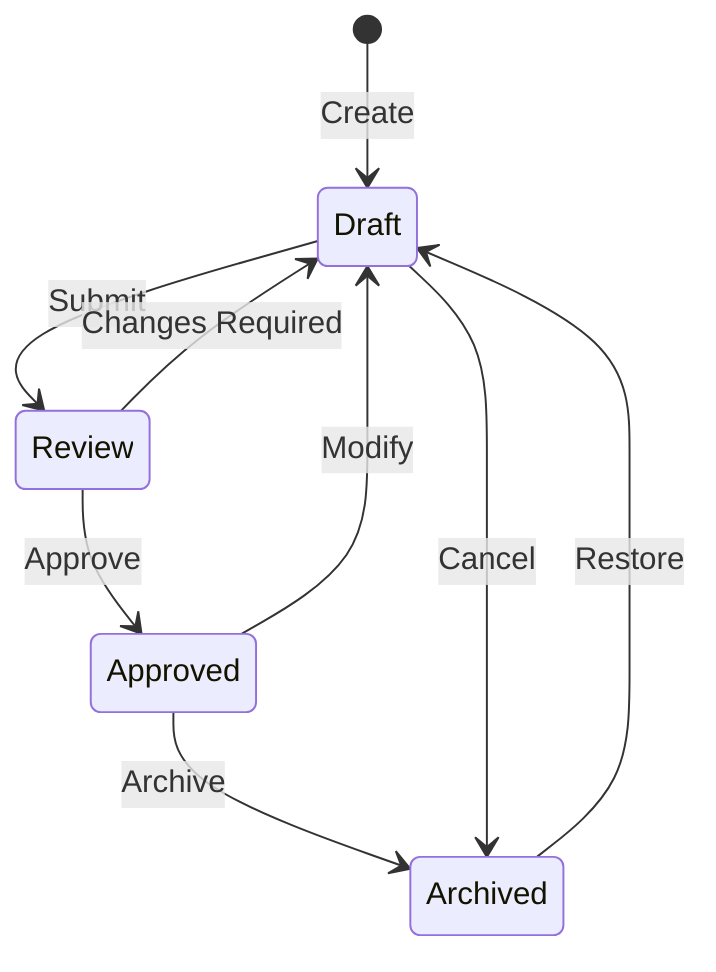
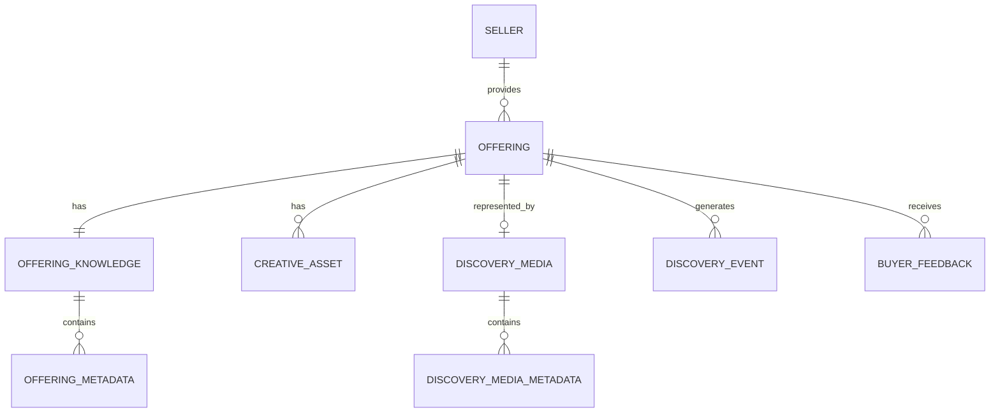

# Offering Knowledge

## Document Status

| Field                  | Value                                                          |
| ---------------------- | -------------------------------------------------------------- |
| **Status**             | Draft                                                          |
| **Version**            | 0.4                                                            |
| **Owner**              | PinkCurve Product Team                                         |
| **Last Reviewed**      | 2026-10-22                                                    |
| **Related Components** | Creative Studio, Discovery Engine,                             |
|                        | Adaptive Metadata Navigation, Discovery                        |
|                        |Analytics, Learning Engine, Seller Intelligence, Trust & Safety |

---

## Overview

Offering Knowledge is PinkCurve's structured understanding of an **Offering**.

It goes beyond a traditional listing by capturing not only what an offering is, but also:

* What it provides
* Who may find it useful
* What needs or interests it addresses
* What makes it different
* Where and when it is relevant
* How it can be discovered
* What visual and creative assets describe it
* How buyers interact with it
* How PinkCurve's understanding of it improves over time

Offering Knowledge provides a shared knowledge foundation for discovery, Adaptive Metadata Navigation, creative generation, analytics, learning, seller intelligence, and trust.

---

# Offering as a Discovery Object

An **Offering** is an independently identifiable product or service, paid or free, submitted and managed by an authorized Seller through PinkCurve's **Offering Discovery** service.

Each Offering is identified by its unique `offering_id` and may have associated Discovery Media identified independently by `discovery_media_id`.

Offering Knowledge describes the underlying Offering. It does not define the identity, lifecycle, or governance of other Discovery Services such as Real-Time Discovery, Brand Recognition, Community Service, or Public Announcement.

All Discovery Services may use shared PinkCurve capabilities while retaining their own service-specific records, Discovery Media, and applicable rules.

Not every Discovery Object must be an Offering. PinkCurve's broader Discovery architecture may support other Discovery Object types while Offering Knowledge remains responsible for the structured understanding of Offerings.

Offering types may include:

- **Product** — A physical or digital product, paid or free.
- **Commercial Service** — A service provided to Buyers, paid or free.
- **Other supported Offering types** — Future types explicitly defined within Offering Discovery.

Examples:

```text
Offering Discovery
    │
    ├── Product
    │     ├── Running shoes
    │     ├── Laptop computer
    │     └── Free household item
    │
    └── Commercial Service
          ├── Home cleaning
          ├── Online tutoring
          └── Free consultation
```

An Offering may have promotional attributes such as a discount, limited availability, or free delivery. These attributes do not automatically create a separate Offering type or Discovery Service.

Real-Time Discovery, Brand Recognition, Community Service, and Public Announcement remain independent Discovery Services under PinkCurve's Product Architecture.

Not every knowledge field applies to every Offering. The Offering Knowledge model must therefore be **extensible rather than rigid**, accommodating differences among products and services without changing their fundamental identity.

This abstraction allows PinkCurve to represent different types of Seller-defined Offerings while allowing the broader Discovery Object architecture to support additional forms of Discovery.

---

# Why Offering Knowledge Matters

Traditional listings commonly contain:

* Name
* Description
* Price
* Basic specifications
* Images
* URL

This may be sufficient to display an item, but it is not sufficient for intelligent discovery.

PinkCurve needs to understand relationships such as:

```text
Offering
   ↓
Characteristics
   ↓
Benefits
   ↓
Needs / Interests
   ↓
Relevant Buyers
   ↓
Discovery Context
```

For example, knowing that an offering is a "running shoe" is useful.

Knowing that it is:

* lightweight
* designed for trail running
* waterproof
* suitable for long-distance runners
* available locally
* discounted this week

provides much stronger discovery knowledge.

That knowledge can help PinkCurve determine **when, where, why, and for whom the offering may matter**.

---

# Knowledge Layers

PinkCurve should distinguish between different sources and types of knowledge.

## 1. Source Knowledge

Source Knowledge contains information supplied or verified by the Seller or another authoritative source.

Examples include:

* Offering name
* Description
* Price
* Features
* Specifications
* Location
* Validity period where applicable
* Quantity or capacity where applicable
* Expiration conditions where applicable
* Images
* Videos
* Destination URL
* Promotion terms

Source Knowledge represents factual information supplied or confirmed by the Seller or obtained from other authorized sources, subject to applicable verification and approval requirements.

---

## 2. Derived Knowledge

Derived Knowledge is generated or enriched by PinkCurve from Source Knowledge.

Examples include:

* Categories
* Metadata
* Semantic concepts
* Potential benefits
* Audience relevance
* Offering relationships
* Search terms
* Embeddings
* Visual characteristics
* Suggested discovery dimensions

AI may assist in producing Derived Knowledge.

Derived knowledge should maintain provenance so PinkCurve knows how and when it was generated.

---

## 3. Learned Knowledge

Learned Knowledge emerges from actual discovery activity.

Examples include:

* Which metadata buyers use
* Which attributes attract interest
* Which audiences respond
* Which creative representations perform well
* Which discovery contexts produce useful interactions
* Which attributes buyers reject
* Which combinations of metadata values frequently lead to meaningful Buyer exploration

Learned Knowledge allows PinkCurve's understanding of an offering to improve over time.

Learned Knowledge should complement—not silently overwrite—verified Source Knowledge.

Learned Knowledge may improve Discovery Fit, metadata relevance, and Adaptive Metadata Navigation by identifying useful relationships among Buyer interests, Discovery Media metadata, and observed Discovery behavior.

Learned signals remain distinguishable from authoritative Offering attributes and approved Discovery Media metadata. They may influence Discovery Engine decisions without automatically modifying either record.

Any proposed changes to authoritative Offering Knowledge or approved Discovery Media must follow their respective governance and approval requirements.

---

# Core Offering Information

Common core fields may include:

| Field | Description |
|---|---|
| `offering_id` | Unique Offering identifier |
| `offering_type` | Product, Commercial Service, or another explicitly supported Offering type within Offering Discovery |
| `offering_name` | Display name |
| `offering_description` | Description of the Offering |
| `offering_url` | Destination page supplied or authorized by the Seller |
| `seller_id` | Seller responsible for providing the Offering |
| `category` | Primary Offering category |
| `brand` | Brand or organization where applicable |
| `price_amount` | Numeric price where applicable |
| `currency_code` | Currency where applicable |
| `price_description` | Price context such as "per month" |
| `availability` | Availability information |
| `availability_status` | Current availability state where applicable |
| `quantity_available` | Current quantity or capacity where applicable |
| `location` | Geographic relevance where applicable |
| `valid_from` | Beginning of the Offering's real-world validity period where applicable |
| `valid_until` | End of the Offering's real-world validity period where applicable |

Offering validity is distinct from a Discovery Media Discovery Period. Offering validity describes when the underlying Offering is valid or available, while the Discovery Period determines when particular Discovery Media may be presented through PinkCurve.

For time-sensitive Offerings, validity, availability, and quantity or
capacity may directly affect Discovery readiness. An Offering should not
remain eligible for active Discovery when its applicable validity period
has ended, its availability has ended, or its relevant quantity or
capacity has been exhausted.

Not all fields are required for every Offering type.

For example, a free product or free commercial service may have no price, while a digital product or online commercial service may have no meaningful physical location.

---

# Rich Knowledge

Rich Offering Knowledge may include:

| Field                   | Description                                                                     |
| ----------------------- | ------------------------------------------------------------------------------- |
| `key_features`          | Important characteristics                                                       |
| `key_benefits`          | Potential benefits                                                              |
| `target_audiences`      | Relevant audience descriptions                                                  |
| `use_cases`             | Situations in which the offering may be useful                                  |
| `needs_addressed`       | Needs or interests the offering may address                                     |
| `unique_selling_points` | Important differentiators                                                       |
| `differentiators`       | Differences from similar offerings                                              |
| `brand_voice`           | Tone and communication guidelines                                               |
| `faqs`                  | Common questions and answers                                                    |
| `specifications`        | Structured specifications                                                       |
| `keywords`              | Search and discovery terms                                                      |
| `categories`            | Offering categories and classifications used to organize and support discovery  |
| `metadata`              | Structured Offering attributes and metadata maintained as part of authoritative |
|                         | Offering Knowledge; discovery-oriented metadata used by AMN belongs to          |
|                         | Discovery Media                                                                 |
| `creative_assets`       | Images, videos, and related assets                                              |

---

# Offering Metadata

Offering Knowledge maintains structured Offering attributes and metadata that provide an authoritative factual foundation for discovery.

Discovery Media metadata uses or references relevant Offering information, together with approved discovery-oriented enrichment, to support Discovery Fit and Adaptive Metadata Navigation.

Metadata describes characteristics buyers may use to understand and refine discovery.

For example:

```text
Running Shoes
│
├── Activity
│   ├── Road Running
│   ├── Trail Running
│   └── Walking
│
├── Features
│   ├── Waterproof
│   ├── Lightweight
│   └── Cushioned
│
├── Price Range
│
├── Brand
│
├── Size
│
├── Location / Availability
│
└── Promotion
```

Metadata should not be treated merely as internal tags.

It may become part of the buyer-facing discovery interface.

---

## Adaptive Metadata

The metadata useful for discovery may change depending on:

* Offering category
* Current result set
* Buyer intent
* Location
* Available inventory
* Buyer selections
* Discovery context

For example, a Buyer exploring running shoes may select multiple metadata values in any order:

```text
Selected Metadata:
  Activity: Trail Running
  Feature: Waterproof
  Price Range: Under $100
```

The Buyer may add, remove, or change any selection without following a predefined category path.

PinkCurve may determine that the most useful next metadata dimensions are:

```text
Waterproof
Terrain
Cushioning
Price
Brand
Availability Nearby
```

Adaptive Metadata Navigation does not require Buyers to follow a fixed category hierarchy or predefined sequence of metadata selections.

PinkCurve dynamically organizes and presents relevant metadata dimensions and values based on the available Discovery Media, Buyer selections, and Discovery context.

Buyers may combine metadata values freely, allowing AMN to surface matching Discovery Media without requiring sequential browsing through unrelated results.

Discovery Media metadata provides the discovery-oriented dimensions and values used by Adaptive Metadata Navigation.

Offering Knowledge supplies authoritative Offering attributes that may be referenced by Discovery Media metadata, ensuring that Buyer-facing discovery remains consistent with verified Offering information.

---

## Offering Attributes and Discovery Media Metadata

PinkCurve distinguishes between **Offering attributes** and **Discovery Media metadata**.

### Offering Attributes

Offering attributes are maintained as part of Offering Knowledge or the associated operational Offering state.

They describe the underlying product or service and provide the authoritative information needed to understand, manage, and validate the Offering.

Examples include:

- Offering type
- Name and description
- Price and currency
- Brand
- Product or service specifications
- Features and characteristics
- Location or service area
- Availability and quantity or capacity
- Validity and expiration conditions
- Destination URL

Each Offering is identified by its unique `offering_id`.

### Offering Attribute Sources and Capture

Offering attributes may originate from several sources:

- **Seller manual entry:** The Seller directly enters or updates Offering information through PinkCurve's web browser Seller interface.
- **Seller-provided URL:** PinkCurve extracts proposed Offering attributes from the destination page supplied and authorized by the Seller.
- **Seller-uploaded materials:** PinkCurve extracts proposed attributes from authorized documents, images, descriptions, catalogs, or other supporting materials.
- **Structured import:** Offering attributes are imported from Seller-authorized product feeds, e-commerce systems, APIs, or structured files.
- **PinkCurve AI assistance:** AI may extract, organize, normalize, or suggest Offering attributes based on authorized source materials.

### Attribute Verification and Authority

Seller-entered attributes are Seller-provided claims and remain subject to applicable validation and approval requirements.

Attributes extracted or imported from external sources are treated as proposed Source Knowledge until appropriately confirmed.

AI-inferred attributes must be distinguished from extracted facts and must not automatically become authoritative Offering facts.

The Seller is responsible for confirming material Offering information. PinkCurve applies its applicable verification, trust, safety, and approval controls before the information becomes approved Offering Knowledge.

Each significant attribute should retain sufficient provenance to identify its source, confirmation status, and relevant timestamps.

Approved Offering Knowledge provides the authoritative factual attributes used by Discovery Media, Creative Studio, and the Discovery Engine.

Changes to authoritative descriptive Offering attributes follow the Offering Knowledge Draft → Review → Approved lifecycle.

Frequently changing operational attributes, such as availability, remaining quantity or capacity, and expiration status, may be maintained separately under applicable operational validation and Discovery eligibility rules.

### Discovery Media Metadata

Discovery Media metadata describes the characteristics and discovery context of the associated Discovery Media.

For the PinkCurve MVP, each Offering supports a maximum of one Discovery Media, identified independently by `discovery_media_id`.

Discovery Media metadata may include:

- Categories and discovery topics
- Relevant Buyer needs and interests
- Features and benefits useful for discovery
- Use cases
- Geographic relevance
- Discovery keywords and semantic concepts
- Metadata dimensions used by Adaptive Metadata Navigation
- Other approved discovery-oriented attributes

Discovery Media metadata may originate from:

- Seller-entered or Seller-confirmed metadata
- PinkCurve AI extraction from authorized source materials
- PinkCurve AI inference
- Approved enrichment and learning processes

### Attribute and Metadata Consistency

Offering Knowledge remains the authoritative source for factual Offering attributes.

When Discovery Media metadata represents an Offering fact, it must reference or derive from the corresponding authoritative Offering attribute rather than establish an independent conflicting fact.

AI-generated or inferred metadata must retain appropriate provenance and must not be represented as a verified Seller claim without confirmation.

Discovery Media metadata may be enriched to improve Discovery Fit and Adaptive Metadata Navigation, subject to applicable approval, quality, and trust rules.

Metadata enrichment does not automatically modify authoritative Offering Knowledge. Changes to authoritative Offering Knowledge follow its established Draft → Review → Approved lifecycle.

Operational Offering state may change independently, subject to applicable validation and Discovery eligibility rules.

### Relationship to Other Discovery Services

This section defines the relationship between Offering Knowledge and Discovery Media metadata specifically for Offering Discovery.

Other Discovery Services, including Real-Time Discovery, Brand Recognition, Community Service, and Public Announcement, maintain their own service-specific attributes while following the common Discovery Media metadata principles defined by PinkCurve's Product Architecture.

---

# Location and Time Knowledge

Some Offerings have geographic or temporal relevance.

Examples include:

- Local commercial services
- Restaurant products and services
- Products with limited-time discounts
- Products available at specific locations
- Services with scheduled availability
- Products with limited inventory
- Seasonal products and services

Offering Knowledge may therefore include:

### Location

* Country
* Region or state
* City
* Service area
* Geographic coordinates where appropriate
* Online-only availability

### Time

* Availability periods
* Scheduled product or service availability
* Promotion start and expiration
* Business availability
* Seasonal relevance
* Current availability status
* Quantity or capacity where relevant
* Hard real-world expiration or availability deadline
* Seller early termination where applicable

These temporal attributes describe the underlying Offering and must be distinguished from the Discovery Period of its associated Discovery Media.

For the PinkCurve MVP, each Offering supports a maximum of one Discovery Media. The Offering may remain valid even when its associated Discovery Media has not yet started or its Discovery Period has ended.

Changes to the Discovery Media or its Discovery Period must follow the applicable Discovery Media approval and lifecycle rules. The existing `discovery_media_id` is retained when the Discovery Media is modified.

Location and time can become important discovery dimensions.

For time-sensitive Offerings, time and availability also affect whether
the Offering remains eligible for Discovery. PinkCurve should be able to
stop presenting an Offering when it expires, becomes unavailable,
reaches an applicable quantity or capacity limit, is ended early by the
Seller, or otherwise becomes ineligible for Discovery.

---

# Creative Assets

Offering Knowledge should maintain references to the visual materials available for discovery.

Creative Assets are source or generated materials associated with an Offering.
They are distinct from **Discovery Media**, which represents the visual or other
presentation content made eligible for presentation through PinkCurve Discovery.
Creative Assets may be used by the Creative Studio to produce Discovery Media.

These may include:

* Product images
* Seller-provided videos
* Logos
* Promotional images
* Generated creatives
* Creative variants
* Supporting media

The Creative Studio can use these assets together with structured Offering Knowledge to create discovery content.

Creative assets should maintain provenance sufficient to distinguish
Seller-provided or otherwise authorized factual media from
PinkCurve-generated presentation assets.

For Offerings where the visual appearance of the actual item is material
to Buyer understanding, generated presentation should not falsely depict
the Offering as though the generated image were factual Seller-provided
media.

This distinction is especially important for Real-Time Discovery, where
a Seller may provide a current photo and PinkCurve may rapidly create a
poster or other visual presentation around that source material.

---

# Knowledge Capture

Offering Knowledge may enter PinkCurve through several paths.

## Manual Entry

Sellers create, enter, edit, and manage Offering Knowledge through PinkCurve's **web browser Seller interface**.

The Seller interface should guide Sellers toward providing useful and accurate Offering Knowledge without requiring unnecessarily complicated data entry.

PinkCurve may assist Sellers through structured forms, suggested metadata, AI-assisted extraction, and validation.

The PinkCurve mobile app does not support Seller creation or maintenance of Offering Knowledge. Sellers may use the mobile app to view their own Discovery Media and participate in Buyer-style discovery, subject to applicable access permissions.

---

## URL-Based Knowledge Capture

A destination URL is an important source of Offering Knowledge.

With permission from the Seller, PinkCurve may analyze the supplied page to extract information such as:

* Offering name
* Description
* Features
* Price
* Images
* Specifications
* FAQs
* Brand information
* Other useful structured knowledge

Information extracted from a Seller-provided URL must be treated as **proposed Source Knowledge** until it has been reviewed and confirmed through the applicable Seller verification process.

PinkCurve may use AI-assisted extraction to reduce manual data entry, but extraction alone does not establish that the information is accurate, current, or authorized for use.

The Seller remains responsible for confirming material Offering facts, including applicable prices, descriptions, specifications, availability, and destination information.

Confirmed information may become part of the approved Offering Knowledge used by Creative Studio and Discovery Engine, subject to PinkCurve's applicable Trust, Safety, and approval requirements.

Subsequent changes to the destination page do not automatically overwrite previously approved Offering Knowledge. Material changes should be evaluated through the appropriate update and reverification process.

---

## AI-Assisted Extraction

AI may analyze:

* Offering pages
* Uploaded documents
* Images
* Existing descriptions
* Seller-supplied materials
* Structured feeds

AI can suggest knowledge rather than requiring Sellers to manually enter every field.

AI-assisted knowledge processing must distinguish between **extracted facts** and **inferred knowledge**.

- **Extracted facts** are information identified in Seller-provided or otherwise authorized source materials, such as product specifications, stated prices, and service descriptions.
- **Inferred knowledge** consists of interpretations or suggestions generated by AI, such as potential use cases, relevant Buyer interests, semantic relationships, and suggested metadata.

Extracted facts require appropriate confirmation before becoming approved Source Knowledge. AI-inferred information must retain its inferred status and provenance and must not be represented as a verified Seller claim without appropriate confirmation.

PinkCurve may use approved inferred knowledge to support Discovery Fit, Adaptive Metadata Navigation, and creative suggestions, subject to applicable quality and trust controls.

Both extracted and inferred knowledge should retain sufficient source references, processing timestamps, and provenance information to support verification, correction, and appropriate quality controls.

PinkCurve does not maintain separate Offering Knowledge versions. Extracted or inferred information must follow the applicable knowledge approval rules before becoming part of approved Offering Knowledge.

---

## Structured Import

PinkCurve may support imports from:

* E-commerce systems
* Product feeds
* Catalogs
* APIs
* Structured files
* Organization databases

Information obtained through structured imports is treated as proposed Offering Knowledge until it has been appropriately validated and confirmed by the Seller.

Imported attributes must retain applicable source provenance and must not automatically overwrite approved Offering Knowledge.

Material changes to approved Offering Knowledge must follow the Draft → Review → Approved lifecycle.

Frequently changing operational attributes may be updated through separate validated processes, subject to applicable Discovery eligibility requirements.

---

## Learning

After an Offering becomes available for Discovery, Buyer interactions and other Discovery signals may generate Learned Knowledge that improves Discovery Fit, metadata relevance, and Adaptive Metadata Navigation.

Learned Knowledge remains separate from authoritative Offering Knowledge and approved Discovery Media. It may influence Discovery Engine decisions without automatically modifying either approved record.

This creates a continuous knowledge cycle:

```text
Seller Information / Authorized Sources
                  │
                  ▼
       Offering Knowledge Capture
                  │
                  ▼
     Seller Confirmation / Approval
                  │
                  ▼
      Approved Offering Knowledge
                  │
                  ▼
       Discovery Media Creation
                  │
                  ▼
       Discovery Media Approval
                  │
                  ▼
          Discovery Engine
                  │
                  ▼
         Buyer Interactions
                  │
                  ▼
         Discovery Signals
                  │
                  ▼
          Learning Engine
                  │
                  ▼
          Learned Knowledge
                  │
                  ▼
   Discovery Fit / AMN Improvement
```

Learned Knowledge may improve Discovery Fit and Adaptive Metadata Navigation without automatically modifying approved Offering Knowledge or Discovery Media.

Proposed changes to either approved record must follow its respective approval lifecycle.

---

# Knowledge Provenance

PinkCurve should know where important knowledge came from.

Knowledge may be labeled as:

* Seller supplied
* Seller verified
* AI extracted
* AI inferred
* Imported
* Learned from discovery
* Platform generated

Provenance is important because not all knowledge has the same authority.

For example:

```text
Price
Source: Seller
Verification: Seller confirmed

Category
Source: AI inferred
Verification: Seller approved

Metadata: "Good for hiking"
Source: AI inferred

Metadata: "Frequently explored by trail runners"
Source: Discovery learning
```

Provenance helps PinkCurve distinguish **facts, interpretations, and learned signals**.

For time-sensitive knowledge, provenance should also preserve when the
information was supplied, observed, extracted, verified, or last
confirmed where applicable.

This is especially important for information such as price,
availability, quantity or capacity, location, validity periods, and
expiration conditions because otherwise correct information may become
stale.

Freshness therefore should be evaluated together with provenance when
PinkCurve determines whether time-sensitive knowledge can still be
trusted for active Discovery.

---

# Knowledge Verification and Trust

Offering Knowledge must not become a mechanism for spreading false or misleading claims.

Knowledge may therefore require different levels of verification.

Potential controls include:

* Seller verification
* Offering verification
* URL validation
* Automated content checks
* Duplicate detection
* Suspicious claim detection
* Prohibited content detection
* Human review when necessary

Trust status may affect whether an Offering becomes eligible for discovery.

Knowledge completeness and Discovery readiness are separate concepts.

An Offering may contain complete descriptive knowledge while still being
ineligible for active Discovery because required approval has not been
completed, its validity period has not started or has ended, it is no
longer available, its quantity or capacity has been exhausted, its
destination URL requires reverification, or a trust, safety, or policy
condition has suspended Discovery eligibility.

Changes to these operational conditions may therefore change Discovery
readiness without changing the Offering's descriptive Knowledge
Completeness Score.

AI-generated knowledge should not automatically be treated as verified fact.

See: [Security, Privacy, and Trust](12-security-privacy-and-trust.md)

---

# Knowledge Completeness

PinkCurve may calculate a **Knowledge Completeness Score** to identify missing
or insufficient Offering Knowledge.

The score should measure the completeness of useful knowledge for the applicable
Offering type rather than simply counting populated fields. Information that is
irrelevant, duplicated, unreliable, or insufficiently meaningful should not
increase completeness merely because a field contains a value.

Example:

| Score Range | Interpretation |
| ----------- | -------------- |
| 0–25        | Minimal        |
| 26–50       | Basic          |
| 51–75       | Good           |
| 76–100      | Comprehensive  |

Possible factors include:

* Required information
* Rich knowledge coverage
* Metadata quality
* Creative asset availability
* Destination URL quality
* Location information where relevant
* Offering-type-specific fields

However, completeness does **not** mean Discovery quality or Discovery readiness.

An Offering with extensive information is not automatically more relevant
or valuable than another Offering, nor is it automatically eligible for
active Discovery.

Discovery readiness depends on applicable operational conditions such as
approval, trust status, validity, availability, freshness, and other
Offering-type-specific requirements.

The completeness score should primarily help sellers and PinkCurve identify missing knowledge.

The weighting algorithm remains an experimental product decision and should be validated using discovery outcomes.

---

# Knowledge Quality

Completeness and quality should be treated separately.

Knowledge Quality may consider:

* Accuracy
* Freshness
* Current availability where applicable
* Validity status where applicable
* Consistency
* Source reliability
* Verification status
* Metadata usefulness
* Duplicate information
* Contradictions
* Buyer feedback

An Offering could therefore have:

```text
Completeness: 95
Quality: 62
```

if it contains extensive but outdated or poorly verified information.

---

# Knowledge Lifecycle



### Lifecycle Rules

Offering Knowledge follows a simple **Draft → Review → Approved** lifecycle.

When approved Offering Knowledge is modified, its status returns to **Draft**. The modified knowledge must be submitted for review and approved again before it becomes eligible for use by the Discovery Engine.

The Offering retains its existing `offering_id`. PinkCurve does not create separate Offering Knowledge versions for ordinary modifications.

Only approved Offering Knowledge associated with an otherwise eligible Offering and approved Discovery Media may be used for active Discovery.

Archived knowledge is not eligible for active Discovery. Restoring archived knowledge returns it to Draft and requires approval before reuse.

Offering Knowledge and Discovery Media have separate approval statuses. Approval of one does not automatically approve the other.

### Draft

Offering Knowledge is being entered, imported, corrected, or enriched.

### Review

Offering Knowledge is being evaluated or verified before it is approved for use by PinkCurve.

### Approved

The applicable Offering Knowledge has been approved for use by PinkCurve.

Approved knowledge does not by itself make an Offering eligible for active Discovery. Discovery eligibility is determined separately using applicable approval, trust, validity, availability, freshness, policy, and other Discovery-readiness conditions.

### Archived

Archived Offering Knowledge is inactive and is not eligible for active Discovery.

Archiving preserves the current Offering Knowledge record and its associated `offering_id` without creating a separate historical version.

When archived Offering Knowledge is restored, its status returns to **Draft**. It must complete the Review and approval process before becoming eligible for active Discovery.

Archiving does not change the identity of the Offering or automatically approve its associated Discovery Media.

---

# Knowledge Updates

Offering Knowledge is maintained as a single current record associated with its `offering_id`.

Sellers may update Offering Knowledge to correct factual information, change descriptions, adjust prices, modify Offering attributes, or revise other applicable information through PinkCurve's web browser Seller interface.

Discovery Media metadata is maintained separately as part of Discovery Media and follows its own governance and approval requirements.

Modifying approved Offering Knowledge returns its approval status to **Draft**. The updated knowledge must pass through **Review** and receive approval before it can be used for active Discovery.

PinkCurve does not maintain separate Offering Knowledge versions or a version history for rollback.

Frequently changing operational information, such as availability, remaining quantity or capacity, validity, expiration, and Seller early termination, may be updated independently of the descriptive Offering Knowledge approval workflow, subject to applicable validation and Discovery eligibility rules.

Operational changes that make an Offering ineligible must prevent its associated Discovery Media from being presented, even when that Discovery Media remains approved.

Offering Knowledge and Discovery Media retain their respective unique identifiers throughout their lifecycles.

---

# Relationships



The logical architecture separates the Offering entity from its associated Offering Knowledge and Discovery Media.

Each Offering is identified by its unique `offering_id` and maintains one current Offering Knowledge record without knowledge versioning.

For the PinkCurve MVP, each Offering supports a maximum of one Discovery Media, identified independently by `discovery_media_id`. An Offering may temporarily have no Discovery Media during preparation, but active Discovery requires one approved and eligible Discovery Media.

Sellers may create multiple Offerings, each with its own Offering Knowledge and Discovery Media, subject to applicable platform policies and subscription limits.

This relationship model applies specifically to Offering Discovery. Other Discovery Services maintain their own service-specific entities and identifiers, with their Discovery Media referencing those entities rather than an `offering_id`.

Offering Knowledge and Discovery Media have independent approval statuses. Both must satisfy applicable approval and Discovery eligibility requirements before the Discovery Engine presents the associated Discovery Media.

---

# Integration with Other Components

## Creative Studio

Offering Knowledge provides the authoritative factual and contextual information used by Creative Studio to generate Discovery Media.

Creative Studio may combine approved Offering Knowledge, authorized Creative Assets, and applicable discovery-oriented metadata to produce visual presentation content for PinkCurve Discovery.

AI-generated creative content must remain consistent with authoritative Offering attributes and must not introduce unsupported factual claims.

For the PinkCurve MVP, each Offering supports a maximum of one associated Discovery Media. Creative Studio may create or modify that Discovery Media while preserving its `discovery_media_id`.

New or modified Discovery Media must follow its Draft → Review → Approved lifecycle before becoming eligible for presentation to Buyers.
Creative Studio may use:

* Features
* Benefits
* Audiences
* Brand voice
* Images
* Videos
* Differentiators
* Metadata
* Destination information

See: [Creative Studio](05-creative-studio.md)

---

## Discovery Engine

Offering Knowledge provides the authoritative descriptive and operational information needed by the Discovery Engine to understand an Offering and evaluate its eligibility for Discovery.

Each Offering is identified by `offering_id` and supports a maximum of one associated Discovery Media, independently identified by `discovery_media_id`, for the PinkCurve MVP.

Discovery Media contains presentation content and discovery-oriented metadata originating from Seller input, approved Offering attributes, PinkCurve AI extraction or inference, and applicable learning processes.

The Discovery Engine evaluates eligible Discovery Media using the Discovery Fit process, including relevance, ranking, diversity, and quality. Discovery Media metadata supports matching and ranking against Buyer interests, intent, and Discovery context.

The Discovery Engine does not select among multiple Discovery Media for the same Offering.

Only approved Discovery Media associated with approved Offering Knowledge and an otherwise eligible Offering may be presented to Buyers. Applicable operational conditions, including availability, validity, freshness, and trust status, must also be satisfied.

Discovery may use:

* Semantic meaning
* Metadata
* Category
* Location
* Availability
* Freshness
* Validity period
* Discovery readiness
* Audience relevance
* Learned signals
* Trust status

Offering Knowledge provides both descriptive knowledge used to understand
and rank an Offering and operational knowledge used to determine whether
the Offering is currently eligible for Discovery.

For time-sensitive Offerings, the Discovery Engine should use current
validity, availability, freshness, trust, and other applicable
Discovery-readiness conditions before presenting the Offering to Buyers.

See: [Discovery Engine](06-discovery-engine.md)

---

### Adaptive Metadata Navigation

Adaptive Metadata Navigation (AMN) uses Discovery Media metadata to help Buyers visually identify and discover relevant Offerings.

Offering Knowledge provides authoritative Offering attributes that may be referenced or represented in Discovery Media metadata.

AMN intelligently organizes and presents relevant metadata dimensions and values based on the available Discovery Media, Buyer interests, current selections, and Discovery context.

Buyers may select one or multiple metadata values and freely add, remove, or change their selections without following a fixed category hierarchy.

AMN uses these metadata combinations to rapidly surface matching Discovery Media, including relevant items that might otherwise appear far down in the Discovery results.

The metadata presented to Buyers may adapt as the available Discovery Media and Buyer selections change.

---

## Discovery Analytics

Analytics measures how Offering Knowledge performs during discovery.

Examples include:

* Which metadata buyers select
* Which attributes correlate with exploration
* Which offerings receive negative feedback
* Which knowledge gaps reduce discovery effectiveness

See: [Discovery Analytics](07-discovery-analytics.md)

---

## Learning Engine

The Learning Engine analyzes Discovery signals to improve PinkCurve's understanding of Buyer interests, Offering relevance, and Discovery Media effectiveness.

Learned Knowledge may support Discovery Fit, metadata enrichment, and Adaptive Metadata Navigation without automatically modifying authoritative Offering Knowledge or approved Discovery Media.

Any proposed modifications to these approved records must follow their respective governance and approval requirements.

Examples include:

* Emerging buyer interests
* Useful metadata relationships
* Audience response patterns
* Creative effectiveness
* Negative signals
* Offering relationships

Learned information should maintain provenance and should not silently replace verified seller information.

Learning Engine outputs may enrich Learned Knowledge and influence future Discovery,
but they should not silently overwrite authoritative Source Knowledge. Where learned
signals conflict with verified Source Knowledge, the conflict should remain identifiable
through provenance and be handled through the appropriate verification or governance process.

See: [Learning Engine](08-learning-engine.md)

---

## Seller Intelligence

Seller Intelligence can use Offering Knowledge and discovery results to help sellers improve their offerings and campaigns.

Examples include:

* Missing knowledge
* Weak metadata
* Buyer interest patterns
* Creative opportunities
* Discovery opportunities
* Knowledge freshness issues
* Discovery-readiness issues
* Availability or expiration issues

See: [Seller Intelligence](09-seller-intelligence.md)

---

# Data Model

See schema:

`../schemas/offering-knowledge.schema.json`

Primary logical entities may include:

- `offerings`
- `offering_knowledge`
- `offering_metadata`
- `creative_assets`
- `discovery_media`
- `discovery_media_metadata`
- `knowledge_sources`

Each Offering maintains one current Offering Knowledge record and supports a maximum of one Discovery Media record for the PinkCurve MVP.

Offering metadata and Discovery Media metadata have distinct ownership and responsibilities. `offering_metadata` belongs to Offering Knowledge and represents structured Offering characteristics, while `discovery_media_metadata` belongs to Discovery Media and supports discovery matching, ranking, and Adaptive Metadata Navigation.

When Discovery Media metadata represents an authoritative Offering attribute, it must reference or derive from the corresponding Offering Knowledge or operational state rather than maintain an independently conflicting fact.

Each metadata entity must preserve applicable source provenance, verification status, and governance requirements. The exact physical storage and relationships are defined by the Data Architecture.

Offering Knowledge and Discovery Media retain separate approval statuses and independent lifecycles. No separate Offering Knowledge version entity is required.

Operational Offering state may include rapidly changing information such
as current availability, remaining quantity or capacity, validity status,
expiration, Seller early termination, and current Discovery readiness.

Operational state remains logically associated with the Offering and may be updated independently of the descriptive Offering Knowledge approval lifecycle, subject to applicable validation and Discovery eligibility rules.

The exact persistence model and physical entities for this state are
defined by the Data Architecture.

Exact physical database design is defined in the Data Architecture rather than this document.

See: [Data Architecture](11-data-architecture.md)

---

# Current Implementation Status

## Implemented

* Basic Offering Knowledge storage
* Seller relationship
* Offering relationship
* Basic CRUD operations

## In Progress

* Knowledge capture workflow
* Offering Knowledge model refinement
* Completeness scoring

## Planned

* URL-based knowledge extraction
* AI-assisted enrichment
* Metadata generation
* Adaptive metadata support
* Knowledge provenance
* Knowledge quality scoring
* Structured import
* Learning-based enrichment
* Trust and verification integration
* Discovery-readiness evaluation
* Time-sensitive Offering knowledge
* Freshness and validity tracking
* Operational availability and quantity or capacity tracking
* Creative asset provenance

---

# Open Questions

See [Open Decisions](19-open-decisions.md) for decisions including:

- Knowledge completeness weighting
- Knowledge quality measurement
- Discovery-readiness rules by Offering type
- Conflict handling between Seller-provided and AI-generated knowledge
- Metadata governance
- Learned Knowledge approval

---

# Design Principles

Offering Knowledge should follow several long-term principles.

### Seller Knowledge Remains Authoritative

PinkCurve may enrich knowledge, but verified Seller facts should not be silently changed by AI or learning systems.

### Knowledge Must Be Explainable

PinkCurve should know where significant knowledge came from.

### Metadata Is Part of the Product Experience

Metadata is not merely internal tagging. It can become a buyer-facing discovery mechanism through Adaptive Metadata Navigation.

### Learning Enriches Rather Than Rewrites

Behavioral signals can improve PinkCurve's understanding without redefining factual offering information.

### Knowledge Is Dynamic

Offering Knowledge evolves as offerings, markets, buyers, and discovery patterns change.

### Freshness Is Part of Knowledge

For time-sensitive Offerings, knowledge must be useful at the time of
Discovery, not merely correct when it was originally captured.

Availability, validity, quantity or capacity, expiration, and other
time-sensitive facts should therefore be evaluated for freshness when
they affect Discovery readiness.

### Quality Matters More Than Volume

More fields do not automatically create better discovery.

### Trust Applies to Knowledge

AI-generated or seller-supplied claims must be subject to appropriate quality and trust controls.

---

# Related Documents

* [Product Architecture](03-product-architecture.md)
* [Creative Studio](05-creative-studio.md)
* [Discovery Engine](06-discovery-engine.md)
* [Adaptive Metadata Navigation](23-adaptive-metadata-navigation.md)
* [Discovery Analytics](07-discovery-analytics.md)
* [Learning Engine](08-learning-engine.md)
* [Seller Intelligence](09-seller-intelligence.md)
* [Data Architecture](11-data-architecture.md)
* [Security, Privacy, and Trust](12-security-privacy-and-trust.md)
* [Buyer Experience](20-buyer-experience.md)
* [Open Decisions](19-open-decisions.md)
* [Offering Knowledge Flow Diagram](../diagrams/offering-knowledge-flow.md)
