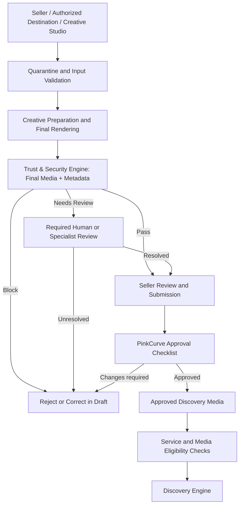
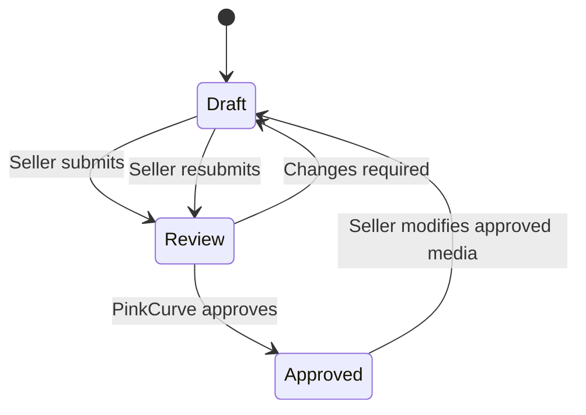

# Creative Studio

## Document Status

| Field                  | Value                                                                                        |

| ---------------------- | -------------------------------------------------------------------------------------------- |

| **Status**             | Draft                                                                                        |

| **Version**            | 0.6                                                                                          |

| **Owner**              | PinkCurve Product Team                                                                       |

| **Last Reviewed**      | 2026-10-22                                                                                   |

| **Related Components** | Offering Knowledge, Discovery Engine, Discovery Analytics, Learning Engine, AI Platform,     |

|                        | Seller Intelligence                                                                          |

---

## Overview

Creative Studio helps Sellers create, enhance, adapt, and prepare Discovery Media for PinkCurve Discovery. Discovery Media may also be created or provided directly by Sellers without being generated by Creative Studio.

Creative Studio is responsible exclusively for creating, enhancing, adapting, and preparing Discovery Media. It does not create, modify, or manage the authoritative attributes or operational state of an associated Discovery Service. It uses applicable Approved Source Knowledge and authorized creative assets to prepare presentation content and discovery-oriented metadata. Metadata representing authoritative service facts must remain consistent with the underlying Discovery Service.

For MVP, each Discovery Service entity may have **at most one associated Discovery Media**. Creative Studio can use multiple working assets or candidate drafts internally, but only one Discovery Media entity is associated with a given service entity. Creative Studio does not determine Discovery Classification, pricing, eligibility, or ranking.

Its purpose is broader than generating advertisements.

Creative Studio helps Sellers communicate why a Discovery service or its subject matter may be:

* Relevant

* Useful

* Interesting

* Timely

* Worth exploring

Creative Studio may work with:

* Seller-provided images

* Seller-provided videos

* Existing marketing materials

* Destination URLs

* AI-generated content

* AI-assisted modifications

* PinkCurve-created or assisted Discovery Media

The objective is to help create, enhance, adapt, or prepare Discovery Media that Buyers can understand quickly, particularly on mobile devices.

---

# MVP Scope and Architectural Constraints

| Area | MVP decision | Future possibility |
|---|---|---|
| Media association | At most one Discovery Media per Discovery Service entity | Multiple approved variants with explicit governance |
| Media lifecycle | Draft → Review → Approved; edits return Approved to Draft | Additional workflow automation without changing the core rule |
| Source of truth | Discovery Service owns authoritative attributes and operational state | Expanded service-specific schemas |
| Media metadata | Governed presentation/discovery metadata with provenance | More AI-derived and learned metadata |
| Creative campaigns | Not required as a separate platform entity | Optional campaign organization |
| Seller authoring | Web interface only | Reconsider if justified by product requirements |
| AI generation | Optional; use suitable existing assets first | Richer image/video generation |
| Working Candidates | Optional internal alternatives; one selected media entity | More advanced candidate evaluation |
| Trust & Security | Mandatory scanning and validation of all sources and final media | Risk-adaptive automation with retained safeguards |
| Approval checklist | Seller self-review and PinkCurve approval, including metadata | Configurable classification-aware policies |
| Economics | Minimize fixed costs; use cost-effective production and usage-based resources | Unit-economics optimization from measured demand |
| Real-Time media | Rapid, low-cost, factual media with required approval | More automation under trust policy |
| Media validity | Finite start and end date/time | No open-ended validity |

Creative Studio does not define service eligibility, Discovery Classification, billing, ranking, or Buyer navigation. The Discovery Engine enforces eligibility; Discovery Analytics measures outcomes; AMN uses governed metadata to support Buyer navigation.

---

# Creative Philosophy

PinkCurve is a **visual-first discovery platform**.

Buyers should not have to read large amounts of promotional text before understanding a Discovery service or its subject matter.

Creative Studio therefore follows several principles.

### Understand Quickly

Discovery Media should communicate the main idea of the Discovery service or its subject matter within a short period of attention.

### Show Rather Than Explain

Images, video, demonstrations, scenes, and concise visual information should carry much of the message.

### Remain Grounded in Approved Source Knowledge

Discovery Media should accurately represent the Discovery service and its underlying subject matter and should not introduce unsupported claims.

### Preserve Authenticity

Seller-provided content may often be more authentic and informative than completely AI-generated content.

### Separate Truth From Presentation

Creative Studio may improve how a Discovery service and its subject matter are presented, but it should not invent their factual reality.

For factual characteristics of the Discovery service and its underlying subject matter, especially where visual appearance matters, the Seller or another authorized source should supply the underlying truth. PinkCurve may then organize, enhance, format, or present that truth effectively for Discovery.

This principle is especially important for Real-Time Discovery, where a

Seller may provide a current photo and a few factual details while

PinkCurve rapidly creates a useful visual presentation around them.

\> **Seller supplies truth → PinkCurve supplies presentation.**

### Support Buyer Discovery

Discovery Media should help Buyers decide whether the Discovery service or its subject matter deserves further exploration rather than pressure them into an action or transaction.

### Mobile First

Discovery Media must work well on small screens and in visual feed environments.

### Trustworthy

Discovery Media must not intentionally mislead Buyers or disguise important limitations.

---

# Creative Studio Is Not an Ad Generator

Traditional advertising systems primarily ask:

\> How can we persuade someone to click or buy?

PinkCurve asks a different question:

\> How can we help someone quickly understand whether this discovery may matter to them?

This distinction affects Creative Studio design.

Creative Studio may help create or prepare advertising-style Discovery Media, but its primary goal is effective Discovery communication.

Effective Discovery Media helps the Buyer quickly answer questions such as:

* What is this?

* Why might I care?

* Who is it for?

* What is different about it?

* Is it relevant to me?

* Should I explore it further?

The destination page remains the place where the buyer can investigate details and, where applicable, complete a transaction.

---

# Creative Sources

PinkCurve should not assume that Discovery Media must be generated by Creative Studio or by AI.

Creative Studio may work with Seller-provided Discovery Media, source material, and other approved inputs.

## Seller-Provided Discovery Media and Creative Assets

Sellers may provide existing Discovery Media and creative assets such as:

* Product images

* Videos

* Demonstrations

* Commercials

* Brand materials

* Logos

* Promotional images

* Existing social or web creative

If suitable Seller-provided Discovery Media already exists, PinkCurve should make effective use of it rather than regenerate or substantially modify it unnecessarily.

---

## Destination URL

The destination URL, where applicable, is an important Creative Studio input.

With appropriate permission, PinkCurve may use information available from the destination to understand:

\- Visual identity

\- Existing imagery

\- Relevant characteristics

\- Brand context

\- Important messages

\- Available media

The destination URL connects Creative Studio with the Seller's actual destination experience where an external destination exists.

---

## Approved Source Knowledge

Approved source knowledge provides the factual and contextual foundation for creative development.

It may include:

* Features or characteristics

* Benefits

* Audiences

* Differentiators

* Use cases

* Metadata

* Brand voice

* Images

* Videos

* Location

* Availability

* Promotions

* Destination information

Approved source knowledge and Discovery Media serve different purposes. Approved source knowledge provides the factual and contextual basis for representation, while Discovery Media is the visual or other media used to communicate the Discovery service to Buyers. Creative Studio may use approved source knowledge to create, enhance, adapt, or validate Discovery Media.

---

## AI-Assisted and AI-Generated Discovery Media

Creative Studio may use AI to assist in creating, enhancing, adapting, or preparing Discovery Media where useful.

Examples include:

* Creative concepts

* Briefs

* Scripts

* Storyboards

* Headlines

* Captions

* Images

* Voice-over

* Visual variations

* Video segments

* Complete short-form Discovery Media where technology, quality, and applicable policy permit

AI generation is one capability available to Creative Studio. Discovery Media may originate from Sellers, existing authorized sources, Creative Studio, AI-assisted processes, or combinations of these sources.

---

## Seller-Provided and Destination-Sourced Creative Materials

Creative Studio may receive, retrieve, derive, enhance, or generate creative production components rather than requiring the Seller to provide a finished Discovery Media item.

The supported creative-material categories include:

1. Creative concepts
2. Briefs
3. Scripts
4. Storyboards
5. Headlines
6. Captions
7. Images
8. Voice-over
9. Visual variations
10. Video segments

For each category, Creative Studio should first determine whether suitable Seller-provided material already exists, whether material may be obtained from an **authorized Seller destination URL**, and whether AI assistance is actually necessary. Destination content must be accessed only within applicable permissions and usage rights; material found at a destination is **not automatically approved factual knowledge**.

The pipeline should reuse suitable materials, generate only missing or insufficient components, and assemble the selected materials into **one Discovery Media entity per Discovery Service entity** for MVP. Each material or material-derived claim should retain practical source attribution, rights information, and provenance. AI-inferred or destination-derived factual claims require validation against the applicable authoritative source or Seller confirmation.

Working assets, temporary candidates, and reusable production components are not separately eligible Discovery Media.

---

## Rapid Real-Time Discovery Media

Real-Time Discovery may require a much simpler creative path than longer-lived Discovery services or campaigns.

A Seller may provide only:

* A current photo or other authorized factual media

* A short description

* Price or discount where applicable

* Current availability or quantity where applicable

* Location

* Expiration or availability period

Creative Studio may use this information to rapidly create, enhance, or prepare simple Discovery Media such as a poster, card, image, or other feed-oriented presentation.

If no factual photo is available, PinkCurve may create a

typography-based or graphic presentation, but it should not generate an

image that falsely appears to depict the actual subject of the Real-Time Discovery.

Real-Time Discovery Media should prioritize:

* Speed

* Factual accuracy

* Clarity

* Local relevance where applicable

* Freshness

* Low generation cost

Rich scripts, storyboards, video generation, and multiple creative variants should not be required when they would add unnecessary delay or cost to short-lived Real-Time Discovery.

\> **The richness of Discovery Media should be proportional to the lifetime and purpose of the Discovery service.**

---

# Creative Workflow

Creative Studio supports a lightweight path for existing Seller media and a richer optional path for media needing production. In both cases, the authoritative Discovery Service is managed separately and supplies the applicable facts and operational state.

```text
Seller-provided media / Approved Source Knowledge / Authorized assets
                              ↓
                 Create / Select / Adapt
                              ↓
                    Seller reviews draft
                              ↓
               Discovery Media — Draft
                              ↓
                   Submit → Review
                              ↓
                  PinkCurve approval
                              ↓
               Discovery Media — Approved
                              ↓
    Discovery Engine checks service + media eligibility
                              ↓
                       Buyer Discovery
```

Sellers create, edit, review, and submit Discovery Media through the **Seller web interface**, not the mobile app. Sellers may view their media and use Buyer-style discovery on mobile. Buyers may use the web or mobile app for Buyer functionality.

A Seller may use an existing suitable image or video without AI generation. Real-Time Discovery should favor fast, low-cost posters or feed cards using current authorized facts, but it must still meet required Seller review, PinkCurve approval, and trust checks. Approval time and service start/expiry conditions remain governed by the underlying Real-Time Discovery service.

---

# Creative Pipeline

When Discovery Media must be created or materially adapted, Creative Studio may use a structured pipeline.

```mermaid
flowchart LR
    SK[Approved Source Knowledge] --> CB[Optional Creative Brief]
    CA[Authorized Assets] --> CB
    OBJ[Discovery Objective] --> CB
    CB --> PROD[Optional Concept / Script / Storyboard / Production]
    PROD --> DM[Discovery Media Draft]
    DM --> TS[Mandatory Trust and Security Validation]\n    TS --> SR[Seller Review and Submission]
    SR --> PR[PinkCurve Review]
    PR --> ADM[Approved Discovery Media]
    ADM --> EL[Service and Media Eligibility Check]
    EL --> DE[Discovery Engine]
```

Not every Discovery Media item or Creative Campaign must pass through every Creative Studio production stage.

For example:

```text

Existing Seller Video

        ↓

PinkCurve Review / Adaptation

        ↓

Discovery Media

        ↓

Seller Review, where applicable

        ↓

PinkCurve Review / Approval

        ↓

Approved Discovery Media

        ↓

Discovery

```

This avoids unnecessary generation work and preserves useful seller-created material.

---

# Working Candidates — Optional Creative Selection

Creative Studio may identify or produce several **Working Candidates** to help a Seller select an effective creative approach. A candidate may be a concept, headline, poster, visual arrangement, storyboard, or assembled media draft; candidates are production alternatives, **not separate approved Discovery Media entities**.

For example, a Seller may compare a feature-focused candidate, a benefit-focused candidate, and a promotion-focused candidate. The Seller may choose one, request adjustments, or provide their own suitable media. Candidate creation is optional: a complete, effective Seller asset or a short-lived Real-Time opportunity should not incur unnecessary AI-generation cost or delay.


Selection criteria should prioritize factual accuracy, Buyer comprehension, relevance, accessibility, mobile presentation, trust, and incremental cost. Candidate counts and generation effort should be bounded by the expected value and lifetime of the Discovery Service. Unselected candidates remain working materials and are not delivered to Buyers.

---

# 1. Creative Brief

The Creative Brief establishes what the intended Discovery Media should communicate and provides direction for applicable Creative Studio work.

Possible inputs include:

* Approved Source Knowledge  

* Discovery objective

* Target discovery context

* Intended audience

* Existing Discovery Media and creative assets

* Brand voice

* Desired duration

* Creative format

The brief may define:

* Primary message

* Buyer relevance

* Key benefits

* Important differentiators

* Visual direction

* Tone

* Format

* Duration

* Call to explore

* Restrictions or claims that must be avoided

A Seller may create the brief manually, use AI assistance, or allow PinkCurve to propose one.

---

# 2. Creative Concept and Script

For video, story-based, or other applicable Discovery Media, Creative Studio may generate a concept or script.

A script may contain:

* Opening hook

* Scene descriptions

* Narration

* Dialogue

* Visual actions

* Discovery service or subject demonstrations

* On-screen text

* Closing message

* Destination call-to-action

Scripts should remain grounded in approved source knowledge applicable to the Discovery service.

---

# 3. Storyboard

A storyboard converts the creative concept into a planned visual sequence for applicable Discovery Media.

It may define:

* Scenes

* Frames

* Shot composition

* Discovery service or subject presentation

* Text placement

* Transitions

* Timing

* Voice-over alignment

* Existing assets to reuse

* Assets that must be generated

The storyboard is particularly useful when assembling Discovery Media from multiple creative assets or sources.

---

# 4. Creative Asset Production

Creative production may combine several methods.

Creative assets are production components that may be used individually or combined to create, enhance, adapt, or prepare Discovery Media.

### Seller Assets

Use existing images, videos, logos, or other media.

### AI Assistance

AI may:

* Generate images

* Generate video segments

* Create voice-over

* Create captions

* Resize or reformat content

* Suggest scenes

* Create alternate versions

* Adapt content for different audiences or discovery contexts

### External Creative Tools

Creative Studio may integrate with specialized image, video, audio, or editing systems.

PinkCurve should remain provider-independent where possible because creative-generation technologies change rapidly.

---

# 5. Review and Approval

New or materially modified Discovery Media should not automatically become eligible for use in Discovery.

The normal workflow should support Seller review before applicable PinkCurve review and approval.

```text
Discovery Media — Draft
       ↓ Seller submits
Discovery Media — Review
       ↓ PinkCurve approves
Discovery Media — Approved
       ↓ Service and media eligibility checks
Available to Discovery Engine
```

Discovery Media approval does not by itself authorize the associated Discovery service for active Discovery. The associated Discovery service must independently satisfy its applicable approval, trust, validity, freshness, and Discovery-readiness requirements.

Review may check:

* Discovery service and subject-matter accuracy

* Brand alignment

* Visual quality

* Unsupported claims

* Required disclosures

* Destination accuracy

* Trust and policy compliance

PinkCurve may perform automated or human review of Discovery Media according to applicable risk and approval policies.

Discovery Media review should be risk-based.

New Sellers, first submissions of a Discovery service, materially changed Discovery Media, sensitive claims, suspicious content, or other higher-risk cases may require human review in addition to automated checks.

For trusted Sellers with a strong history, PinkCurve may eventually

allow automated approval of defined low-risk Discovery Media changes when

applicable policy permits, while retaining monitoring and audit

evidence.

For rapid Real-Time Discovery Media, automated checks may evaluate factors such as factual consistency, required information, image and text consistency, destination integrity, prohibited content, and other risk signals before determining whether human review is required.

High AI confidence should not bypass human review where PinkCurve

policy requires human approval.

---

# Mandatory Trust & Security Validation

**All Discovery Media and associated metadata must pass appropriate Trust & Security Engine validation before PinkCurve approval and Buyer-facing publication, regardless of origin.** Seller-uploaded assets, authorized destination-sourced materials, third-party outputs, and content generated inside Creative Studio are subject to the same publication gate. Internally generated media is not trusted merely because PinkCurve produced it.

## Asset Ingestion and Technical Safety

Untrusted inputs should be quarantined until they pass appropriate security checks. Controls may include:

- Malware and malicious-content scanning for uploaded and retrieved assets.
- Actual file-type, size, encoding, structural, and media-decoder validation, rather than relying on filename extensions.
- Restricted, isolated processing of potentially dangerous files and media.
- Removal or safe handling of unnecessary active content, unsafe embedded links, and sensitive metadata.
- Destination URL and redirect integrity checks, including protections against unauthorized network access.
- Appropriate scanning of the **final rendered media** as well as its inputs, particularly after transformations or new asset generation.

A scan result is not proof that a file is risk-free. Suspicious, unsupported, or unvalidated assets must be blocked or held for review; they must not be published.

## Content, Privacy, and Metadata Safety

Validation should examine misleading claims, prohibited content, intellectual-property or usage-right concerns, confidential or personal information leakage, unauthorized brand use, embedded text, captions, voice-over, destination links, and associated metadata. Security checks complement, but do not replace, factual grounding and Seller confirmation.

The Trust & Security Engine may return **Pass**, **Needs Review**, or **Block**, with reason codes, evidence references, timestamps, and the evaluated asset/media identifier. A Pass does not itself grant PinkCurve approval.

## Approval and Revalidation Boundary



A material change to approved media or its governed metadata returns the **same Discovery Media entity** to Draft and requires resubmission, revalidation, and reapproval. Newly identified threats may cause immediate suppression even if the media was previously approved. Risk-based automation can accelerate low-risk Real-Time workflows, but may not bypass mandatory checks or required human approval.

---

# Discovery Media Review and Approval Checklist

The checklist is a **single, shared, configurable framework** used first for Seller self-review and then for PinkCurve validation and approval. It applies to the final creative and its associated structured metadata, not merely to the visible image or video. The Seller web interface should show missing fields, actionable errors, and submission readiness without imposing unnecessary complexity.

| Area | Seller self-review | PinkCurve validation |
|---|---|---|
| Media content and technical quality | Confirm correct, legible, mobile-appropriate image/video | Verify format, rendering, duration, accessibility and technical constraints |
| Factual accuracy and claims | Confirm representation and claims against approved information | Compare material claims with applicable Approved Source Knowledge |
| Metadata completeness | Fill required fields for the service and classification | Validate required schema, types, controlled values, and relationships |
| Metadata accuracy and provenance | Confirm inferred or extracted attributes | Check source, confidence, authorization, and conflicts with authoritative service facts |
| Discovery Classification | Confirm the service's assigned classification is represented accurately | Validate consistency; Creative Studio cannot change classification |
| Validity and freshness | Confirm finite media start/end and current claims | Check dates, time zone, expiration, and authoritative service eligibility separately |
| Destination and rights | Confirm destination and rights to creative materials | Check URL integrity, redirects, permissions, and policy |
| Trust, security, privacy | Resolve flagged assets and sensitive information | Require Trust & Security Engine result and any mandated review |
| Buyer experience | Confirm quick comprehension and truthful presentation | Check clarity, mobile suitability, accessibility, and misleading emphasis |
| Seller representation | Confirm brand, identity, and permissions | Apply applicable impersonation, brand, and policy checks |

**Classification-aware extensions** should cover Real-Time Discovery (availability, quantity/capacity, location, expiry and approval timing), Brand Recognition (authorized brand representation), Offering Discovery (offering attributes and claims), and Community/Public services (appropriate source, locality, and applicable disclosures). Promotional facets such as Discount or Trending do not become independent Discovery Classifications.

## Review Outcomes and Responsibilities

- **Seller:** reviews and confirms creative content, key attributes, and inferred facts; submits through the Seller web interface.
- **Creative Studio:** prepares media and metadata, provides checklist feedback, and corrects production issues; does not approve its own output.
- **Trust & Security Engine:** performs mandatory technical/content/security validation and records findings.
- **PinkCurve approval function:** applies policy and the checklist, including human review where required, then approves or returns the same media entity to Draft.
- **Discovery Engine:** independently checks Approved status, finite media validity, and current Discovery Service eligibility before delivery.

The checklist is an approval control, **not** a replacement for the authoritative service-specific approval and operational-readiness checks. A media approval does not imply service readiness. The detailed policy should be reconciled with **PD-007** in Chapter 19, including minimum requirements for MVP.

---

# Creative Studio Purpose and Presentation

Creative Studio does not define PinkCurve's Discovery Service taxonomy, Discovery Classification, or billing rules. A Discovery service determines what is being submitted for Discovery, while Creative Studio determines how that service may be visually communicated.

Creative Studio should therefore distinguish among the underlying Discovery Service, its single Discovery Classification, the purpose or presentation of Discovery Media, and the media format. Discount, Nearby, Limited, New, and Trending are not separate billable Discovery Classifications merely because they influence presentation; the classification is defined by the underlying service and governs applicable pricing rules.

## Offering Discovery Presentation

Creative Studio may prepare Discovery Media for Offering Discovery that introduces an Offering and helps Buyers quickly understand its relevance.

---

## Promotion Presentation

Creative Studio may create, enhance, or adapt Discovery Media using a promotion-oriented presentation when the underlying Discovery service includes promotional information such as

* Discounts

* Limited-time offers

* Special availability

* Seasonal opportunities

Promotion expiration must be represented accurately so outdated promotions are not presented as active.

---

## Real-Time Discovery Presentation

Creative Studio supports Real-Time Discovery by creating, enhancing, adapting, or preparing Discovery Media that helps Buyers quickly understand time-sensitive Discovery while it is still relevant and available.

Examples may include:

* Limited-time availability

* Same-day or short-lived specials

* Time-sensitive local opportunities

* Limited quantity or capacity

* Time-sensitive Discovery subjects approaching a defined expiration

Discovery Media used for Real-Time Discovery should emphasize the information necessary for a Buyer to understand the opportunity quickly, including applicable location, price or discount, availability, quantity or capacity, and expiration.

Creative Studio should not continue presenting Real-Time Discovery as current when the underlying Real-Time Discovery service is no longer eligible for active Discovery.

The presentation therefore depends on current approved source knowledge and Discovery readiness rather than on the creative asset alone.

---

## Brand Recognition Presentation

Creative Studio may use a Brand Recognition presentation to help a Seller introduce or reinforce its brand even when the Buyer is not immediately exploring a specific Discovery service or subject matter.

Discovery Media used for Brand Recognition may communicate:

* Who the seller is

* What the seller provides

* What differentiates the brand

* Why the brand may be worth remembering

The Seller controls how its brand is represented, subject to applicable PinkCurve trust, approval, and Discovery requirements.

PinkCurve provides Discovery and measurement.

---

## Story Presentation

Creative Studio may create, enhance, or adapt Discovery Media using a story-oriented presentation to help Buyers understand a Discovery service or its subject matter through:

\- Use cases

\- Problems and solutions

\- Demonstrations

\- Before-and-after contexts

\- Lifestyle situations

\- Customer scenarios

Story presentations can make Discovery more understandable without requiring long descriptions.

---

## New Offering Presentation

Creative Studio may create, enhance, or adapt Discovery Media using a New Offering presentation to introduce an Offering that has recently become available for Discovery.

“New” is a Discovery context or presentation purpose rather than a separate Discovery service classification.

New Offering presentations may be particularly useful in PinkCurve's daily Discovery feed.

---

## Trending Presentation

Creative Studio may create, enhance, or adapt Discovery Media using a Trending presentation only when PinkCurve has determined that a Discovery service or its subject matter is experiencing meaningful Discovery interest or other qualifying trend signals.

“Trending” is a PinkCurve-determined Discovery context rather than a Seller-defined Discovery service classification.

Trending status must be determined by PinkCurve's Discovery systems and should not be created or claimed by the Seller.

---

## Community Service and Public Announcement Presentation

Creative Studio may create, enhance, adapt, or prepare Discovery Media for Community Service and Public Announcement Discovery services.

This Discovery Media may communicate information such as:

* Community resources

* Public services

* Local programs

* Events

* Public information

The Discovery Media should reflect the purpose and requirements of the underlying Discovery service rather than treating Community Service or Public Announcement as a Creative Studio classification.

---

# Discovery Media Formats

Discovery Media may use formats such as:

* Static images

* Posters

* Feed cards

* Image sequences

* Short-form video

* Story cards

* Animated content

* Existing Seller videos

* AI-generated video

* Mixed-media Discovery Media

* Future interactive formats

PinkCurve's Discovery Media architecture should not depend on a single media format. Creative Studio should be able to work with applicable formats as they evolve.

---

# Duration

Short-form video may commonly use durations such as:

* 10–15 seconds for rapid discovery

* 20–30 seconds for fuller explanation

* Up to **2 minutes** for general Discovery Media when the subject requires fuller explanation or demonstration

General Discovery Media may run for up to **2 minutes** when justified by Buyer understanding. This is an upper bound, not a target; short media should remain the default when sufficient. Brand Recognition Discovery may run up to **5 minutes** under its separately defined policy. Media duration is distinct from the finite start and end date/time that determine media validity.

The appropriate duration depends on:

* Complexity of the Discovery service or its subject matter

* Buyer context

* Creative format

* Discovery placement

* Performance evidence

---

# Discovery Media Variants — Future Capability

**MVP boundary:** Each Discovery Service entity has at most one associated Discovery Media entity. Multiple simultaneously eligible media variants per service entity, automated creative selection, and A/B testing are **not part of MVP**.

Creative Studio may generate several *working candidates* (e.g., feature-focused, benefit-focused, story-oriented, or promotion-oriented concepts) for Seller review, but the Seller selects a single Discovery Media for submission. Unselected candidate assets are not independent Discovery Media eligible for Discovery.

A later release may support multiple approved variants per Discovery Service entity, subject to a new architecture and explicit rules for identity, approval, selection, measurement, and billing. That future capability must not be inferred from the MVP data model.

Creative evaluation should consider Buyer relevance, exploration, positive and negative feedback, Discovery quality, trust, and Seller value—not click-through rate alone.

---

# Creative Campaigns — Future Organizational Capability

A Creative Campaign is an optional way to organize creative work, briefs, and source assets. It is **not required for MVP**, is not a Discovery Service or Discovery Classification, and does not create additional Discovery Media slots for a service entity. Campaign scheduling does not override the authoritative validity or eligibility of the underlying Discovery Service or the finite validity period of its Discovery Media.

If a later release introduces a persisted Creative Campaign entity, its proposed fields may include `campaign_id`, `seller_id`, `discovery_service_id`, `title`, `objective`, `target_context`, and organizational status. Ownership flows through `seller_id`; `organization_id` is derived through the Seller relationship. Exact fields, lifecycle, and relationships must be decided in Data Architecture before implementation.

For MVP, creative briefs and working assets can be organized within the Seller's creative workspace without a separate campaign entity. Previously implemented campaign containers may remain as internal tooling but must not dictate the platform's authoritative Discovery Media model.

---

# Discovery Media Lifecycle

Discovery Media follows the simple approval lifecycle established in Product Architecture:



**Draft** is editable and not eligible for Discovery. **Review** is submitted and awaiting applicable PinkCurve checks or approval. **Approved** means the Discovery Media passed its review, but does not by itself mean the associated Discovery Service is eligible for active Discovery.

Any modification to an Approved Discovery Media record returns that same entity to **Draft** and requires resubmission and reapproval before it can be used again. The `discovery_media_id` remains unchanged. MVP does not maintain separately approved media versions or version history solely for audit or rollback.

Operational conditions such as active, paused, expired, unavailable, or suppressed are **Discovery eligibility / serving states**, not additional Discovery Media approval states. Every Discovery Media has a finite validity start and end time; no open-ended validity. The Discovery Engine must verify both media approval and validity and the associated Discovery Service's current eligibility before serving the media.

Audit events, provenance, Discovery events, and billing records may be retained under their own stable identifiers and references without requiring separate historical versions of Discovery Media. A trust or safety issue may suppress use of Approved media pending appropriate action.

---

# Grounding and Accuracy

Discovery Media must remain grounded in applicable Approved Source Knowledge.

AI should not invent:

* Product features

* Discounts

* Testimonials

* Certifications

* Performance claims

* Availability

* Prices

* Medical or safety claims

* Seller guarantees

without appropriate source information and verification.

PinkCurve should maintain traceability between important claims or representations in Discovery Media and their approved knowledge sources where practical.

Visual representations in Discovery Media should follow the same grounding requirements as textual claims.

When the actual appearance of the subject being represented is material to Buyer understanding, Creative Studio should distinguish Seller-provided or otherwise authorized factual imagery from AI-generated presentation imagery.

AI-generated imagery should not be presented in a way that falsely implies that it is factual imagery of the actual product, food, place, service result, event, community resource, public information, or other subject being represented in Discovery Media.

The same grounding and provenance requirements should apply regardless of whether Discovery Media is Seller-provided, Creative Studio-assisted, or AI-generated.

PinkCurve should preserve sufficient Discovery Media provenance to support this distinction and downstream trust, review, and auditing.

---

# Creative Quality

Creative quality is broader than visual polish.

Potential dimensions include:

### Accuracy

Does the Discovery Media accurately represent applicable facts, claims, conditions, and Approved Source Knowledge?

### Freshness

For time-sensitive Discovery services, does the Discovery Media still represent current Approved Source Knowledge, including applicable availability, price, quantity or capacity, validity period, and expiration?

### Clarity

Can the buyer quickly understand what is being shown?

### Visual Quality

Is the content suitable for PinkCurve's visual experience?

### Relevance

Does the Discovery Media communicate information that matters in its Discovery context?

### Authenticity

Does the Discovery Media accurately reflect the Seller, the applicable Discovery service and its subject matter, and the brand where relevant?

### Trust

Does it avoid misleading or manipulative representation?

### Mobile Suitability

Can it be understood on a small screen?

### Accessibility

Where appropriate, content should support capabilities such as captions, readable text, and other accessibility requirements.

---

# Creative Performance

Discovery Analytics should measure how Discovery Media performs in different Discovery contexts.

Possible signals include:

* Views

* Meaningful viewing time

* Exploration actions

* Click-throughs

* Metadata navigation after viewing

* Positive feedback

* Negative feedback

* Ratings or comments where applicable

* Destination visits

* Brand-recognition signals

* Repeat discovery patterns

Discovery Media performance should be interpreted in context.

A high click-through rate alone does not prove that Discovery Media is useful or that it produced valuable Discovery.

---

# Learning Loop

Creative Studio participates in PinkCurve's continuous learning system.

```text

Discovery Media

   ↓

Buyer Discovery

   ↓

Interaction Signals

   ↓

Discovery Analytics

   ↓

Learning Engine

   ↓

Learned Creative Signals / Models

   ↓

Creative Studio

   ↓

New / Improved Discovery Media

   ↺

```

The Learning Engine may produce learned signals or models that help Creative Studio identify patterns such as:

* Which messages resonate

* Which scenes help understanding

* Which formats work for certain Discovery services, subject types, or Discovery contexts

* Which Discovery Media or presentation characteristics perform better in certain Discovery contexts

* Which Discovery Media or presentation characteristics produce negative feedback

* Which brand messages improve recognition

These insights may be provided to sellers through Seller Intelligence.

---

# Human-in-the-Loop

AI and automation can reduce the effort required to create, prepare, and review Discovery Media, but PinkCurve should not assume complete automation is always appropriate.

Human review of Discovery Media may be particularly valuable for:

* New Sellers or first-time Discovery Media submissions

* Higher-risk or high-value Discovery contexts

* Sensitive claims

* Brand-critical representations

* Public-service or public-announcement information

* Discovery Media flagged by automated trust systems

Seller review remains an important control over how the Seller, its Discovery services, and their subject matter are represented. Seller review does not replace any PinkCurve review or approval required by applicable trust, safety, or Discovery policies.

The authority, responsibilities, and criteria for PinkCurve approval of Discovery Media should be defined by the applicable Discovery Media approval model rather than by Creative Studio itself.

---

# Discovery Media Metadata — Structure, Sources, and Governance

Discovery Media includes **presentation content** and a governed set of **discovery-oriented metadata**. Metadata makes media understandable, searchable, filterable, and navigable at scale. Creative Studio prepares and proposes metadata; the Discovery Media management and approval workflow governs accepted values. AMN and the Discovery Engine consume eligible metadata but do not rely on Creative Studio to implement navigation or ranking.

## How Metadata Is Included

Each Discovery Media entity has its stable `discovery_media_id` and association with the applicable Discovery Service entity. Its metadata is stored as structured fields or governed attribute/value records **associated with that same media entity**, not burned exclusively into pixels or video frames. Selected values may also be displayed as text, captions, badges, or overlays, but the structured metadata remains independently accessible for AMN, search, validation, and analytics. Physical schema choices belong in Data Architecture.

For MVP, a Discovery Service entity has at most one Discovery Media entity. Multiple metadata attributes on that entity do **not** constitute multiple media variants. A metadata change that modifies an Approved Discovery Media record follows the established **Draft → Review → Approved** lifecycle, retains the same media ID, and requires reapproval before the modified media is used. Changes to live authoritative operational facts are managed by the Discovery Service and checked at discovery time; they do not automatically become unapproved edits to the media entity.

## Metadata Categories and Examples

| Category | Illustrative values | Authority and treatment |
|---|---|---|
| Identity and linkage | `discovery_media_id`, `discovery_service_id`, associated `seller_id` | Platform-managed identifiers and relationships; Seller relationship is authoritative |
| Media technical properties | Image/video type, MIME/format, width, height, aspect ratio, resolution, video length, language, captions | Derived from the actual media or validated input |
| Presentation descriptors | Title, short annotation, visible subject, scene, style, demonstration type, accessibility description | Seller-confirmed or appropriately reviewed AI-assisted descriptions |
| Stable subject taxonomy | Fashion, footwear, electronics, restaurant, community event; governed subtypes | Governed taxonomy; avoid inventing incompatible free-form categories |
| Subject-specific attributes | Color, size, material, waterproof, terrain, intended use, country of origin | Source-backed service/Offering facts when factual; references or derived representations, not conflicting independent facts |
| Geography | Country, state, city, postal code, address when available, latitude/longitude | Derived from authorized service/location facts; apply privacy and precision controls |
| Seller-declared merchandising | Discount, special offer, free delivery, limited-time promotion | Grounded in the service's current approved promotion and validity conditions |
| Computed discovery signals | New, Trending, popularity or freshness signals | Determined by PinkCurve systems; not freely asserted by Creative Studio or Seller |
| Validity and timing | Media valid-from and valid-until timestamps; media duration | Media validity always has finite start and end; service availability is separately authoritative |
| Provenance and governance | Source type/reference, extraction method, confidence if inferred, verification state, last checked time | Traceability for review, correction, and safe use |

This is an **extensible metadata framework**, not a requirement that every service populate every field. Applicable attributes vary by Discovery Service and subject type. Required fields and controlled vocabularies should be governed centrally and defined in service-specific schemas where appropriate.

## Metadata Creation and Validation Workflow

1. **Collect:** Read authorized Seller-provided media, Seller-entered descriptions, and applicable Approved Source Knowledge and service attributes.
2. **Extract:** Obtain objective media properties (for example, image dimensions, video duration, file format, and supported language/caption details).
3. **Suggest:** Use AI, where useful, to identify visible subjects and propose relevant descriptive tags or attribute values. Mark uncertain inferences rather than treating them as verified facts.
4. **Reconcile:** Compare proposed factual attributes with authoritative Discovery Service information; reject or flag unsupported or conflicting claims. Dynamic conditions such as quantity, price, and availability must be read from the service at the time they matter.
5. **Normalize:** Map accepted values to governed names, types, units, controlled vocabularies, and appropriate geographic granularity; avoid duplicate synonyms and uncontrolled tag proliferation.
6. **Seller review:** Present the metadata alongside a media preview in the Seller **web interface**, allowing correction or confirmation of Seller-controllable values.
7. **PinkCurve review and approval:** Validate content, metadata, provenance, and policy requirements together before the media becomes Approved.
8. **Publish for discovery:** Make approved structured metadata available to Discovery Engine and AMN. Reconcile current service eligibility and computed signals at discovery time.

## Metadata Ownership and Change Rules

Creative Studio may **propose or prepare** media metadata, but it cannot override authoritative service data. Media-native facts such as dimensions may be machine-extracted; Seller assertions need appropriate grounding; AI-inferred attributes require provenance and review; PinkCurve-derived signals remain under their originating system's control. Do not duplicate operational state as independently editable media metadata. Instead, resolve current authoritative values or references when rendering and matching media.

A Discovery Media record may have many metadata values, including combinations that AMN can expose on small screens. The AMN interface chooses which values to surface, compress, or combine based on discovery context; the metadata itself should remain structured, extensible, and traceable.

---

# Creative Studio and Adaptive Metadata Navigation

Creative Studio prepares Discovery Media presentation content and may suggest **discovery-oriented metadata** derived from Seller input, authorized media, AI extraction/inference, and approved source knowledge. Metadata must carry appropriate provenance and governance. Service-specific attributes and operational state remain authoritative in the underlying Discovery Service; media metadata must reference or derive from those facts rather than create conflicting copies.

Adaptive Metadata Navigation (AMN) makes relevant metadata visible and usable for discovery. Buyers may select **one or multiple metadata values**, combine them, and add, remove, or change selections without following a fixed category hierarchy. The system must organize and compress potentially large metadata sets for mobile presentation and rapidly surface matching Discovery Media even when those items would otherwise appear far down a feed.

For example, a Buyer viewing trail-running shoes may combine `Waterproof`, `Lightweight`, and `Terrain: Trail`, then remove `Lightweight` to broaden the results. Creative Studio does not implement AMN ranking or navigation logic; it supplies governed media metadata to the platform's Discovery Engine and AMN capabilities.

Metadata types must distinguish stable taxonomy and service facts from Seller-declared promotions and dynamic computed signals such as New or Trending. Creative Studio must not independently assert PinkCurve-computed Trending status.

---

# Integration Points

## Offering Knowledge → Creative Studio

For Offering Discovery, Offering Knowledge is a primary approved knowledge source for Creative Studio.

For Offering Discovery, Offering Knowledge is an approved source of applicable facts; authoritative service-specific attributes and operational state belong to the associated Discovery Service. Offering Knowledge provides:

* Facts

* Features

* Benefits

* Metadata

* Audiences

* Brand context

* Existing media

* Destination information

* Provenance and verification

* Availability and quantity or capacity where applicable

* Validity and expiration information

* Freshness information

* Discovery-readiness status where applicable

For time-sensitive Offerings, Creative Studio should use current Offering Knowledge when creating, enhancing, or adapting Discovery Media rather than relying only on information that was accurate when the Discovery Media was originally produced.

Changes in availability, validity, expiration, or other Discovery-readiness conditions may require associated Discovery Media to be updated, paused, or no longer presented as current.

Other Discovery services may provide Creative Studio with their own applicable approved source knowledge rather than Offering Knowledge.

See: [Offering Knowledge](04-offering-knowledge.md)

---

## Discovery Media → Discovery Engine

Approved Discovery Media becomes part of the presentation layer used by the Discovery Engine and Buyer Experience.

For MVP, the Discovery Engine evaluates the single associated Approved Discovery Media for each Discovery Service entity; selecting among multiple media variants is a future capability.

Discovery Media approval and Discovery service readiness are separate conditions.

Approved Discovery Media may remain stored and reusable even when its associated Discovery service is temporarily or permanently ineligible for active Discovery.

The Discovery Engine should present Approved Discovery Media only when the associated Discovery service satisfies applicable Discovery-readiness conditions, including current validity, availability, freshness, trust, and other applicable requirements.

See: [Discovery Engine](06-discovery-engine.md)

---

## Discovery Analytics → Creative Studio

Discovery Analytics provides evidence about how Discovery Media performs across different Discovery contexts.

Creative Studio may use these performance signals to evaluate and propose improvements to Discovery Media. Any change to Approved media returns it to Draft for resubmission and approval.

This allows Creative Studio to move from assumptions toward measured improvement.

See: [Discovery Analytics](07-discovery-analytics.md)

---

## Learning Engine → Creative Studio

Learning Engine may provide learned creative signals or models that Creative Studio can use to evaluate and propose improvements to Discovery Media.

Creative Studio remains responsible for deciding how learned signals or models are applied to Discovery Media production and adaptation, subject to applicable Seller controls and PinkCurve trust, safety, and approval requirements.

See: [Learning Engine](08-learning-engine.md)

---

## Seller Intelligence → Creative Studio

Seller Intelligence may surface Discovery Media insights, opportunities, and recommendations to Sellers based on Discovery performance evidence and other applicable Seller signals.

* Improve an opening scene or presentation

* Add missing or more useful subject imagery

* Propose a promotion-oriented presentation for the single Discovery Media

* Produce a shorter Discovery Media version

* Develop a Brand Recognition presentation

* Refresh outdated Discovery Media

Seller Intelligence provides Seller-facing guidance; it does not directly modify Discovery Media or determine which Discovery Media is presented to Buyers.

See: [Seller Intelligence](09-seller-intelligence.md)

---

## AI Platform → Creative Studio

AI Platform provides shared AI capabilities that Creative Studio may use to create, enhance, adapt, analyze, or prepare Discovery Media.

* LLMs

* Image models

* Video models

* Speech models

* Embeddings

* Evaluation

* Prompt management

* Safety controls

* Model routing

Creative Studio determines how these capabilities are applied within its workflows. The AI Platform does not determine Discovery Media purpose, Seller representation, approval, or Discovery eligibility.

Creative Studio should not depend permanently on one AI provider or model.

See: [AI Platform](10-ai-platform.md)

---

## Trust and Safety → Creative Studio

Discovery Media must comply with applicable PinkCurve trust, safety, accuracy, provenance, and content policies regardless of whether it is Seller-provided, Creative Studio-assisted, AI-assisted, or AI-generated.

Creative assets used to produce Discovery Media are also subject to applicable requirements, but approval of an individual creative asset does not by itself constitute approval of the resulting Discovery Media.

Approval of Discovery Media does not constitute approval or Discovery readiness of the associated Discovery service.

Trust systems may evaluate:

* Unsupported claims

* Misleading Discovery Media

* Prohibited content

* Impersonation

* Manipulated content

* Destination inconsistencies

* Fraud indicators

See: [Security, Privacy, and Trust](12-security-privacy-and-trust.md)

---

# Current Implementation

## Implemented

* Creative brief storage and API

* Creative script storage and API

* Creative storyboard storage and API

* LLM-assisted content generation

* Workspace-based organization

* Campaign container

* Campaign-to-artifact relationships

* Offering Knowledge-to-campaign relationships

---

## In Progress

* Creative Studio workflow refinement

* Discovery Media architecture integration

* Seller review workflow

* Existing Discovery Media and creative asset support

* Discovery service-to-Creative Campaign relationship refinement

---

## Planned

* Seller Discovery Media upload and submission workflows

* Seller image and video upload workflows

* URL-assisted Discovery Media understanding

* Discovery Media and creative asset library

* Discovery Media approval workflow integration

* Discovery Media provenance tracking

* Discovery Media lifecycle management

* Multi-variant Discovery Media support (post-MVP only)

* Discovery Media performance analytics

* Learning-based creative signals and models

* Seller-facing Discovery Media insights and recommendations

* Brand-recognition presentation support

* Promotion presentation support

* Feed-oriented Discovery Media formats

* Rapid Real-Time Discovery Media workflow

* Poster and feed-card generation

* Time-sensitive Discovery Media freshness handling

* Image-generation integrations

* Video-generation integrations

* Creative quality evaluation

* Trust and verification integration

* Human review workflows

---

The implemented capabilities reflect the current Creative Studio implementation and may still contain relationships based on the earlier Offering-centered architecture.

As Creative Studio evolves, implementation should support Discovery Media as a platform-level object associated with an applicable Discovery service. Discovery Media may be Seller-provided or created, enhanced, adapted, or prepared through Creative Studio.

Creative Campaigns are optional future organizational structures, not required for MVP. Discovery Media does not require a Creative Campaign in order to exist or participate in Discovery.

For Offering Discovery, Creative Studio may use Offering Knowledge as an approved knowledge source. Other Discovery services may provide their own applicable approved source knowledge.

---

# AI Video Generation

Creative Studio may use AI video generation as one capability for creating, enhancing, or adapting video-based Discovery Media. AI-generated video is not required for Discovery Media, and Discovery Media may instead be provided directly by Sellers or created through other authorized methods.

Video-generation technology continues to evolve in:

* Quality

* Reliability

* Cost

* Latency

* Control

* Brand consistency

PinkCurve can therefore use a hybrid strategy:

```text

Seller Information / Approved Source Knowledge / Creative Assets

                         ↓

                  Creative Studio

                         ↓

             AI-Assisted Video Creation

                         ↓

                  Discovery Media

                         ↓

                  Seller Review

                         ↓

             PinkCurve Review / Approval

                         ↓

            Approved Discovery Media

                         ↓

                    Discovery

```

AI-generated video should follow the same Discovery Media grounding, provenance, Seller-control, review, approval, and lifecycle requirements as Discovery Media created through other methods.

As video-generation quality improves, PinkCurve can increase its use without changing the core architecture.

Video should not become the default Discovery Media format merely because it

can be generated.

Long-lived Discovery services may justify richer internal creative work involving strategy, scripts, storyboards, and multiple working assets; multiple simultaneously active Discovery Media variants are post-MVP.

Short-lived Discovery services, especially Real-Time Discovery, should generally favor simpler, faster, and lower-cost Discovery Media formats when those formats communicate the Discovery service and its subject matter effectively.

\> **The richness of Discovery Media should be proportional to the lifetime and purpose of the Discovery service.**

---

# Evaluation Hypotheses

Creative Studio should validate several hypotheses rather than assume them.

### Hypothesis 1

AI-assisted Creative Studio capabilities can reduce the cost and effort required for Sellers to create, enhance, adapt, or prepare Discovery Media for PinkCurve.

### Hypothesis 2

Effective Discovery Media helps Buyers understand the applicable Discovery service and its subject matter more quickly.

### Hypothesis 3

In a post-MVP release, multiple Discovery Media variants may improve Discovery when optimization considers Buyer usefulness rather than clicks alone; MVP supports one media entity per service entity.

### Hypothesis 4

Seller-provided Discovery Media combined with AI assistance may often outperform fully AI-generated Discovery Media.

### Hypothesis 5

Discovery Media performance learning can improve future Discovery and Seller outcomes.

These hypotheses should be tested through actual platform data.

---

### Hypothesis 6

A rapid Discovery Media workflow using Seller-provided factual information, Seller-provided Discovery Media or creative assets, and simple PinkCurve-assisted presentation can produce sufficiently clear, trustworthy, and useful Discovery Media for time-sensitive Discovery without requiring the full creative-production workflow.

---

# Rapid Real-Time Discovery as a Strategic Differentiator

Rapid Real-Time Discovery is a first-class, optimized path through the Creative Pipeline, not a separate incompatible media architecture. Its value is the integrated experience: **Seller opportunity → low-friction creative preparation → mandatory security and approval → timely Buyer Discovery → measurable Seller value**. AI poster generation alone is not a defensible advantage.

A typical Seller should be able to supply a current photo, concise description, and applicable price or discount, location, availability, and expiration. Creative Studio should reuse those assets, prepare a readable poster or feed card, validate required metadata, and route it through Seller confirmation and PinkCurve checks with minimal avoidable delay and expense.

The service's approval-dependent start, minimum duration, extension, and expiration rules remain authoritative outside Creative Studio. Creative Studio must not promise delivery before approval or display expired opportunities as current.

**MVP validation metrics** should include Seller time to create/submit media, PinkCurve approval latency, total time to eligible Discovery, cost per approved media item, Buyer engagement and negative feedback, and repeat Seller use. Competitive advantage and network effects are hypotheses to validate, not guaranteed outcomes.

---

# Cost-Efficient, Revenue-Aligned Creative Operations

PinkCurve should minimize fixed operating costs and align variable expenses with actual usage and revenue-generating activities while maintaining healthy contribution margins. Creative Studio should use suitable existing Seller materials first, perform only necessary transformations, and select economical AI models and infrastructure when generation is justified.

- Avoid mandatory AI generation, candidate proliferation, or expensive video production when simpler media is effective.
- Prefer lightweight templates and bounded compute for short-lived Real-Time opportunities.
- Use managed or usage-based infrastructure where economically appropriate, while evaluating minimum commitments and per-use fees.
- Preserve mandatory security and approval checks; cost optimization must not bypass them.
- Track per-item generation, storage, validation, approval, and delivery-related costs against applicable Seller revenue and Buyer/Seller outcomes.

A low fixed-cost architecture is not sufficient on its own: each revenue-generating workflow should aim for a sustainable contribution margin after its incremental costs, including payment processing and trust controls.

---

# Design Principles

### Visual Discovery Comes First

Discovery Media should communicate visually whenever visual presentation helps Buyers understand the Discovery service or its subject matter quickly and naturally.

Visual-first does not mean video-first or production-heavy. Images, posters, cards, short video, Seller-provided media, and other appropriate formats may all support effective visual Discovery.

Creative exists to make Discovery easier, not to add unnecessary production complexity.

### Use Existing Discovery Media When It Works

PinkCurve should use suitable Seller-provided or existing authorized Discovery Media when it effectively supports Discovery. Creative Studio should not regenerate, replace, or materially modify Discovery Media merely because AI generation or other creative-production capabilities are available.

### Match Creative Effort to Discovery Service Purpose

Creative effort should reflect the purpose, lifetime, complexity, and presentation needs of the Discovery service.

Long-lived Discovery services may justify richer Discovery Media and more extensive creative production, while short-lived Discovery services, especially Real-Time Discovery, should generally favor simpler and faster approaches when those approaches communicate effectively.

PinkCurve should not add creative complexity that increases cost or

latency without materially improving Buyer understanding.

\> **The richness of Discovery Media should be proportional to the lifetime and purpose of the Discovery service.**

### Ground Creative in Knowledge

Claims and representations in Discovery Media should be grounded in applicable Approved Source Knowledge.

Creative Studio may improve presentation, but it should not invent or materially alter the factual reality of the Discovery service or its subject matter.

### Seller Control Matters

Sellers should retain appropriate control over how they, their Discovery services, their subject matter, and their brands are represented through Discovery Media.

When Creative Studio creates or materially modifies Discovery Media on behalf of a Seller, the Seller should have an appropriate opportunity to review the representation before applicable PinkCurve review and approval.

Seller review does not replace any PinkCurve review or approval required by applicable trust, safety, or Discovery policies.

### AI Assists Rather Than Defines Creative Studio

Creative Studio must continue to work regardless of which AI generation technologies succeed. AI is a capability used to assist in creating, enhancing, adapting, analyzing, or preparing Discovery Media; it does not define Creative Studio or the Discovery Media architecture.

### Learn From Performance

Discovery Media and Creative Studio practices should improve from real Discovery evidence, including Buyer interactions, usefulness signals, negative feedback, and other applicable performance evidence.

### Do Not Optimize for Clicks Alone

Discovery Media performance should not be optimized for clicks alone. Evaluation should consider Buyer usefulness, relevance, trust, negative feedback, and Seller value.

### Trust Is Required

Discovery Media must accurately and honestly represent the applicable Discovery service and its subject matter. Misleading, unsupported, or deceptive Discovery Media damages trust in the entire PinkCurve Discovery ecosystem.

---

# Related Documents

* [Product Architecture](03-product-architecture.md)

* [Offering Knowledge](04-offering-knowledge.md)

* [Discovery Engine](06-discovery-engine.md)

* [Discovery Analytics](07-discovery-analytics.md)

* [Learning Engine](08-learning-engine.md)

* [Seller Intelligence](09-seller-intelligence.md)

* [AI Platform](10-ai-platform.md)

* [Security, Privacy, and Trust](12-security-privacy-and-trust.md)

* [Buyer Experience](20-buyer-experience.md)

* [Creative Studio Flow Diagram](../diagrams/creative-studio-flow.md)

* [Creative Campaign Schema](../schemas/creative-campaign.schema.json)
