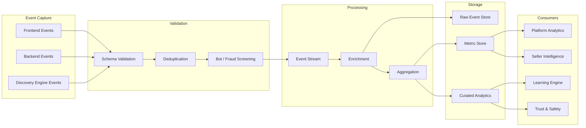

# Discovery Analytics

## Document Status

| Field                  | Value                                                                        |
| ---------------------- | ---------------------------------------------------------------------------- |
| **Status**             | Draft                                                                        |
| **Version**            | 0.3                                                                          |
| **Owner**              | PinkCurve Product Team                                                       |
| **Last Reviewed**      | 2026-10-19                                                                   |
| **Related Components** | Discovery Engine, Buyer Experience, Adaptive Metadata Navigation,            |
|                        | Learning Engine, Seller Intelligence, Trust & Safety                         |

---

## Overview

Discovery Analytics measures whether PinkCurve is helping buyers discover offerings that are relevant, useful, 
interesting, trustworthy, or worth exploring.

Discovery Analytics is PinkCurve's measurement and interpretation capability. It captures evidence of Buyer discovery activity, evaluates discovery effectiveness, and provides reliable signals to other platform capabilities. It supports continuous improvement of discovery quality while preserving the distinction between observed activity, meaningful Buyer outcomes, and qualified billable Seller activity. Billing eligibility and charging rules are governed by PinkCurve's Business Model and billing policies, not by engagement metrics alone.

It captures and interprets discovery activity across the platform and provides evidence for:

* Discovery Engine improvement
* Adaptive Metadata Navigation improvement
* Buyer Experience improvement
* Creative optimization
* Seller Intelligence
* Brand-recognition measurement
* Trust and fraud detection
* Learning Engine development
* Product and business decisions

Discovery Analytics should measure more than clicks.

Its fundamental question is:

> Did PinkCurve help the buyer discover something worthwhile?

The answer may differ depending on the Offering type, buyer intent, discovery surface, and seller objective.

---

# Analytics Philosophy

PinkCurve should not allow one easy-to-measure metric to define success.

Clicks, viewing time, saves, and click-throughs can all provide useful evidence, but each can also be misleading when interpreted alone.

For example:

```text
Long Viewing Time
```

may mean:

```text
Strong Interest
```

or:

```text
Confusion
```

Similarly:

```text
High Click-Through Rate
```

may indicate:

```text
Strong Relevance
```

or:

```text
Misleading Creative
```

Discovery Analytics must therefore interpret **multiple signals together**.

---

# What Discovery Analytics Must Answer

## For Buyers

Discovery Analytics should help PinkCurve understand whether Buyers are discovering worthwhile Offerings through the unified Buyer Discovery experience, regardless of Discovery Mode, Discovery Surface, or Discovery Classification.

* Are buyers finding relevant offerings?
* Can buyers redirect discovery easily?
* Is Adaptive Metadata Navigation helping?
* Are buyers seeing excessive repetition?
* Are negative signals being respected?
* Are useful new discoveries appearing?
* Is the Daily Discovery Feed worthwhile?
* Are trust signals understandable?

---

## For Sellers and Organizations

Discovery Analytics should help Sellers understand how effectively their submitted Discovery Media reaches relevant Buyers, generates meaningful discovery outcomes, and delivers measurable value. Analytics should distinguish discovery performance from billable activity and provide evidence that Sellers can use to improve their Offerings and other Discovery services.

- Are my Offerings and other Discovery services being discovered?
- Which Discovery Media generates meaningful Buyer interest?
- Which creative works best?
- Which metadata attracts Buyer exploration?
- Which audiences or locations respond?
- Are Buyers providing negative feedback?
- Are Buyers visiting my designated destination?
- How many Qualified Offering Visits (QOV) were generated?
- How many Qualified Real-Time Impressions (QRI) were delivered?
- How many qualified Brand Recognition impressions were delivered?
- How many unique Buyers were reached?
- How frequently do Buyers view my Brand Recognition Discovery Media?
- Which qualified actions and impressions are billable under the applicable Discovery Classification?
- How do billable activities relate to my spending limits and billing records?
- What measurable value is PinkCurve delivering?

---

## For PinkCurve

Platform analytics should answer:

* Is discovery quality improving?
* Are ranking changes helping?
* Is AMN improving intent refinement?
* Are new offerings receiving reasonable exposure?
* Is discovery overly concentrated among a few sellers?
* Is the feed becoming repetitive?
* Are trust problems increasing?
* Are bot or manipulation patterns present?
* Which discovery surfaces are effective?
* Where are buyers abandoning discovery?

---

## For the Learning Engine

Analytics provides evidence about:

* Successful discovery
* Failed discovery
* Metadata usefulness
* Creative effectiveness
* Ranking effectiveness
* Buyer preference signals
* Negative feedback
* Exploration outcomes
* Diversity effects
* Seller outcomes
* Trust patterns

The Learning Engine should use these signals carefully rather than treating all interaction as positive engagement.

---

# Discovery Events

Discovery Analytics begins with structured events.

Events represent what happened during the buyer's discovery journey.

---

## Core Event Types

| Event                 | Meaning                                                                             |
| --------------------- | ----------------------------------------------------------------------------------- |
| `offering_presented`  | Offering was displayed                                                              |
| `creative_started`    | Buyer began viewing creative                                                        |
| `creative_completed`  | Buyer viewed a meaningful portion or completed creative                             |
| `offering_opened`     | Buyer requested more information                                                    |
| `destination_clicked` | Buyer initiated a click-through to the Seller's designated external destination     |
| `offering_saved`      | Buyer saved an offering                                                             |
| `offering_shared`     | Buyer shared an offering                                                            |
| `positive_feedback`   | Buyer explicitly expressed positive interest                                        |
| `negative_feedback`   | Buyer explicitly rejected or reduced similar discovery                              |
| `offering_hidden`     | Buyer hid the offering                                                              |
| `seller_hidden`       | Buyer hid a Seller from future Discovery results                                    |
| `offering_reported`   | Buyer submitted a trust or safety report                                            |

---

## Adaptive Metadata Events

AMN requires its own analytics.

Possible events include:

| Event                     | Meaning                                                     |
| ------------------------- | ----------------------------------------------------------- |
| `metadata_presented`      | Metadata choice was shown                                   |
| `metadata_selected`       | Buyer selected a metadata value                             |
| `metadata_removed`        | Buyer removed a previous choice                             |
| `metadata_path_reset`     | Buyer broadened or reset navigation                         |
| `metadata_path_completed` | Navigation led to deeper offering exploration               |
| `metadata_ignored`        | Presented metadata received no interaction where measurable |

These events allow PinkCurve to understand whether metadata actually helps buyers express intent.

---

## Discovery Navigation Events

Other navigation events may include:

* Search initiated
* Search reformulated
* Category selected
* Location changed
* Similar offerings requested
* Alternatives requested
* Discovery reset
* Feed refreshed
* Discovery mode changed

---

# Event Structure

A discovery event may contain:

| Field | Description |
|---|---|
| `event_id` | Unique event identifier |
| `event_type` | Type of event |
| `timestamp` | Event timestamp |
| `discovery_classification` | Offering, Real-Time Discovery, Community Service, Public Announcement, or Brand Recognition |
| `discovery_service_id` | Identifier of the associated Discovery service |
| `offering_id` | Offering identifier, when applicable |
| `seller_id` | Seller responsible for the Discovery service, when applicable |
| `buyer_id` | Registered Buyer identifier |
| `session_id` | Discovery session identifier |
| `surface` | Discovery Surface where the event occurred |
| `discovery_mode` | Search, Browse, Intent, or AMN |
| `position` | Presentation position, when applicable |
| `creative_id` | Discovery Media creative identifier, when applicable |
| `metadata_context` | Active metadata selections, when applicable |
| `discovery_context` | Additional context required for interpretation |
| `experiment_id` | Experiment identifier, when applicable |

Exact event schemas belong in the Data Architecture and schema definitions.

See:

`../schemas/discovery-event.schema.json`

---

# Event Context

Analytics requires enough context to explain an outcome.

For example, knowing:

```text
Offering X received a click
```

is much less useful than knowing:

```text
Buyer selected:
Trail Running
    ↓
Waterproof
    ↓
Offering X presented
    ↓
Buyer opened Offering X
    ↓
Buyer clicked seller destination
```

Context allows PinkCurve to evaluate **why discovery worked**.

However, context collection must follow data-minimization and privacy principles.

---

# Signal Interpretation

Discovery signals should not automatically be categorized as positive simply because an interaction occurred.

A useful signal model may distinguish:

### Exposure Signals

The buyer had an opportunity to see something.

Examples:

* Offering presented
* Metadata presented
* Creative started

---

### Interest Signals

The buyer demonstrated possible interest.

Examples:

* Meaningful creative viewing
* Offering opened
* Metadata selected

---

### Strong Interest Signals

The buyer intentionally chose to continue exploration.

Examples:

* Offering saved
* Show more like this
* Destination clicked
* Directions requested
* Contact initiated

---

### Negative Signals

The buyer communicated that discovery was undesirable.

Examples:

* Not interested
* Show fewer like this
* Hide offering
* Hide seller
* Irrelevant

---

### Trust Signals

The interaction may indicate a trust problem.

Examples:

* Misleading information
* Incorrect offering
* Suspicious seller
* Report offering
* Broken or inconsistent destination

Trust signals should route to Trust & Safety as well as analytics.

---

# Meaningful Discovery

A **Meaningful Discovery** occurs when PinkCurve provides an offering that creates evidence of genuine buyer value.

No single action universally defines Meaningful Discovery.

Examples may include:

* Buyer explores offering details
* Buyer follows a useful metadata path
* Buyer saves an offering
* Buyer shares an offering
* Buyer follows a Seller-designated external destination
* Buyer requests directions
* Buyer contacts an organization
* Buyer returns to an offering later
* Buyer positively rates an offering
* Buyer discovers a useful public or community resource

Meaningful Discovery is therefore a **conceptual platform outcome**, not necessarily one database event.

---

# Discovery Outcomes by Discovery Classification

Different Discovery Classifications require different success measurements. Discovery Analytics must evaluate outcomes according to the objectives of each classification rather than applying commercial Offering metrics universally.

| Discovery Classification | Possible Meaningful Outcomes                                                        |
| ------------------------ | ----------------------------------------------------------------------------------- |
| Offering                 | Exploration, save, destination visit, contact, directions                           |
| Real-Time Discovery      | Timely Buyer exploration, destination visit, and other evidence of useful discovery |
| Community Service        | Resource exploration, contact, directions                                           |
| Public Announcement      | Information access, resource follow-through                                         |
| Brand Recognition        | Qualified impressions, unique reach, repeat exposure, later exploration             |

This prevents commercial click-through behavior from becoming the universal definition of discovery success.

---

# Qualified Offering Visit

A **Qualified Offering Visit (QOV)** is a verified,
Buyer-initiated click-through from PinkCurve Discovery
Media to the Seller's designated external destination.

QOV measures qualified outbound discovery activity,
not confirmed engagement or transactions on the
Seller's website.

QOV is an important measure of commercial discovery value.

A QOV may require criteria such as:

* Human traffic
* Valid discovery session
* Valid offering destination
* No duplicate technical events or fraudulent activity; legitimate, independently initiated repeat visits remain eligible for qualification
* Appropriate interaction qualification

Where measurable and privacy-appropriate, additional destination-quality signals may strengthen qualification.

However, PinkCurve may not always be able to observe behavior after the buyer leaves PinkCurve.

QOV should therefore avoid depending on seller-site measurements that PinkCurve cannot reliably or appropriately collect.

---

## QOV Is Not Universal

QOV is especially useful for sellers because PinkCurve normally does not process the final transaction.

However, it should not become the only platform value measure.

For example:

```text
Public Resource
    ↓
Buyer gets phone number
    ↓
Buyer calls service
```

may represent successful discovery without a QOV.

Similarly:

```text
Brand Recognition Creative
    ↓
Buyer remembers brand
    ↓
Buyer explores brand weeks later
```

requires different measurement.

---

## QOV Repeat Billing Policy

Each valid, qualified, Buyer-initiated visit from PinkCurve Discovery Media to the Seller's designated external destination is eligible for billing under the applicable Chapter 13 policy.

**Each independently qualified QOV is eligible for billing, including repeat visits by the same registered Buyer to the same Offering.**

The previous rolling 24-hour QOV billing restriction is removed.

### Qualification Requirements

- The visit must originate from an authenticated registered Buyer.
- The Buyer must intentionally initiate the destination visit.
- The Discovery Media and destination must be valid.
- Duplicate technical events must not generate additional charges.
- Automated or fraudulent activity must be excluded.
- Applicable Seller spending limits must be enforced.

### Repeat Visits

A Buyer may visit the same Offering multiple times, including within a 24-hour period.

Each independently initiated QOV that satisfies the qualification requirements is eligible for billing, regardless of previous visits to the same Offering.

PinkCurve must preserve the complete visit history for analytics, fraud detection, billing reconciliation, and auditing.

### Billing Integrity

PinkCurve should monitor abnormal repeat-visit patterns and apply fraud-prevention controls.

Suspicious visits may be withheld from billing pending validation.

The billing system must maintain traceability between qualified visits and Seller charges.

The authoritative QOV billing policy is defined in Chapter 13 — Business Model. Discovery Analytics provides qualified event evidence but does not independently determine Seller charges.

---

# Qualified Real-Time Impression (QRI)

A **Qualified Real-Time Impression (QRI)** is a verified presentation of Real-Time Discovery Media to an eligible registered Buyer that satisfies PinkCurve's Real-Time impression qualification criteria.

QRI measures qualified Buyer exposure to time-sensitive Discovery Media.

Unlike QOV, QRI does not require the Buyer to click through to the Seller's destination.

## QRI Qualification

A QRI should satisfy criteria such as:

- Eligible registered Buyer
- Valid Discovery session
- Approved and active Real-Time Discovery Media
- Valid presentation meeting minimum visibility requirements
- No fraudulent or automated activity
- Appropriate impression deduplication and frequency controls

The exact visibility threshold and qualification rules must be defined and validated before production billing.

## QRI and Billing

QRI is an analytics measurement and does not automatically establish a billable impression.

Real-Time Discovery may use qualified impression-based billing under the applicable Business Model policy.

The relationship between QRI, billable impressions, pricing units, Seller spending limits, and billing records must be explicitly defined in Chapter 13.

## QRI and Learning

QRI provides evidence of qualified exposure but does not independently demonstrate Buyer interest or successful discovery.

The Learning Engine should evaluate QRI alongside other signals, including:

- Buyer exploration
- Positive and negative feedback
- Destination click-through
- Discovery context
- Operational freshness

QRI should not automatically be interpreted as positive Buyer engagement.

---

# Discovery Funnel

A conventional commercial discovery funnel may look like:

```text
Offering Presented
      ↓
Creative Viewed
      ↓
Offering Explored
      ↓
Destination Clicked
      ↓
Qualified Offering Visit
```

But PinkCurve should support multiple paths.

For example:

```text
Offering Presented
      ↓
Metadata Selected
      ↓
Alternative Offerings
      ↓
Offering Saved
```

or:

```text
Community Resource Presented
      ↓
Community Service Explored
      ↓
Directions Requested
```

Discovery Analytics must therefore support **journeys**, not merely one fixed funnel.

---

# Discovery Journey

A discovery journey represents a sequence of interactions within a discovery context.

Example:

```text
Open PinkCurve
      ↓
See Running Shoes
      ↓
Select "Trail"
      ↓
Select "Waterproof"
      ↓
View Offering A
      ↓
Not Interested
      ↓
View Offering B
      ↓
Save Offering B
      ↓
Visit Seller
```

This journey contains both negative and positive evidence.

The negative feedback on Offering A is not a failure of the entire session.

It helped the buyer refine the discovery process.

---

# Adaptive Metadata Navigation Metrics

AMN requires metrics beyond click-through rate.

Potential measures include:

### Metadata Selection Rate

How often presented metadata choices are selected.

### Metadata Progression Rate

How often a metadata selection leads to another useful refinement.

### Metadata Path Depth

How far buyers navigate through adaptive metadata before exploring an offering.

### Metadata Exit Rate

Where buyers abandon or reset navigation.

### Metadata Reversal Rate

How often buyers remove a previous metadata selection.

High reversal may indicate confusing or inappropriate metadata.

### Metadata-to-Exploration Rate

How often a metadata path leads to deeper offering exploration.

### Metadata Usefulness

A learned measure of whether a metadata dimension helps buyers reach meaningful discovery.

---

# AMN Example

```text
Shoes
  ↓
Running
  ↓
Trail
  ↓
Waterproof
  ↓
Offering Exploration
```

Analytics should be able to determine:

* Which metadata was presented
* Which metadata was selected
* Which alternatives were available
* How candidate offerings changed
* Whether the path resulted in useful discovery

This evidence will eventually allow the Learning Engine to improve AMN itself.

---

# Negative Feedback Metrics

Negative feedback is one of PinkCurve's most valuable discovery signals.

Important measurements may include:

* Not Interested rate
* Show Fewer Like This rate
* Hide Offering rate
* Hide Seller rate
* Irrelevance rate
* Misleading-content rate
* Report rate
* Repetition complaints

Analytics should distinguish **personal preference rejection** from **platform trust problems**.

For example:

```text
Not Interested
```

does not necessarily indicate a bad offering.

But:

```text
Misleading
```

may indicate a quality or trust problem requiring broader investigation.

---

# Feedback Response Measurement

PinkCurve should also measure whether it respects negative feedback.

Example:

```text
Buyer selects:
"Show fewer like this"
        ↓
Next 20 discoveries
        ↓
How many similar offerings remain?
```

If similar unwanted content continues to dominate the feed, the system has failed to respond appropriately.

This creates a metric for **feedback effectiveness**, not merely feedback collection.

---

# Discovery Relevance

Direct relevance is difficult to observe perfectly.

PinkCurve may estimate relevance using combinations of:

* Metadata selections
* Search alignment
* Positive feedback
* Negative feedback
* Offering exploration
* Saves
* Destination actions
* Repeat interest
* Immediate rejection

The system should avoid assuming that impression or viewing time alone means relevance.

---

# Discovery Diversity

Analytics should measure whether buyers are receiving meaningful variety.

Potential dimensions include:

* Seller diversity
* Brand diversity
* Price diversity
* Attribute diversity
* Category diversity
* Creative diversity
* Location diversity
* New versus established offerings

Useful metrics may include:

### Seller Concentration

How much discovery exposure is dominated by a small number of sellers.

### Repetition Rate

How often buyers see the same or highly similar offerings.

### Alternative Exposure

Whether buyers receive meaningful alternatives during focused discovery.

### Discovery Breadth

How many distinct offering characteristics appear during exploration.

Diversity metrics should measure useful choice rather than random variety.

---

# New Offering Analytics

PinkCurve should specifically measure the opportunity provided to new offerings.

Metrics may include:

* Initial eligible exposure
* Time to first meaningful discovery
* Time to first positive interaction
* New-offering negative-feedback rate
* New-offering QOV rate
* Exposure relative to comparable established offerings

This helps detect a system that unintentionally favors offerings simply because they already have historical data.

---

# Daily Discovery Feed Metrics

The Daily Discovery Feed needs its own measures.

The goal is not maximizing endless scrolling.

Useful feed measures may include:

* Fresh discovery rate
* Repetition rate
* New offering exposure
* Trending-content usefulness
* Local discovery engagement
* Promotion relevance
* Negative-feedback rate
* Feed-to-exploration rate
* Meaningful discoveries per visit

A potentially important future metric is:

### Useful Visit Rate

The percentage of feed visits that produce at least one meaningful discovery action.

This may better represent PinkCurve's goal than total time spent.

---

# Freshness

Analytics should measure whether buyers are seeing genuinely new opportunities.

Possible measures include:

* New-to-buyer offering rate
* Repeat exposure rate
* Time since previous exposure
* New category exposure
* Newly available local offering exposure

Freshness must be balanced with relevance.

---

# Trending Analytics

Trending systems require careful measurement because popularity can be manipulated.

Trending analytics may examine:

* Rate of qualified interest increase
* Geographic spread
* Buyer diversity
* Positive versus negative feedback
* Bot probability
* Seller concentration
* Time-window stability

Trend status should be auditable enough for PinkCurve to investigate suspicious spikes.

---

# Location Analytics

For location-relevant offerings, metrics may include:

* Discovery by city or region
* Distance ranges
* Nearby-offering exploration
* Location-to-click performance
* Directions requests
* Local trend behavior

Location reporting should use appropriate aggregation to avoid exposing unnecessary individual location data.

---

# Creative Analytics

Creative Studio needs evidence about how creative affects discovery.

Potential measurements include:

* Creative start rate
* Meaningful viewing rate
* Completion rate where applicable
* Offering exploration after creative
* Negative feedback after creative
* Destination click-through
* Performance by creative variant
* Performance by discovery context
* Performance by metadata path

A high-performing creative should not be defined solely by viewing time or clicks.

Creative effectiveness should incorporate downstream discovery quality.

---

# Brand Recognition Analytics

Brand Recognition requires different metrics from direct-response discovery.

Potential measures include:

* Qualified brand impressions
* Unique buyer reach
* Repeat brand exposure
* Brand creative exploration
* Brand-page exploration
* Later offering exploration
* Brand saves or follows if supported
* Geographic reach
* Category reach

Longer-term measurement may attempt to determine whether buyers who saw a brand-recognition creative later explore the seller's offerings.

PinkCurve should avoid claiming causal brand lift without sufficient evidence.

---

## Brand Recognition Measurement and Billing

Brand Recognition Discovery uses **qualified impression-based billing**.

A qualified Brand Recognition impression represents a verified presentation of approved Brand Recognition Discovery Media to an eligible registered Buyer that satisfies the applicable impression qualification requirements.

### Repeat Impression Billing

Legitimate repeat viewing by the same registered Buyer is permitted and billable when each viewing independently satisfies the qualification requirements.

- Each qualified impression may generate a billable event.
- Repeat impressions from the same Buyer are eligible for billing.
- Legitimate qualified repeat impressions are billable without a fixed 24-hour exclusion window.
- Duplicate technical events, fraudulent impressions, and automated activity must be excluded.
- Seller spending limits and applicable billing controls must be enforced.

### Analytics and Billing Separation

Discovery Analytics must distinguish:

- Total impressions
- Qualified impressions
- Unique Buyers reached
- Qualified repeat impressions
- Billable impressions
- Subsequent Buyer exploration and feedback

Qualified Brand Recognition impressions must remain distinguishable from Qualified Real-Time Impressions (QRI), since the two Discovery Classifications may have different qualification and billing policies.

The detailed qualification, pricing, and billing rules are governed by Chapter 13.

The Learning Engine may use Brand Recognition exposure and repeat-viewing patterns to improve discovery relevance and creative effectiveness. However, repeat exposure alone must not automatically be interpreted as positive Buyer interest.

---

# Seller Value Metrics

Seller analytics should help answer:

> Is PinkCurve producing value worth what I am paying?

Potential value measures include:

* Qualified Offering Visits
* Meaningful discoveries
* Offering saves
* Contacts
* Directions
* Brand reach
* Relevant audience exposure
* Repeat interest
* Campaign performance

Seller Intelligence may combine these into a future **Seller Value Index** or similar measure.

The exact definition should remain experimental until validated.

---

# Discovery Score

The **Discovery Score** is PinkCurve's experimental attempt to summarize discovery effectiveness.

The v0.2 formula based primarily on:

```text
View Rate
Engagement Rate
CTR
QOV Rate
```

is too narrow for PinkCurve's broader discovery model.

For v0.3, Discovery Score should be treated as a **framework rather than a fixed formula**.

Possible dimensions may include:

```text
Discovery Score
     │
     ├── Relevance
     ├── Meaningful Exploration
     ├── Positive Feedback
     ├── Negative Feedback
     ├── Destination Value
     ├── Diversity
     ├── Trust
     └── Discovery Freshness
```

The final weighting should be derived from real platform evidence.

---

## Important Constraint

Discovery Score should not become a ranking objective automatically.

If one composite score becomes the sole optimization target, the platform may learn unintended behaviors.

Instead, Discovery Score should initially function as:

* A monitoring indicator
* An experimentation measure
* A comparative diagnostic
* A product-learning tool

Its relationship to ranking should be validated separately.

---

# Metric Hierarchy

PinkCurve may organize metrics into several levels.

## Level 1 — Platform Health

Examples:

* Event-delivery health
* Latency
* Error rate
* Data completeness

---

## Level 2 — Discovery Activity

Examples:

* Offerings presented
* Creative views
* Metadata selections
* Searches
* Offering opens

---

## Level 3 — Discovery Quality

Examples:

* Relevance indicators
* Negative-feedback rate
* AMN usefulness
* Diversity
* Freshness
* Repetition

---

## Level 4 — Buyer Value

Examples:

* Saves
* Useful exploration
* Directions
* Contacts
* Destination visits
* Return interest

---

## Level 5 — Seller or Organization Value

Examples:

* QOV
* Qualified reach
* Contacts
* Brand recognition
* Campaign effectiveness
* Value Index

This hierarchy helps prevent raw activity from being confused with actual value.

---

# Experimentation

Discovery Analytics should support controlled experimentation.

Potential experiments include:

* Ranking approaches
* AMN metadata selection
* Creative formats
* Feed composition
* Discovery Signals
* Negative-feedback controls
* Exploration rate
* New-offering exposure
* Ranking diversity
* Location presentation

Experiments should define:

* Hypothesis
* Control
* Treatment
* Success metrics
* Guardrail metrics
* Duration
* Sample requirements
* Decision criteria

---

# Guardrail Metrics

An experiment may improve one metric while damaging another.

For example:

```text
CTR ↑
```

while:

```text
Negative Feedback ↑
Seller Diversity ↓
Trust Reports ↑
```

should not automatically be considered successful.

Useful guardrails may include:

* Negative-feedback rate
* Trust reports
* Seller concentration
* Repetition
* Latency
* Buyer complaints
* Privacy impact

---

# Seller Dashboard

The Seller Dashboard should translate analytics into understandable business information rather than expose raw platform complexity.

Potential views include:

* Offering discovery
* Meaningful discovery
* QOV
* Campaign performance
* Creative performance
* Metadata insights
* Geographic discovery
* Brand recognition
* Trends
* Negative feedback
* Value delivered

Seller Intelligence should convert analytics into recommended actions.

For example:

```text
Observation:
Buyers frequently select "Waterproof"
but your offering does not clearly show this feature.

Possible Recommendation:
Add waterproof information and supporting imagery.
```

See: [Seller Intelligence](09-seller-intelligence.md)

---

# Platform Analytics

Internal PinkCurve analytics may monitor:

* Overall discovery quality
* Ranking behavior
* AMN performance
* Feed health
* New-offering exposure
* Seller concentration
* Bot traffic
* Trust incidents
* Creative performance
* Experiment results
* System anomalies
* Data pipeline health

Internal analytics may contain more technical detail than seller-facing analytics.

---

# Buyer-Facing Analytics

PinkCurve may eventually provide limited buyer-facing controls or insights such as:

* Saved offerings
* Discovery history
* Preference controls
* Hidden offerings
* Hidden sellers
* Metadata interests

The objective should be control and transparency rather than behavioral profiling for its own sake.

---

# Event Processing Architecture



The exact infrastructure can evolve independently of this logical architecture.

---

# Raw Events and Derived Metrics

PinkCurve should distinguish between:

### Raw Events

What actually happened.

Example:

```text
metadata_selected = "Waterproof"
```

### Derived Metrics

An analytical interpretation.

Example:

```text
Waterproof metadata selection rate = 32%
```

### Learned Signals

Patterns generated by models or statistical analysis.

Example:

```text
"Waterproof" appears highly useful for trail-running discovery.
```

Maintaining this separation improves explainability and auditability.

---

# Data Quality

Analytics is only useful when its underlying data is reliable.

Important controls include:

### Schema Validation

Ensure events conform to expected structures.

### Timestamp Validation

Detect invalid or delayed timestamps.

### Deduplication

Prevent duplicate event counting.

### Session Integrity

Identify corrupted or impossible event sequences.

### Bot Detection

Identify automated or fraudulent interactions.

### Attribution Integrity

Avoid assigning one event to the wrong campaign, offering, or discovery path.

### Missing Event Monitoring

Detect sudden drops that may indicate instrumentation problems.

---

# Bot and Manipulation Detection

Discovery metrics influence seller value and eventually learning.

They therefore represent a potential manipulation target.

Analytics should help detect:

* Automated clicks
* Artificial views
* Coordinated engagement
* Seller-generated fake traffic
* Repeated suspicious sessions
* Abnormal geographic patterns
* Unusual event velocity

Suspicious activity should not be counted as normal discovery value.

See: [Security, Privacy, and Trust](12-security-privacy-and-trust.md)

---

# Privacy

Discovery Analytics must follow PinkCurve's privacy principles.

These include:

* Data minimization
* Purpose limitation
* Appropriate consent
* Secure storage
* Access controls
* Retention policies
* Aggregation
* De-identification where appropriate
* Buyer controls

Analytics should collect information because it supports discovery, trust, operations, or legitimate measurement—not because the information might someday be useful.

---

# Identified Buyers

When a buyer account exists and appropriate permissions apply, analytics may support:

* Cross-session preferences
* Saved offerings
* Discovery history
* Feedback effectiveness
* Personalized discovery

Identity should be separated from analytical data where practical.

---

# Buyer Registration and Discovery Sessions

PinkCurve MVP requires Buyers to register and authenticate before participating in the Buyer Discovery experience.

Discovery Analytics must associate Buyer discovery activity with a valid registered Buyer identity and Discovery session, subject to applicable privacy and security controls.

## MVP Requirements

- Buyer registration and authentication are required.
- Each Discovery session must have a valid session identifier.
- Discovery events must be attributable to the appropriate registered Buyer.
- Buyer identity must be protected through appropriate access controls and data minimization.
- Automated agents acting as Buyers are not supported in the MVP.
- Anonymous or unidentified Buyer Discovery sessions are outside the MVP scope.

## Future Considerations

Anonymous discovery and authorized AI-agent participation may be evaluated in future platform versions.

Any future support must define appropriate identity, permissions, attribution, fraud prevention, and billing-integrity requirements before implementation.

The authoritative identity and access policies are defined in Chapter 12 — Security, Privacy, and Trust.

---

# Data Retention

Different analytical data may require different retention periods.

For example:

* Raw events
* Aggregated metrics
* Fraud evidence
* Experiment results
* Billing evidence
* Seller reports

should not automatically share the same retention policy.

Retention requirements should be documented in the Data Architecture and privacy policies.

---

# Analytics and Billing

PinkCurve Discovery Analytics provides verified measurement evidence that supports Seller billing. However, Discovery Analytics does not independently determine pricing or execute billing transactions.

Billing eligibility, pricing, spending limits, and charging rules are governed by the Business Model defined in Chapter 13.

## Billing Measurements by Discovery Classification

| Discovery Classification| Billing Measurement                                                                        |
|-------------------------|--------------------------------------------------------------------------------------------|
| Offering                | Qualified positive Buyer actions, including eligible Qualified Offering Visits (QOV)       |
| Real-Time Discovery     | Qualified impressions under the applicable Real-Time billing policy                        |
| Brand Recognition       | Qualified Brand Recognition impressions, including legitimate qualified repeat impressions |
| Community Service       | Governed by the applicable Community Service billing policy                                |
| Public Announcement     | Governed by the applicable Public Announcement billing policy                              |

## Billing Event Integrity

Billing-related events require stronger integrity controls than ordinary analytical events.

These controls include:

- Verified registered Buyer identity
- Valid Discovery session
- Event and attribution integrity
- Technical event deduplication
- Bot and fraud exclusion
- Classification-specific billing qualification
- Seller spending-limit enforcement
- Immutable billing evidence
- Reconciliation and auditability
- Seller-visible billing explanations
- Dispute support

## Separation of Responsibilities

Discovery Analytics records and validates observable Buyer activity.

The billing system applies the applicable Business Model policies to determine which qualified activities are billable.

A single Buyer interaction may therefore produce an analytical event without necessarily producing a billable event.

Likewise, legitimate repeat activity may generate multiple billable events when permitted by the applicable Discovery Classification.

Analytical event records and billing records must remain traceable to their underlying evidence without assuming that every analytical event is billable.

---

# Current Status

## Implemented

* Limited basic offering-view tracking

---

## In Development

* Discovery event model
* Analytics architecture
* Buyer interaction instrumentation
* AMN event definitions

---

## Planned

* Complete discovery event schema
* Event processing pipeline
* Metadata-navigation analytics
* Negative-feedback analytics
* QOV measurement
* Discovery Score experimentation
* Seller dashboard
* Platform analytics
* Diversity metrics
* New-offering metrics
* Daily Discovery Feed metrics
* Creative analytics
* Brand-recognition analytics
* Location analytics
* Bot and manipulation detection
* Experimentation framework
* Seller Value measurement
* Learning Engine integration

---

# Initial MVP Analytics

PinkCurve does not need every analytical metric or advanced learning capability before launching its MVP.

The initial implementation should prioritize reliable event capture, meaningful Buyer feedback, Discovery Classification awareness, and billing measurement integrity.

## Core Discovery Events

The MVP should capture fundamental Buyer discovery activity, including:

- Discovery Media presented
- Creative started or viewed
- Offering opened or explored
- Metadata selected or removed
- Positive Buyer feedback
- Negative Buyer feedback
- Destination clicked
- Buyer-initiated repeat viewing

These events must preserve sufficient context to reconstruct the Buyer discovery journey.

## Classification-Specific Measurements

The MVP should support the following measurements where the corresponding Discovery Classification is enabled:

| Discovery Classification | Initial Measurement |
|---|---|
| Offering | Qualified positive Buyer actions, including QOV |
| Real-Time Discovery | Qualified Real-Time Impressions (QRI) |
| Brand Recognition | Qualified impressions, including legitimate repeat impressions |
| Community Service | Meaningful resource exploration and applicable Buyer actions |
| Public Announcement | Information exposure and applicable Buyer actions |

Billing eligibility must be determined independently according to Chapter 13.

## Minimum Event Context

Events should retain:

- Event identifier and timestamp
- Registered Buyer identifier
- Discovery session identifier
- Discovery Classification
- Relevant Discovery service identifier
- Seller identifier where applicable
- Discovery surface and mode
- Creative identifier
- Active metadata context where applicable
- Impression or interaction qualification status where applicable

## Initial Data Quality Requirements

The MVP should include:

- Schema validation
- Technical event deduplication
- Basic bot and fraud filtering
- Session and attribution integrity
- Classification-specific qualification rules
- Traceability between qualified activity and billing records

## Learning Engine Readiness

The MVP should preserve reliable signals for future Learning Engine improvements without requiring sophisticated machine-learning models at launch.

Initial learning may rely on simple feedback-driven adjustments and validated analytical rules.

The priority is to capture correct, interpretable, and trustworthy discovery evidence before introducing advanced optimization.

---

# Open Questions

See [Open Decisions](19-open-decisions.md) for unresolved questions and decisions requiring cross-chapter alignment.

## Discovery Measurement

- Discovery Score definition and validation
- Meaningful Discovery qualification
- QOV qualification thresholds
- QRI visibility and qualification thresholds
- Brand Recognition impression qualification thresholds
- AMN usefulness metrics
- Seller Value Index
- Daily Discovery Feed usefulness measurement

## Billing Measurement

- Classification-specific impression qualification and frequency controls
- Real-Time Discovery impression billing units and pricing
- Brand Recognition impression pricing and spending-limit policies
- Attribution windows for qualified Buyer actions
- Reconciliation between analytical events and billing records

## Learning and Experimentation

- Learning Engine signal weighting
- Negative-feedback interpretation
- Discovery ranking experimentation
- Experiment methodology and guardrails

## Data Governance

- Event and billing evidence retention
- Privacy-preserving Buyer history
- Fraud detection and event qualification

## Confirmed MVP Decisions

The following are established policies rather than open questions:

- Buyer registration and authentication are required.
- Anonymous Buyer Discovery is outside MVP scope.
- Autonomous Buyer agents are outside MVP scope.
- Brand Recognition uses qualified impression-based billing.
- Every independently qualified QOV is eligible for billing, including legitimate repeat visits by the same registered Buyer to the same Offering. No rolling 24-hour billing restriction applies.
- Legitimate qualified repeat Brand Recognition impressions are eligible for billing without a fixed 24-hour exclusion window.
- Analytics measurements and billing eligibility remain separate responsibilities.

---

# Design Principles

### Measure Discovery, Not Just Engagement

Activity is evidence. Buyer value is the objective.

### Preserve the Journey

Individual events gain meaning from the discovery path around them.

### Negative Feedback Is Valuable Data

Rejection helps PinkCurve understand relevance and should not be treated merely as failure.

### AMN Must Be Measurable

Adaptive navigation can only improve if PinkCurve understands which metadata helps buyers.

### Commercial Metrics Are Not Universal

QOV is an important measure of commercial discovery value, but it should not define success across all Discovery Classifications. Real-Time Discovery, Community Service, Public Announcement, and Brand Recognition require measurements appropriate to their respective objectives.

### Avoid Single-Metric Optimization

No single metric should control product behavior without guardrails.

### Protect Metric Integrity

Bots and manipulation can corrupt discovery, learning, seller reporting, and billing.

### Analytics Must Be Explainable

PinkCurve should distinguish raw events, derived metrics, and learned interpretations.

### Privacy Applies to Measurement

The ability to collect information does not automatically justify collecting it.

### Start Simple

The MVP should capture trustworthy events first and add sophisticated metrics as evidence grows.

---

# Related Documents

* [Product Architecture](03-product-architecture.md)
* [Offering Knowledge](04-offering-knowledge.md)
* [Creative Studio](05-creative-studio.md)
* [Discovery Engine](06-discovery-engine.md)
* [Learning Engine](08-learning-engine.md)
* [Seller Intelligence](09-seller-intelligence.md)
* [AI Platform](10-ai-platform.md)
* [Data Architecture](11-data-architecture.md)
* [Security, Privacy, and Trust](12-security-privacy-and-trust.md)
* [Buyer Experience](20-buyer-experience.md)
* [Open Decisions](19-open-decisions.md)
* [Discovery Event Schema](../schemas/discovery-event.schema.json)
* [Discovery Score Schema](../schemas/discovery-score.schema.json)
